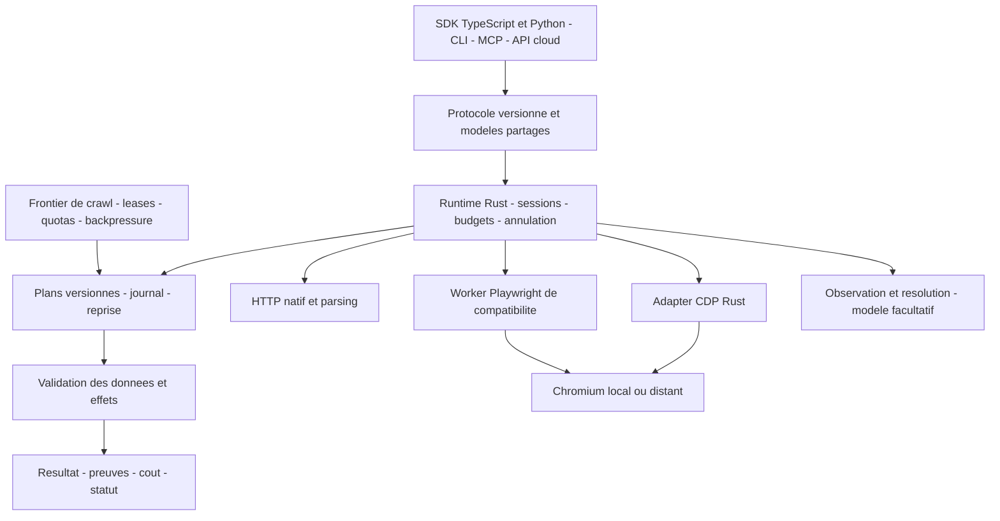

# ADR-001 : langage et architecture du runtime Automan

**Statut : proposé, à adopter explicitement lors du démarrage de l'implémentation.**
**Date : 7 octobre 2026.**
**Décision finale : utilisateur / porteur du projet.**

## Contexte

Automan doit être un framework open source qui combine collecte HTTP, rendu navigateur, actions déterministes, perception/extraction assistée par modèles et workflows réutilisables. Les services commerciaux doivent utiliser le même exécuteur. La contrainte initiale de petite équipe et de sortie en 3–6 mois a été retirée ; elle ne gouverne pas ce choix. Les objectifs sont vitesse, efficacité, polyvalence et fiabilité, avec une preuve comparative à qualité égale.

**Il n'existe pas de consensus universel établi sur le meilleur langage de ce type de framework.** Les projets étudiés montrent plusieurs solutions : Stagehand exécute son runtime dans une extension Chrome avec des clients TS/Python/Go ; Crawlee possède des implémentations TS et Python et accepte des clients HTTP natifs ; Spider et ses agents sont en Rust. Ce relevé n'est pas un sondage représentatif de tous les développeurs. [Architecture Stagehand](https://github.com/browserbase/stagehand/blob/main/CONTRIBUTING.md), [Crawlee Python](https://crawlee.dev/python/docs/guides/architecture-overview), [Crawlee/Impit](https://crawlee.dev/js/docs/guides/impit-http-client), [Spider publié](https://docs.rs/crate/spider/2.53.9/source/).

La distinction à conserver est entre **langage du moteur, langue de l'API et emplacement d'exécution**. Des clients différents peuvent consommer un protocole commun. Un moteur natif n'élimine pas la latence du réseau, du modèle ou de Chromium ; des opérations exécutées loin du navigateur peuvent perdre davantage en allers-retours que le contrôleur ne gagne en CPU. Cette dernière conclusion est une inférence architecturale, cohérente avec le placement et le batching Stagehand ; ce n'est pas un gain chiffré mesuré pour Automan. [Protocole Stagehand](https://github.com/browserbase/stagehand/blob/main/packages/protocol/README.md), [batching](https://docs.stagehand.dev/v4/reference/stagehand).

## Décision proposée

Construire **un moteur canonique Rust asynchrone, utilisable comme bibliothèque et binaire autonome**, avec des SDK TypeScript et Python, une CLI et des outils MCP consommant le même contrat. Tokio est le candidat de runtime async. Le protocole partagé porte types, résultats, capacités, budgets, progression et annulation ; les modèles sont générés, les APIs publiques restent idiomatiques. Le cloud lance les mêmes workers Rust près de leurs navigateurs.

Rust est retenu pour l'unité du moteur, sa distribution native, la maîtrise des allocations et ressources, la concurrence et l'absence de GC dans le cœur. **Cela ne démontre pas sa supériorité sur le temps total d'un workflow.** Les services et processus dépendants, dont Chromium, gardent leurs propres comportements. [Rust](https://rust-lang.org/), [Tokio](https://tokio.rs/).

Le navigateur est une dépendance pilotée. Un adapter CDP natif encapsule Chromey/Chromiumoxide ; la sélection finale de la bibliothèque attend une qualification des capacités. Un adapter Playwright fournit compatibilité et référence de comportement. Chaque session possède un seul backend responsable de son lifecycle. Les objets internes des drivers ne deviennent pas le contrat public d'Automan. [Chromey](https://github.com/spider-rs/chromey), [Chromiumoxide](https://github.com/mattsse/chromiumoxide), [actionability Playwright](https://playwright.dev/docs/actionability).

## Options considérées

Les appréciations ci-dessous sont nos choix de conception pour ce périmètre, pas un classement communautaire ou un benchmark.

| Option | Avantages pertinents | Coûts et limites | Place proposée |
| --- | --- | --- | --- |
| Rust | Moteur natif commun, contrôle des ressources, async, bibliothèque + binaire | Distribution par plateforme, IPC, qualification et maintenance d'un driver CDP | Cœur, workers, CLI |
| TypeScript | Accès direct à l'écosystème Playwright et APIs web ; bonne surface développeur | Runtime Node pour un moteur TS ; GC et coût CPU à mesurer, aucun handicap universel établi | SDK, outils et interface ; worker Playwright |
| Python | Intégration aux pipelines de données et d'agents ; API familière à leurs utilisateurs | Hot paths CPU à déléguer si le profiling le demande ; packaging d'un moteur Python à considérer | SDK et intégrations |
| Go | Runtime réseau/concurrence et distribution de binaire ; drivers CDP et crawlers existants | GC ; ne résout pas à lui seul la parité des attentes et actions navigateur | Alternative viable au cœur, SDK futur possible |

La présence d'Impit permet à TS/Python d'utiliser déjà du code natif ; il serait faux de déduire la vitesse de toute une stack du langage de son SDK. Go ne doit pas être rejeté pour son seul GC, et un moteur Python peut déléguer ses parties coûteuses. [Impit](https://github.com/apify/impit), [chromedp](https://github.com/chromedp/chromedp), [Colly](https://github.com/gocolly/colly).

## Architecture proposée

Le cœur forme des modules bien séparés dans un produit commun ; l'architecture initiale ne nécessite pas un service indépendant pour chaque module. Les workers deviennent des frontières de processus lorsque l'isolation, la proximité du navigateur ou la répartition du travail le justifient.

### Contrats structurants

1. **Protocole :** JSON-RPC bidirectionnel proposé sur stdio local et WebSocket distant sécurisé. Version et capacités négociées ; grands artefacts transférés par références ou flux bornés. Ce choix est proposé pour unifier SDK, CLI et cloud ; son overhead sera mesuré. Des bindings embarqués peuvent être ajoutés si un usage justifie leur coût.
2. **Exécution :** API/HTTP, parsing, navigateur déterministe et résolution par modèle. Le moyen d'accès est choisi selon le résultat demandé et l'historique ; les routes connues comme nécessitant JS peuvent aller directement au navigateur.
3. **Plans :** version, paramètres, exigences de session, étapes, attentes, préconditions et postconditions. Recorder, code ou modèle peuvent produire des plans ; aucune conversion générale de tout code arbitraire en plan sûr n'est promise.
4. **Collecte :** frontier, déduplication, quotas par domaine, leases et backpressure distincts de la reprise des actions. Un adapter Crawlee externe peut posséder la queue pendant qu'Automan exécute, sans double scheduler pour une requête.
5. **État :** SQLite proposé en local pour journal/checkpoints ; PostgreSQL et stockage d'objets proposés pour le cloud multi-worker. Les résultats sont idempotents lorsque leur contrat le permet ; un effet externe incertain exige réconciliation de l'état avant répétition.
6. **Vérification :** schéma, identité, complétude, fraîcheur et postcondition sont des propriétés séparées. Distinguer succès technique, résultat vérifié, résultat partiel et effet inconnu. Les verdicts probabilistes sont explicitement identifiés.
7. **Modèles et caches :** modèles facultatifs pour découverte, ambiguïté et réparation. Cache de perception, cache de plan et cache de données ont des invalidations distinctes. Un plan valide peut s'exécuter sans nouvelle inférence.
8. **Placement :** conserver workers et navigateurs proches, sessions réutilisées sous identité isolée, opérations indépendantes groupées et concurrence bornée. Le SDK ne possède pas une seconde implémentation du moteur.

Ces choix s'inspirent de responsabilités présentes dans les références, sans leur attribuer une garantie qu'elles n'ont pas. Voir [contrats inspectés](../../research/2026-10-07-crawlee-spider-contracts-followup.md) et [Stagehand/alternatives](../../research/2026-10-07-stagehand-alternatives-followup.md).

## Conséquences et arbitrages

Le produit dispose d'une seule sémantique d'exécution locale et distante, avec une distribution indépendante du langage client. La maintenance se concentre sur le protocole et les adapters ; l'équipe doit cependant qualifier l'actionability CDP, les courses de navigation, frames/OOPIF, téléchargements, pertes de connexion et cancellation. Le simple binding d'une commande CDP n'assure pas la fiabilité Playwright.

Le choix Rust ne doit pas déplacer l'effort hors des coûts dominants. Le premier objectif de performance est d'éviter un rendu ou une décision inutile, puis les captures et allers-retours redondants ; le profiling décide de l'optimisation CPU. La sécurité mémoire du cœur ne prouve pas la correction de la recette, de l'extraction ou des effets sur le site.

Les fonctions déjà présentes chez les concurrents — HTTP adaptatif, script cache, réparation, vérification — restent des références. La différenciation Automan doit porter sur leur contrat commun, leur portabilité, leur diagnostic et le coût par résultat réellement correct. [Comparaison approfondie](../../research/2026-10-07-stagehand-crawlee-spider-comparison.md).

## Actions de qualification

- [ ] Fixer schémas, ownership des sessions et états terminaux avant le driver public.
- [ ] Établir des baselines équivalentes HTTP, rendu JS et workflows authentifiés avec Spider, Crawlee, Playwright et Stagehand.
- [ ] Qualifier Chromey/Chromiumoxide derrière le même contrat, conserver le backend Playwright pour les capacités requises encore incomplètes.
- [ ] Mesurer CPU/mémoire totale, startup froid/chaud, latence, RPC, appels LLM et coût de toutes les tentatives.
- [ ] Tester dérive de DOM, données changeantes, auth expirée et interruption entre effet, validation et acquittement.

Les gates de promotion d'un backend reposent sur **qualité et fiabilité équivalentes avec gain mesuré**. Aucun classement universel des langages ni gain chiffré Automan n'est établi par cet ADR. [Audit des benchmarks publics](../../research/2026-10-07-benchmark-audit-followup.md).
