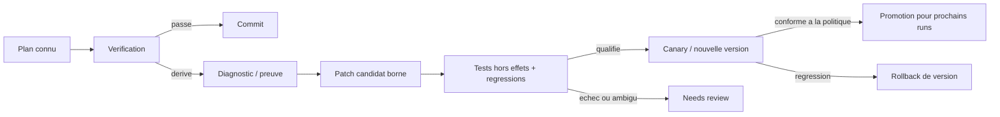

# Architecture proposée d'Automan

**7 octobre 2026 — proposition de conception, aucune implémentation à ce stade.** Ce document développe l'[ADR langage/runtime](../research/2026-10-07-adr-runtime-language.md). Les APIs exemples et les objectifs de qualification sont décrits séparément dans [api.md](./api.md) et [roadmap-validation.md](./roadmap-validation.md).

## 1. Principes et décisions

### 1.1 Un moteur canonique, des surfaces idiomatiques

Rust/Tokio possède les contrats d'exécution : plans, état, frontier, admission, reprises, sessions, validation et coûts. Il est utilisable comme bibliothèque et comme exécutable. Les SDK TypeScript/Python, la CLI et les apps consomment le même moteur. Les modèles de protocole sont générés ; les façades restent idiomatiques, documentées et courtes.

Ce choix vise distribution native, contrôle des ressources et unité sémantique. Il ne prouve pas un avantage sur le temps total d'un workflow dominé par réseau, Chromium ou modèles. Un moteur TS/Node avec Playwright est une alternative crédible, tout comme Go pour la distribution et le réseau. Les bénéfices du choix Rust doivent être mesurés sur le produit complet. [ADR proposé](../research/2026-10-07-adr-runtime-language.md), [Rust](https://rust-lang.org/), [Tokio](https://tokio.rs/).

### 1.2 Modules profonds, processus justifiés

| Module | Responsabilité et contrat | Frontière de processus proposée |
| --- | --- | --- |
| Contrôle | Créer/inspecter/annuler un run, gérer versions, identités et capacités | Daemon local ; API de contrôle cloud |
| Frontier | Déduplication, découverte, priorité, leases, délais, fin de crawl | Dans le moteur ; état partagé cloud |
| Exécuteur | Interpréter le plan, journaliser les étapes, conditions et résultats | Worker Rust |
| Admission | Réserver ressources, budgets et capacité avant dispatch | Locale au moteur, crédits globaux accordés par contrôle cloud |
| Accès au site | HTTP, parsing, CDP, Playwright ; informations et erreurs normalisées | HTTP dans worker ; Chromium et compatibilité Playwright séparés |
| Sessions/pools | Ownership, identité, santé, disponibilité, retrait et réutilisation | Manager dans worker ; Chromium isolé selon périmètre |
| Décision/agent | Modèles, décisions typées, outils et budgets, compilation | Module facultatif ; providers locaux/distants |
| Validation/réparation | Vérifier résultat, diagnostiquer dérive, qualifier version candidate | Même exécuteur ; runs de test séparés |
| Données | Datasets, artefacts, caches, export, provenance et outbox | SQLite + fichiers local ; PostgreSQL + objets cloud |
| Observabilité | Journal structuré, spans, compteurs, traces expurgées | Même module ; exporteur facultatif |

Une tâche async, un onglet, un processus et une machine sont quatre unités différentes. Un worker peut traiter plusieurs requêtes HTTP et posséder plusieurs processus Chromium ; le nombre de workers ne définit donc pas seul la concurrence. L'architecture évite un service indépendant pour chaque module et un second scheduler à l'intérieur d'un adaptateur.

### 1.3 Réutiliser des composants, conserver les contrats

Les projets existants servent de référence et de dépendances ciblées. Le moteur Spider complet ne devient pas le propriétaire caché de la frontier Automan ; Crawlee peut orchestrer un adaptateur Automan dans une intégration externe, mais alors **Crawlee possède la file**. Un backend Stagehand expose ses limites de version et de cache. Il ne réimplémente pas les pools de la plateforme.

| Composant | Choix proposé | Pourquoi / qualification restante |
| --- | --- | --- |
| Async/types | Tokio, Serde ; JSON Schema généré à partir des types partagés | Schémas de wire versionnés, limitations communes explicitement testées ; Schemars candidat de génération |
| HTTP | Reqwest comme baseline ; adapter Impit/wreq ou transport spécialisé facultatif | Streaming, TLS, pools et timeouts ; compatibilité, empreinte, licence et gain propres aux transports spécialisés |
| Parsing | Parser DOM HTML5 pour CSS ; réécriture/filtrage streaming quand utile | DOM pour relations/locators ; streaming pour volume ; XPath à qualifier séparément |
| Chromium/CDP | Chromey et Chromiumoxide à qualifier derrière le contrat navigateur | Sélection finale par conformité et maintenance, pas par annonce de débit |
| Compatibilité | Worker Playwright dédié et versionné | Référence pour attentes, actions et moteurs Firefox/WebKit lorsque requis |
| État | SQLite WAL local ; PostgreSQL cloud | Transactions, contraintes uniques et leases ; les mêmes états métier, des implémentations de stockage adaptées |
| Artefacts | Fichiers locaux ou stockage objet compatible S3 | Flux bornés, checksums, références et politiques de rétention |
| Observabilité | tracing + export OpenTelemetry | Corrélation run/étape/tentative/provider ; conventions GenAI versionnées car encore en développement |

Sources des candidats : [Reqwest](https://docs.rs/reqwest/latest/reqwest/), [Impit](https://github.com/apify/impit), [html5ever](https://github.com/servo/html5ever), [scraper](https://github.com/rust-scraper/scraper), [lol-html](https://github.com/cloudflare/lol-html), [Schemars](https://github.com/GREsau/schemars), [Chromey](https://github.com/spider-rs/chromey), [Chromiumoxide](https://github.com/mattsse/chromiumoxide), [conventions GenAI](https://opentelemetry.io/docs/specs/semconv/gen-ai/gen-ai-spans/). Une bibliothèque CSS ne suffit pas à annoncer une implémentation XPath complète.

## 2. Modèle de domaine et d'état

### 2.1 Objets persistés

| Objet | Éléments contractuels |
| --- | --- |
| Workspace | Propriétaire, membres, politiques, quotas et namespaces de données |
| WorkflowVersion | Identifiant/version immuables, entrée/sortie, plan ou package de code, validations, capacités et budgets |
| Run | Version fixée, paramètres, périmètre d'identité, politiques, état et limites |
| RunTask | Activation durable d'un run/étape autonome, dependencies/timer, lease/epoch et classe de ressources ; distincte d'une URL de frontier |
| CrawlRequest | URL/méthode/payload, contexte, clé de déduplication, découverte, priorité, délai, lease et résultat |
| StepAttempt | Étape/tentative, observation utilisée, commande, timestamps, coût, preuve et statut |
| Session | Identité, domaine, cookies/stockage autorisés, backend propriétaire, lease et santé |
| Worker | Version, capacités, placement, état, crédits de capacité et heartbeat |
| DatasetCommit | Clé idempotente, schéma/version, données ou référence durable, provenance, validation |
| Artifact | Type, taille, digest, emplacement, droits et rétention |
| RepairCandidate | Version de base, raison, patch, tests, coûts, version candidate et statut de promotion |

Un run fixe sa version et ses politiques au démarrage. Une réparation promue sert les prochains runs ; elle ne modifie pas silencieusement le plan d'un run déjà en cours. Une reprise explicite peut basculer de version avec événement et nouvelle tentative identifiables.

Un workflow autonome sans crawl possède aussi des activations durables : démarrage, étape prête, timer expiré ou attente résolue. L'exécuteur les journalise et les workers les prennent par lease/epoch, sous la même admission que les requêtes de collecte. La frontier possède découverte/déduplication d'URL ; elle n'est pas utilisée artificiellement pour stocker une attente humaine ou une action métier. Une seule activation propriétaire agit sur une session mutante ; un DAG peut paralléliser des branches indépendantes selon leur scope. Crash ou perte du worker relit le journal et réconcilie l'effet avant nouvelle attribution, avec les mêmes limites de fencing.

### 2.2 États distincts

**Run** : `queued → running`, avec `waiting` (timer, capacité, authentification ou décision humaine) et `retrying` non terminaux. États terminaux : `succeeded`, `partial`, `failed`, `needs_review`, `effect_unknown`, `cancelled`.

- `succeeded` : tous les critères requis du workflow ont passé.
- `partial` : données utilisables, mais une partie du contrat n'est pas satisfaite ; la partie manquante est décrite.
- `needs_review` : décision ou validation non concluante ; les interfaces indiquent ce qui manque.
- `effect_unknown` : une action a peut-être eu lieu, mais son effet n'est pas confirmé ; aucune répétition automatique non idempotente.
- `failed` : objectif non atteint avec cause connue ; `cancelled` : exécution arrêtée, sans effacer les résultats déjà commis. Une annulation avec effet externe incertain conserve `effect_unknown` et la demande d'annulation dans l'historique.

**Requête de frontier** : `ready`, `leased`, `running`, `delayed`, `handled`, `dead_letter`, `cancelled`. `handled` signifie acquittement, pas succès métier. Les compteurs distinguent requêtes traitées, résultats valides, rejets et doublons.

**Étape** : `pending`, `running`, `committed`, `failed`, `effect_unknown`. **Validation** : `passed`, `failed`, `inconclusive`, `not_checked`. Un transport HTTP réussi ou un clic sans exception retourne un statut technique ; il ne transforme pas un run en succès vérifié.

`resume` agit sur une attente non terminale. Après `needs_review` ou `effect_unknown` terminal, une commande de réconciliation ajoute une résolution et sa preuve sans réécrire l'historique ; une continuation crée un nouveau run lié au précédent. Elle épingle version, paramètres, résultat de réconciliation et checkpoints réutilisables après revalidation. Aucun effet inconnu non résolu n'est répété ; données soumises à fraîcheur et sessions expirées ne sont pas réutilisées aveuglément.

## 3. Frontier, reprise et transactions

### 3.1 Frontier complète

- Queues nommées et persistantes ; priorités stables, FIFO et stratégie profondeur/largeur configurables, admission par domaine et tenant.
- Canonicalisation configurable : fragments, query strings, paramètres fonctionnels, méthode et corps. Une URL seule n'identifie pas toujours la requête ; les variations de langue, d'identité et de données requièrent un scope distinct.
- Déduplication dans le scope déclaré, profondeur, nombre de pages, domaine/path/query allow/deny, robots/sitemaps, liens et redirections, découverte depuis DOM/HTML/XHR/JS lorsque activée.
- Dates de prochaine collecte, délais, horaires et récurrence ; recrawl crée une nouvelle fenêtre de collecte plutôt que de rester bloqué par la déduplication historique.
- Leases renouvelables, heartbeat, délais explicites, retries, dead-letter inspection et requeue contrôlé, import/export/checkpoint.
- Fin de crawl calculée sur demandes actives + leases + délais + producteurs de découverte connus. Un message « file vide » ne prouve pas qu'un producteur ne découvrira plus rien.
- Quotas et files d'attente bornés ; arrêter ou suspendre la découverte lorsque le stockage ou la sortie sature.

La réutilisation d'une queue existante et son mode de reprise sont explicites : le défaut ne purge pas l'état d'un run repris. Les enseignements Crawlee/Spider, dont l'écart entre disque de visites et frontier durable, sont sourcés dans la [matrice de collecte](../research/2026-10-07-crawl-capability-matrix.md).

### 3.2 Protocole de prise en charge

1. Admission vérifie les quotas et capacités, puis la transaction attribue une requête avec propriétaire, expiration et **epoch monotone de lease**.
2. Le worker ne garde pas une transaction SQL ouverte pendant une navigation. Il renouvelle sa lease et contrôle sa validité avant les nouvelles commandes.
3. Il produit des résultats provisoires, puis les valide selon le contrat.
4. Une transaction publie le résultat idempotent, la découverte suivante, l'événement d'achèvement et l'acquittement si ces éléments résident dans le même store.
5. Un commit utilisant un ancien epoch est rejeté. Le worker perdant arrête ses nouvelles actions ; la session concernée est mise en quarantaine si un effet peut rester actif.

Les appels de handler `emit`/`discover` confirment seulement le staging sous requête/tentative/epoch. Le moteur publie les sorties après fin réussie du handler et validation. Un échec abandonne la visibilité du staging, ou applique une politique explicite de sous-ensemble partiel validé avec outcome distinct ; il ne publie pas des liens ou lignes provisoires comme un succès complet. Les callbacks qui écrivent directement dans un système tiers n'obtiennent pas cette atomicité.

**Le fencing empêche les écritures internes périmées ; il n'annule pas un clic déjà transmis à un site tiers.** Une partition réseau peut laisser un ancien worker vivant. La réattribution d'une session mutante requiert arrêt/isolement confirmé ou réconciliation, et ne suffit jamais à garantir l'effet externe exactement une fois.

PostgreSQL peut attribuer des éléments avec `FOR UPDATE SKIP LOCKED` puis mise à jour de lease dans une transaction courte. Ce mécanisme convient à un accès de type queue mais n'assure pas l'ordre global de traitement, la fairness ou la reprise à lui seul. Le scheduler porte ces contrats. [SELECT PostgreSQL](https://www.postgresql.org/docs/current/sql-select.html).

SQLite WAL s'utilise sur un même hôte avec un seul writer à un instant donné ; un writer dédié sérialise/batche les transactions bornées. Les payloads volumineux ne passent pas tous dans le journal. Il n'est pas proposé comme base partagée sur filesystem réseau pour un cluster. [SQLite WAL](https://sqlite.org/wal.html).

### 3.3 Dataset et artefacts sans fausse atomicité

La clé de commit inclut run, requête, version du pipeline et identité métier ou ordinal stable. La déduplication de transport et l'upsert métier sont deux politiques distinctes : deux produits différents ayant le même prix ne doivent pas être fusionnés.

Un blob est écrit, confirmé durable et vérifié par digest avant la transaction qui publie sa référence. Un upload abandonné reste un artefact provisoire récupérable par politique de rétention ; aucune transaction SQL ne prétend englober un object store externe. Une outbox transactionnelle livre ensuite webhooks et exports avec identifiant d'événement, retry et déduplication côté destination.

Pour une destination externe non transactionnelle, livrer une fois ou rejouer après crash relève de son contrat d'idempotence. Les utilisateurs voient la position d'export, les rejets et les doublons détectés. L'acquittement n'est pas différé indéfiniment par un export vers un système indisponible : l'outbox possède son propre état.

### 3.4 Retry, réparation et effet incertain

Une politique distingue transport temporaire, throttling `Retry-After`, navigateur perdu, authentification expirée, blocage, données invalides, drift de locator, absence métier et effet inconnu. Elle fixe maximum de **tentatives**, délais/backoff avec jitter, timeout global et plafond de coût. Rotation de proxy/session et appel de réparation consomment le même budget total ; aucun retry invisible par étage ne multiplie librement les tentatives.

Les limites se composent : le transport peut retenter une opération sûre, mais annonce ses tentatives au run ; le workflow décide de la reprise métier. Un résultat d'un provider est journalisé ; un replay d'historique ne réappelle pas ce provider si l'étape est commise et réutilisable. Le contrat évite la construction d'un moteur universel rejouant du code arbitraire.

La littérature opérationnelle Temporal explicite le crash après un effet et avant l'enregistrement : une activity peut être exécutée plusieurs fois, même si son achèvement est observé une seule fois. Automan reprend cette distinction, sans intégrer Temporal comme dépendance obligatoire. [Activity Definition](https://docs.temporal.io/activity-definition).

**Pourquoi pas Temporal obligatoire ?** Il est adapté aux orchestration longues et multi-services ; il ajoute un service, des contraintes de replay et une exploitation qui ne sont pas nécessaires à une collecte locale. Automan propose un exécuteur de plans borné avec état transactionnel ; un connecteur Temporal peut lancer et suivre un run comme activité idempotente. Si les futurs workflows généraux excèdent ce contrat, la décision devra être réexaminée plutôt que de reproduire tout Temporal.

## 4. Pools, workers, concurrence et autoscaling

### 4.1 Pools indépendants mais admission commune

| Pool | Cycle de vie et fonctions requises |
| --- | --- |
| Workers | Registration version/capabilities, heartbeat, capacité, sélection par région/backend, drainage, rolling update, arrêt et reprise |
| HTTP | Connexions keep-alive, protocoles disponibles, DNS, timeouts et quotas par origine/proxy ; fermeture et taille bornées |
| Processus navigateurs | Launch/attach, warmup, santé, limite mémoire/pages/âge, retrait, crash replacement et drainage |
| Contextes/pages | Identité, storage state, fenêtres/onglets, quotas, ownership, fermeture des pages orphelines |
| Sessions | Cookies/stockage, succès/erreurs, expiration, domaine/identité/proxy cohérents, refresh, quarantine et retirement |
| Proxies | Config/provider, sticky session, pays/région si fourni, santé et score, cooldown, rotation raisonnée, quotas et coût |
| Modèles | Providers/modèles, connexions, limites requêtes/tokens, circuit breakers, retries et coût |

Configuration globale et surcharges par workflow/run/domaine. Hooks avant/après création et navigation, extensions déclarées et instrumentation ; aucun hook ne peut contourner les limites globales. Les ressources privées d'une identité ne sont pas recyclées vers une autre sans remise à zéro qualifiée.

### 4.2 Admission et contrôles

Une unité de travail annonce sa classe de ressources. L'admission calcule les crédits disponibles à partir de limites **workspace → run → worker → domaine → pool**. Ces limites ne portent pas toutes la même unité : requêtes HTTP actives, onglets, CPU, bytes en vol et tokens sont comptés séparément.

Réserver atomiquement les budgets compatibles ou utiliser un ordre d'acquisition fixe et borné ; ne pas conserver un onglet pendant une attente arbitraire de quota modèle. Des réservations de coût précèdent un appel coûteux, puis sont rapprochées de l'usage réel. Un appel déjà envoyé peut dépasser le plafond estimé selon le provider ; cela apparaît dans le relevé et le moteur bloque les suivants. La concurrence cloud globale repose sur crédits attribués, pas sur une limite seulement répétée dans chaque worker.

Backpressure de bout en bout : découverte → queue → HTTP → parsing → modèle → sink. Chaque flux est borné en items **et en octets**. Les gros documents ont taille maximale, parsing/extraction segmentés et politique explicite de rejet ou résultat partiel. La pression du sink réduit l'admission même si le CPU est libre.

### 4.3 Trois niveaux d'autoscaling

1. **Concurrence du worker** : contrôleur utilisant CPU, mémoire disponible du groupe de processus, latences, sockets/pages, tâches bloquées et retard du sink ; hausse progressive, baisse rapide, hystérésis et cooldown.
2. **Crawl par domaine** : adaptation au RTT, erreurs, rate limits et règles de politeness ; quota maximal fixé même si d'autres domaines sont rapides.
3. **Flotte cloud** : nombre/type de workers à partir du backlog admissible, temps d'attente, crédits navigateur/modèle et capacité régionale. Scale-down draine puis arrête ; il ne tue pas un effet non confirmé pour économiser une instance.

La queue peut être grande alors qu'un quota fournisseur empêche toute progression : augmenter les workers dans ce cas augmente le coût, pas le débit utile. Exposer concurrence désirée, admise et active, avec la cause de limitation. Le contrôleur fournit un mode fixe pour reproduire les benchmarks.

### 4.4 Placement et isolation

Les workers navigateurs cloud sont proches de Chromium et regroupent les opérations dépendantes explicitement déclarées. Plusieurs pages peuvent partager un processus lorsque l'isolation et la santé le permettent ; des identités ou tâches non fiables peuvent nécessiter processus/container séparés. Le benchmark compte tous les processus, y compris Node et Chromium.

Dans le cloud, le package de code utilisateur ne s'exécute pas dans le processus du contrôle. Containers/processus isolés, capacités filesystem/réseau limitées, référence de secrets et quotas ; la frontière d'isolation exacte se choisit selon la menace et le coût mesurés. Un simple `eval` ou timeout n'est pas un sandbox.

## 5. Moyens d'accès et choix adaptatif

### 5.1 HTTP et parsing

GET/POST et autres méthodes déclarées, headers, cookies, auth, redirects, compression, encodages, keep-alive, protocoles négociés, certificats, proxies, limites de réponse, streaming et téléchargements. Parsing CSS/XPath une fois qualifiés, JSON/JSON-LD, tables, liens, métadonnées, Markdown, nettoyage de contenu, extraction incrémentale et normalisation typée.

Les clients HTTP spécialisés en fingerprinting sont des options de transport, avec profil cohérent, version et capacités déclarés. Fingerprint, proxy, CAPTCHA ou comportement humain simulé ne constituent pas une garantie d'accès à tout site. Une intégration fournisseur CAPTCHA/handoff peut exister sans être confondue avec un moteur universel de contournement.

### 5.2 Navigateur et contrat d'actionability

Le contrat public couvre launch/connect, plusieurs contextes lorsque le backend le permet, storage state/cookies, pages/popups, navigation, URL/history, CSS/XPath/role/text/test-id locators, frames/OOPIF, shadow DOM, entrées clavier/pointeur/touch, formulaires, scroll, drag/drop, upload/download, dialogs, captures/PDF, évaluations explicites, réseau/route/headers/proxy, console/erreurs et événements.

Ces fonctions ne sont pas supposées disponibles identiquement sur tous les backends. `capabilities()` et le manifeste de workflow déclarent les exigences ; un manque échoue avant l'action ou choisit un autre backend **avant la création de la session**. Pas de changement de pilote propriétaire au milieu d'une session active sans reprise qualifiée.

Pour une action, vérifier unicité, présence, visibilité, stabilité et réception des événements selon sa nature ; retrouver le locator au moment d'agir, pas conserver indéfiniment un pointeur DOM. Les attentes ciblent URL, élément, response, download ou postcondition, plutôt qu'un sleep arbitraire ou un `networkidle` universel. [Actionability Playwright](https://playwright.dev/docs/actionability), [locators](https://playwright.dev/docs/locators).

Les références d'observation portent session/page/frame et génération du document. Navigation ou remplacement de frame invalide les références obsolètes ; une page fermée ne retargete pas automatiquement le voisin. Une ambiguïté retourne les candidats et une erreur typée. Le backend garde une table d'état et une séquence d'événements pour diagnostiquer races de navigation et popups.

**Qualification du driver natif** : CDP transporte les commandes ; Chromey/Chromiumoxide ne prouvent pas à eux seuls ce contrat. Chrome ne garantit pas la compatibilité CDP en tant qu'API publique tierce : versions de Chrome qualifiées, tests de compatibilité et matrice backend sont nécessaires. `connectOverCDP` de Playwright est une voie d'attachement dont la fidélité documentée est inférieure à sa connexion propre. [CDP](https://chromedevtools.github.io/devtools-protocol/), [BrowserType](https://playwright.dev/docs/api/class-browsertype#browser-type-connect-over-cdp).

### 5.3 HTTP adaptatif fondé sur le résultat

Le routage `auto` part d'une connaissance versionnée du domaine/path et du contrat d'extraction. Une page clairement JavaScript ou un workflow interactif connu peut aller directement au navigateur. Pour un nouveau cas, le moteur observe les raisons de sélection ; il ne parcourt pas systématiquement tous les backends.

Sur un échantillon **en lecture** ou une fixture sans effets externes, comparer HTTP et navigateur sur : champs/identités, complétude, pagination, liens découverts, artefacts attendus et freshness. Stager les sorties de chaque tentative avant commit. Le navigateur devient requis si l'HTTP ne satisfait pas le contrat. Une taille HTML, un framework JS détecté ou deux datasets vides ne suffisent pas à démontrer l'équivalence.

Une recette sans oracles de complétude ne peut apprendre qu'une compatibilité technique ou une confiance heuristique, explicitement affichée. Les informations apprises ont un scope, une durée et des événements d'invalidation. Les tâches mutantes ne sont pas exécutées en doublon pour comparer des backends.

Sources de prior art et écarts : [AdaptivePlaywrightCrawler](https://github.com/apify/crawlee/blob/v3.18.2/packages/playwright-crawler/src/internals/adaptive-playwright-crawler.ts), [matrice Crawlee/Spider](../research/2026-10-07-crawl-capability-matrix.md).

### 5.4 Placement, batch et helper de page

Le worker envoie des opérations groupées lorsque dépendances, état attendu et limite de temps sont connus. Une décision basée sur une nouvelle observation reste une frontière de batch. Journaliser les opérations et valider leur résultat ; un batch n'est pas une transaction sur le site.

Un petit helper JavaScript dans le contexte isolé du navigateur, ou une extension facultative, peut réaliser snapshots et opérations locales. Il n'est ni la source de vérité de la frontier ni un second exécuteur durable. Un runtime principal dans une extension, à la Stagehand v4, est une alternative de topologie : qualification séparée de distribution, multi-contextes, lifecycle, protocole, batch et coût. L'évaluation compare des workers placés à distances égales du navigateur, pas simplement Rust contre TypeScript. [Architecture Stagehand](https://github.com/browserbase/stagehand/blob/main/CONTRIBUTING.md), [protocole](https://github.com/browserbase/stagehand/blob/main/packages/protocol/README.md), [expérience de latence publiée et limites](../research/2026-10-07-stagehand-cdp-latency.md).

## 6. Plans, code utilisateur et agents

### 6.1 Plan exécutable borné

Le plan porte : schéma/version, paramètres, secrets référencés, capacités, ressources, entrées/sorties, étapes et dépendances, conditions, boucles bornées, checkpoints, pré/postconditions, stratégie d'erreur et politique de réparation.

Opérations standard : HTTP, navigate, resolve, act, wait, extract, validate, discover, persist, branch, bounded repeat, invoke workflow/tool et handoff. Chaque opération déclare sa nature : lecture, écriture idempotente ou effet non idempotent. Une étape commise a une sortie journalisée ; elle peut être réutilisée lors de la reprise si sa durée de validité et son contrat le permettent. Une extraction devant être fraîche est refaite lors d'un **nouveau run**, même si son plan est connu.

Deux notions sont distinctes : rejouer l'historique d'un run pour reprendre son orchestration ; réexécuter le plan pour collecter de nouvelles données. Le cache d'une sortie historique ne rend pas les données fraîches pour un nouveau run.

La compilation couvre les opérations représentables et leurs paramètres ; pas de promesse de transformer tout programme JavaScript/Python ou toute démonstration en plan correct. Des extensions de code restent possibles, avec contrat de retry et d'effet déclaré.

### 6.2 Handlers SDK et packages distribuables

Un callback TypeScript/Python fourni à la SDK s'exécute dans ce langage ; il ne peut pas être sérialisé comme une fonction opaque vers un worker Rust. En mode local attaché, un pont transporte appels/résultats avec backpressure et annulation ; la disparition du client suspend ou échoue la tâche selon son contrat. La reprise d'un callback arbitraire est au niveau de la tâche, avec réexécution possible, pas à une ligne de code quelconque.

Le cloud accepte un package contenant code, manifestes, lockfiles et entrypoint ou un plan portable. Un host de handlers Node/Python isolé reçoit les tâches du worker ; le moteur garde frontier, leases et résultat. Le manifeste fixe runtime, versions, schémas, dépendances, capacités, ressources et tests. Le build produit une version immuable et son digest. SDK thin ne signifie donc pas que le code utilisateur n'a jamais besoin de Node/Python.

Un adaptateur Crawlee peut utiliser Automan uniquement pour une session ou une extraction. Dans ce mode, Automan n'ajoute pas un second propriétaire de queue. Le contrat de commit/export externe reste celui de l'intégration.

### 6.3 Perception et décisions typées

Une observation assemble DOM réduit/AX tree, éléments ciblés, données réseau pertinentes et capture visuelle facultative. Elle est bornée, horodatée, expurgée et liée à la génération du document. Les champs ont une provenance ; une capture seule n'identifie pas toujours le bon compte ou la bonne ligne.

Une décision renvoie une cible parmi des candidats, une extraction conforme à un schéma, une branche ou une proposition d'étape. Les candidats non ambigus et les règles déterministes passent sans modèle. Des modèles de décision compacts peuvent constituer une option à qualifier ; Jev/TypeSafe étudié dans les PR Stagehand ne devient pas une dépendance stable par supposition.

Résolution proposée : locator principal → alternatives déterministes et identité → comparaison structurelle → modèle typé → vision/agent selon politique. Une similarité n'est pas une probabilité de succès. Ne pas choisir silencieusement le premier ex aequo. Un locator qui correspond encore au mauvais élément doit échouer par validation d'identité ou de postcondition.

### 6.4 Agent Automan facultatif et agents externes

L'agent intégré possède objectif, outils déclarés, état/mémoire bornés, décisions enregistrées, budgets d'actions/tokens/coût/temps et condition terminale. Il utilise les mêmes outils qu'un agent externe. L'utilisateur peut choisir modèle/provider, apporter sa clé ou appeler un provider local ; mode déterministe fonctionnel sans provider.

Les observations de page sont des données non fiables, distinctes de l'objectif et des capacités accordées. Les appels d'outils sont validés par schéma, scope de domaine, effet et budget. Un modèle ne peut pas élargir ses permissions parce qu'un texte de page le demande. Les outils de code arbitraire sont exclus des profils MCP standards et restent une capacité explicite pour code de confiance.

Un message `done` du modèle est une proposition d'arrêt ; il ne valide pas automatiquement l'objectif. L'exécution peut finir `needs_review` si les conditions sont insuffisantes. Le moteur distingue vérifications mécaniques (schéma, URL, identité, nombre de lignes, état serveur) et jugement par modèle (plausibilité) dans la provenance du verdict.

## 7. Vérification, caches et autoréparation

### 7.1 Vérification multi-niveaux

| Niveau | Exemples | Ce qu'il ne prouve pas seul |
| --- | --- | --- |
| Transport | Statut, MIME, téléchargement complet et checksum | L'identité du document ou la couverture du site |
| Structure | Schéma, type, devise/date/unité, champs requis | La vérité des valeurs |
| Identité | Compte, SKU, période, domaine, document attendu | La complétude de toutes les pages |
| Complétude | Pagination terminée, count oracle, absence de trou/doublon, partition parcourue | Données fraîches sans contrat de date |
| Fraîcheur | Horodatage/source, TTL, version, invalidation | Un plan non cassé |
| Effet | État externe relu, reçu métier, version/transaction observée | Effet unique si le site n'offre ni identifiant ni idempotence |
| Jugement probabiliste | Pertinence et plausibilité évaluées par modèle | Preuve indépendante d'identité ou d'effet |

Le validateur critique est défini avant la réparation. Une proposition IA ne peut supprimer une exigence ou diminuer son seuil pour se déclarer réparée. Un changement du contrat métier est une nouvelle version explicitement examinée, pas un patch automatique du locator.

### 7.2 Trois caches, trois invalidations

| Cache | Valeur stockée | Scope et invalidation |
| --- | --- | --- |
| Perception/décision | Snapshot réduit, candidats, décision typée | Session/identité, URL, document/frame generation, langue/viewport, instruction, modèle/prompt et contraintes |
| Plan | Plan paramétré qualifié et alternatives | Version workflow, structure attendue, backend/capacités, contrat d'identité et tests ; dérive/régression invalide |
| Données | Résultat extrait, éventuellement HTTP response | Requête + scope d'identité + schéma/pipeline ; freshness/TTL explicite, contournement et revalidation |

Les secrets ne sont pas les clés visibles de cache. Les scopes sensibles utilisent identifiants internes et séparation d'accès ; aucune mutualisation implicite entre tenants/comptes. Les caches sont locaux/autohébergeables, exportables lorsque permis, inspectables et invalidables. Leur disponibilité n'exige pas Browserbase ou Automan cloud. Comparaison des caches concurrents : [matrice agents](../research/2026-10-07-agent-capability-matrix.md).

### 7.3 Cycle d'autoréparation

1. Détecter locator invalide, données incohérentes, pagination incomplète, changement de page ou postcondition échouée, même sans exception.
2. Capturer preuve minimale et classer la cause. Un `429`, une session expirée ou une donnée réellement absente n'appelle pas nécessairement une modification du plan.
3. Essayer alternatives déterministes, puis produire un patch borné : locator, mapping, attente ou pagination ; limiter tentatives et coût. Conserver version de base, motif et diff.
4. Tester sur observations/fixtures et variantes déjà connues ; les mocks déterminent des comportements mais ne prouvent pas le fonctionnement du site réel. Les étapes mutantes ne sont pas répétées pour tester sans stratégie d'effet définie.
5. Vérifier résultat sur canary autorisé. Promouvoir automatiquement les réparations de lecture lorsque la politique et tous les validateurs le permettent ; sinon demander une décision avec une proposition concrète.
6. Suivre taux de correction, régressions et coût ; rollback explicite. Un rollback de code ne révoque pas un effet externe déjà produit.

Une réparation en cours peut débloquer une tentative du run avec événement et version épinglée ; les autres runs en cours ne changent pas silencieusement. L'historique garde l'échec initial, le coût et les données de validation. Aucun « auto repair 100 % » n'est promis.

## 8. Interfaces, protocole et cloud

### 8.1 Contrats de transport

- **Bibliothèque Rust** : appels typés internes pour exécution embarquée.
- **RPC privé** : schéma Automan versionné ; stdio pour SDK/CLI éphémère, IPC local authentifié pour app/daemon, canal sécurisé pour contrôle des workers distants. Handshake version/capacités, IDs, deadlines, annulation et événements ; stdout réservé aux messages, logs sur stderr.
- **API publique** : HTTPS REST pour ressources/actions durables, SSE pour événements et progression reprenables par curseur ; artefacts par upload/download autorisés. Un run lancé reste inspectable si la connexion disparaît.
- **MCP** : adaptateur du contrat public, stdio et Streamable HTTP conformes à la version négociée. Le protocole MCP et le RPC privé Automan n'ont pas une sémantique supposée identique.

Le protocole MCP courant consulté est 2026-07-28 ; ses règles de version/capabilities par requête et d'absence de requêtes JSON-RPC initiées par le serveur ne sont pas remplacées par le handshake bidirectionnel privé. Les anciennes révisions nécessitent leur adaptation propre. [Transports MCP](https://modelcontextprotocol.io/specification/2026-07-28/basic/transports), [options de plateforme](../research/2026-10-07-product-platform-options.md).

Les clients demandent une projection, une pagination et un curseur plutôt que de recevoir toutes les pages et screenshots à chaque poll. Erreurs typées et compatibles, unknown fields supportés selon version, capacité obligatoire validée avant dispatch. Backpressure/annulation et perte de connexion ont des tests de contrat inter-SDK.

L'API HTTP du daemon local écoute sur loopback, utilise une credential locale par utilisateur et valide Host, Origin et protection CSRF pour les commandes navigateur. Seules les origines de console autorisées et les clients authentifiés accèdent au contrôle ; un token n'est pas codé en dur dans le bundle JS. CORS ou « localhost » ne sont pas une authentification. La distribution de credentials à la console locale est un échange scoped/éphémère contrôlé par le daemon ; tests avec page hostile et DNS rebinding avant livraison.

### 8.2 Web et macOS

**Console React/shadcn avec Vite proposée** : SPA opérationnelle, servie par le daemon local ou CDN en cloud, consommant API/SSE. Cette surface n'exige pas SSR pour inspecter des runs. Next.js demeure une option pour le site public/docs ou un besoin concret de SSR/BFF ; son export statique est également possible. Aucun scheduler/secret provider/driver n'est réimplémenté dans le frontend. [Options sourcées](../research/2026-10-07-product-platform-options.md).

**App macOS native** : SwiftUI pour navigation/vues, AppKit pour intégrations système nécessaires, moteur comme sidecar/daemon commun. Contrôle de démarrage/arrêt, Keychain pour références/credentials locaux, sélection des fichiers, notifications et keyboard commands natives. Le travail peut survivre à la fermeture de fenêtre selon mode explicite. Packaging signé/notarisé et lifecycle des mises à jour qualifiés ; lancement permanent en arrière-plan activé explicitement selon le mécanisme macOS. Pas de binding FFI obligatoire tant qu'une mesure ne démontre son utilité.

### 8.3 Cloud et autohébergement

Le cloud ajoute API d'organisations, auth/roles, contrôle multi-tenant, flotte/scheduling, observabilité conservée, quotas/facturation, object store et connecteurs. Les workers utilisent les mêmes plans/types/runtime que le local, avec capabilities effectives visibles. L'autohébergement permet workers, état, sorties et providers propres ; une licence cloud n'est pas requise pour l'exécution du framework.

Les secrets sont référencés dans le plan et résolus au moment autorisé ; jamais inscrits dans le package portable, logs ou capture par défaut. Les sessions authentifiées ont scope tenant/identité et contrôle d'accès explicite. L'import/export de session est une opération distincte de l'export du plan. Traces et captures ont rétention, expurgation et droits propres.

Scheduling et webhooks : cron/timezone explicites, retard/doublon documenté, clé de run planifié, politique de chevauchement (skip, queue, parallèle autorisé), outbox et signature des livraisons. La même recette peut tourner localement et dans le cloud, à condition que secrets/capacités et connectivité nécessaires y existent.

Le registre de packages porte provenance, versions immuables, schémas, permissions, tests et coûts attendus. Le moteur ouvert reste indépendant de ce registre. La distribution d'un package contenant une dépendance à licence spécifique doit conserver ses conditions ; un processus séparé ne constitue pas en soi une conclusion sur les obligations de distribution.

### 8.4 Mesure et facturation

Comptabiliser tentative/run/tenant : worker CPU/mémoire/temps, navigateur actif, bytes/proxy, modèles/input/output/cache tokens, stockage et exports. Réserver avant exécution, enregistrer usage réel, dédupliquer événements de facturation avec identifiant stable ; échecs et réparations ne disparaissent pas du coût.

Le dashboard affiche budget prévu, réservé et consommé, unités et estimation de coût avec source/version de tarif. L'exécution locale peut exposer les unités sans inventer un prix. Des secondes de navigateur sans succès métier restent consommées ; une offre facturée au résultat exige un contrat métier spécifique.

## 9. Risques, arbitrages et gates

| Risque réel | Conséquence | Réponse et preuve requise |
| --- | --- | --- |
| CDP natif incomplet ou version Chrome changeante | Gain apparent au prix d'actions incorrectes | Suite actionability/frames/network/downloads, versions supportées, backend Playwright disponible |
| Queue et résultats non atomiques | Duplications/pertes après crash | Crash tests avant/après chaque commit, clés idempotentes, outbox et artefacts stagers |
| Session partagée ou vieux worker vivant | Mauvais compte, double mutation | Ownership exclusif, epoch, isolation/quarantine et réconciliation externe |
| HTTP considéré suffisant sur HTML trompeur | Données partielles silencieuses | Comparaison des résultats et découverte, oracles de couverture, flags heuristiques visibles |
| Réparation surfit ou affaiblit validateurs | Scraper apparemment réparé mais faux | Contrat immuable, fixtures de régression, canary, provenance et rollback |
| Callback/package non durable | Reprise prétendue impossible en réalité | Contrat plan vs callback, retries au bon niveau, hosts isolés et tests de crash |
| Concurrence globale ignorée par un module | OOM, quotas dépassés ou coût accru | Admission commune, credits et tests multi-workers/multi-tenants |
| Multiplication de services/adapters avant preuves | Maintenance coûteuse | Modules dans un moteur ; adapters promus sur un besoin et un test qualifié |
| Confusion OSS/cloud/licences | Dépendance propriétaire implicite | Inventaire des composants et fonctionnalités, providers remplaçables, distribution documentée |

Les décisions sont **proposées**. Leur implémentation se construit par lots testables ; les gates et limites de mesure sont définis dans [roadmap-validation.md](./roadmap-validation.md). L'architecture promet des contrats à réaliser, pas une fiabilité ni une performance déjà observées.
