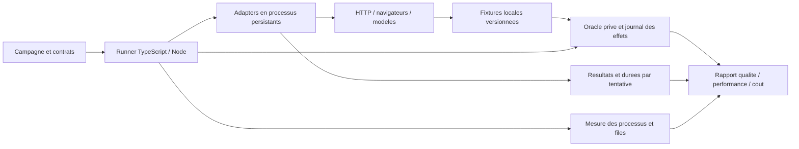

# Automan — proposition de laboratoire comparatif

**7 octobre 2026 — phase initiale : rapport et proposition.** Ce document a précédé les installations et mesures : les arborescences, expériences et seuils ci-dessous décrivent le programme proposé.

**Mise à jour :** la demande suivante a autorisé sa construction. Le [lab opérationnel](../lab/README.md) installe Crawlee, Spider, Stagehand v4, `@crawlee/stagehand` avec v3, Playwright/Puppeteer et les writers Node/Rust. Sa [matrice de couverture](../lab/docs/coverage-matrix.md) fait foi pour les expériences réellement implémentées ; le programme complet ci-dessous ne devient pas automatiquement un travail exécuté.

## 1. Recommandation

**Construire le lab avant de construire la console ou de figer le pilote navigateur.** Garder Rust/Tokio comme candidat privilégié pour le moteur Automan, mais décider des composants à partir de mesures communes : transport HTTP, parsing, pilote, placement des workers, pools, persistance et décisions IA.

L'ambition « le scraper le plus performant » doit devenir une comparaison publiable : **davantage de résultats frais, complets et corrects, à ressources et garanties explicites**. Le lab doit montrer où chaque solution gagne, où elle échoue et combien coûte sa meilleure configuration. Un seul classement mélangerait des services trop différents.

Je recommande trois étapes :

1. **Lab déterministe local** : Crawlee, Spider-rs et Stagehand, avec Playwright et des pilotes simples comme témoins ; HTTP, rendu et primitives sans inférence.
2. **Stress, reprise et topologies** : saturation, sessions, files, incidents, workers proches ou distants du navigateur ; témoin Go et composants natifs utilisables depuis TypeScript.
3. **IA et système Automan** : découverte, extraction sémantique, compilation/replay/réparation, puis petits prototypes de moteurs Rust et Node comparés sur les mêmes contrats.

La [roadmap actuelle](./roadmap-validation.md) commence par la console et un workflow HTTP durable. **Pour la demande présente, je propose un lot préalable « Lab et choix techniques ».** Ce rapport ne modifie pas silencieusement le PRD et n'adopte pas l'[ADR Rust](../research/2026-10-07-adr-runtime-language.md).

## 2. Ce que les recherches établissent déjà

Le dossier fournit une [cartographie de 64 acteurs ou familles](../research/2026-10-07-commercial-landscape.md), des matrices de [crawl](../research/2026-10-07-crawl-capability-matrix.md) et d'[agents](../research/2026-10-07-agent-capability-matrix.md), des [contrats comparés](../research/2026-10-07-stagehand-crawlee-spider-comparison.md) et un [protocole de preuve](../research/2026-10-07-benchmark-and-runtime.md). Le manque principal est maintenant expérimental, pas une nouvelle liste exhaustive.

| Conclusion du dossier | Conséquence pour le lab |
| --- | --- |
| Crawlee orchestre acquisition, handlers, queues et pools ; Spider est un moteur de collecte natif ; Stagehand apporte un runtime navigateur et des primitives sémantiques | Comparer des modes précis, pas trois noms de produits dans un classement général |
| Une queue persistante ou un ensemble `visited` ne constitue pas à lui seul un workflow durable | Ajouter des essais de crash, résultats, acquittements et effets ; déclarer les contrats absents |
| HTTP adaptatif, code caching et replay existent déjà | Mesurer qualité du choix HTTP/browser et amortissement réel, plutôt que présenter ces mécanismes comme nouveaux |
| Le pilote natif doit reproduire des garanties substantielles | Faire passer les tests d'interaction avant de comparer les latences utiles |
| Les benchmarks publics examinés ont des périmètres et asymétries | Refaire les expériences avec oracle, corpus, lifecycle et ressources communs |

L'[audit existant](../research/2026-10-07-benchmark-audit-followup.md) montre notamment que la ligne Node du benchmark Spider désigne le package `crawler`, **pas Crawlee**. Il relève aussi des différences de concurrence, de démarrage et de vérification des sorties. Ces observations portent sur le code inspecté ; elles ne permettent pas d'attribuer ces défauts à toutes les anciennes mesures publiées.

## 3. Stagehand et CDP : l'hypothèse à tester précisément

**Playwright pilote déjà Chromium avec des sessions CDP.** CDP n'est donc pas, en soi, une explication suffisante d'un avantage Stagehand. Le [backend Chromium officiel](https://github.com/microsoft/playwright/blob/main/packages/playwright-core/src/server/chromium/crBrowser.ts) contient cette connexion et les commandes correspondantes.

Stagehand v4 place gestion des cibles, état et dispatch dans une extension proche du navigateur. Le billet des mainteneurs rapporte un parcours distant de 50 actions : **14,22 s en batch contre 22,65 s avec Playwright**, avec un RTT de 42,2 ms. Cela représente environ **1,59× de débit**, ou **37,2 % de durée en moins**, dans ce parcours. Les auteurs le présentent comme un seul run ; ce n'est pas un classement général. [Source officielle](https://www.browserbase.com/blog/stagehand-v4).

La [migration officielle vers v4](https://docs.stagehand.dev/v4/migrations/playwright) décrit une API déterministe plus petite et des différences d'attente, de locators et de réseau. Ainsi, un clic rapide ne prouve pas que le moteur a attendu la bonne cible et vérifié le bon effet. La [référence Playwright](https://playwright.dev/docs/actionability) explicite ses contrôles avant certaines actions.

**Expérience décisive proposée :** même parcours de 50 actions, même Chrome, mêmes postconditions ; Playwright distant, Playwright exécuté près du navigateur, Stagehand séquentiel, Stagehand batch, CDP Rust séquentiel et batch local gardé. Répéter à plusieurs RTT. Cela distingue effet du placement, des échanges, des garanties et du runtime.

Ne pas confondre `connectOverCDP()` externe et l'usage interne de CDP par Playwright : le premier a une [fidélité moindre documentée](https://playwright.dev/docs/api/class-browsertype#browser-type-connect-over-cdp). Le lab gardera des lignes distinctes pour connexion native Playwright et attachement CDP.

## 4. Solutions à inclure

### 4.1 Premier ensemble à installer lors de l'implémentation

Les versions du trio ci-dessous ont été revérifiées dans les registres officiels. Elles constituent une **baseline proposée**, pas une preuve de compatibilité installée. Les dépendances transitives, navigateurs et autres outils devront être figés au bootstrap. [Audit complémentaire](../research/2026-10-07-lab-engine-evidence.md).

| Solution / mode | Place dans le lab | Ce qu'on cherche à apprendre |
| --- | --- | --- |
| **Crawlee TS 3.18.2** : HTTP/Cheerio, Playwright, adaptatif | Concurrent complet de collecte/orchestration | Coût du framework, pools, autoscaling, reprise et qualité du choix HTTP/browser |
| **Spider 2.53.9** : HTTP, Chrome, smart | Concurrent natif Rust de collecte | Débit utile, mémoire totale, streaming et recours au navigateur |
| **Stagehand npm 4.1.0** : Page/Locator, `observe`/`act`/`extract`, batch | Concurrent de primitives navigateur et résolution sémantique | Placement, coût d'observation, actions connues, premier run et réutilisation |
| **Playwright 1.63.0** | Référence de comportement ; script manuel optimisé | Niveau de correction à égaler et coût de ses garanties |
| **Puppeteer / puppeteer-core 25.12.0** | Témoin navigateur plus direct, avec le même Chrome | Coût du pilote et des contrôles ajoutés pour un contrat commun |
| **Chromiumoxide**, puis **Chromey** | Témoins CDP Rust séparés du crawler Spider | Qualification du driver candidat et coût de son implémentation |
| **agent-browser** | Référence de daemon natif et de primitives destinées aux agents | Sessions résidentes, snapshots, références et overhead CLI/RPC |

Sources : [Crawlee](https://crawlee.dev/js/docs/introduction), [Spider](https://docs.rs/spider/2.53.9/spider/), [Stagehand](https://docs.stagehand.dev/v4/first-steps/introduction), [Playwright](https://playwright.dev/docs/library), [Puppeteer](https://pptr.dev/), [Chromiumoxide](https://github.com/mattsse/chromiumoxide), [Chromey](https://github.com/spider-rs/chromey), [agent-browser](https://github.com/vercel-labs/agent-browser).

**Point de version important :** `@crawlee/stagehand` 3.18.2 dépend de Stagehand v3. L'intégration Crawlee + Stagehand est donc une cellule séparée, avec un environnement v3 isolé, si nous souhaitons la mesurer. Ne pas forcer Stagehand v4 dans cet adaptateur ni confondre les numéros des SDK Python et npm. [Manifest officiel](https://github.com/apify/crawlee/blob/v3.18.2/packages/stagehand-crawler/package.json).

### 4.2 Autres concurrents majeurs pour les décisions Automan

« Majeurs » signifie ici pertinents pour une décision du lab ; cette recherche n'établit pas un classement de parts de marché.

| Famille | Priorité et références | Pourquoi les ajouter |
| --- | --- | --- |
| Collecte HTTP | **P1 : Scrapy, Colly async** | Références Python et Go avant de conclure sur Rust ; frontier, pipelines et throttling |
| Extraction et rendu | **P1 : Crawl4AI, Scrapling** | Contenu structuré/Markdown, navigation et relocalisation adaptative |
| Pilotage Go | **P1 : chromedp ou Rod** | Témoin natif/concurrent supplémentaire sur les primitives CDP |
| Agent et décisions réutilisées | **P2 : Browser Use, Skyvern, spider_agent** | Agents, sessions, extraction, code caching et coût de répétition |
| Résolution sémantique | **P2 : AgentQL** | Mesurer la résolution/extraction sur un pilote existant, avec son service propre |
| Moteur de navigateur différent | **P2 : Lightpanda** | Tester le coût du rendu et la compatibilité, séparément du langage du contrôleur |
| Produits de collecte | **P3 : Firecrawl, Apify, Zyte, Bright Data** | Comparer un service complet : qualité, latence, couverture et coût facturé |
| Infrastructure navigateur | **P3 : Browserbase, Browserless, Kernel, Hyperbrowser** | Placement, lancement, sessions, hébergement et limites de flotte |
| Spécialistes / portée ultérieure | Katana, StormCrawler, Selenium/WebDriver BiDi, Magnitude, LaVague | Découverte d'endpoints, crawl distribué, portabilité ou perception ; selon un besoin mesuré |

Sources et distinctions local/cloud/licences : [shortlist vérifiée](../research/2026-10-07-lab-competitor-shortlist.md), [Scrapy](https://docs.scrapy.org/en/latest/), [Colly](https://github.com/gocolly/colly), [Crawl4AI](https://github.com/unclecode/crawl4ai), [Scrapling](https://github.com/D4Vinci/Scrapling), [chromedp](https://github.com/chromedp/chromedp), [Browser Use](https://github.com/browser-use/browser-use), [Skyvern](https://github.com/Skyvern-AI/skyvern), [spider_agent](https://docs.rs/spider_agent/2.53.9/spider_agent/), [AgentQL](https://docs.agentql.com/), [Lightpanda](https://github.com/lightpanda-io/browser).

Browser Use possède plusieurs générations de runtime, dont un cœur Rust dans sa bêta : les épingler séparément. De même, **Spider crate, spider_agent, Chromey et Spider Cloud ne forment pas une seule cellule de benchmark**. Le nom du SDK ne donne pas le langage de toute la stack.

Les services hébergés passent dans une campagne distincte : leur infrastructure, leurs quotas et leurs mécanismes propriétaires ne sont pas des dépendances locales équivalentes. L'open source et le cloud de Firecrawl, par exemple, doivent être mesurés comme deux déploiements différents. Les licences des composants seront consignées à la version installée ; leur présence dans le lab ne décide pas de leur redistribution dans Automan.

Cette campagne utilise un serveur de fixtures contrôlé accessible aux fournisseurs : leur navigateur ne peut pas atteindre directement le `localhost` du Mac. Conserver l'oracle privé, mesurer le réseau navigateur–fixture et publier la géographie. Les pages publiques changeantes servent ensuite de validation externe ; elles ne remplacent pas le corpus contrôlé.

## 5. Installation proposée dans ce dossier

**État observé, sans modification d'environnement :** macOS arm64, Node 24.19.0, Cargo/Rust 1.93.0, Python 3.14.8 ; `pnpm`, `uv` et le CLI Docker sont présents. Google Chrome installé annonce 154.0.8037.99. La présence des commandes ne vérifie ni le daemon Docker, ni la compatibilité des packages, ni les possibilités de lancement des extensions.

### Organisation proposée

```text
automan/
  lab/
    README.md                     # installation, smoke, méthode, interprétation
    protocol/                     # schémas de commande/résultat du lab
    fixtures/                     # sites locaux et journaux des effets
    oracles/                      # validateurs indépendants des adapters
    adapters/
      node/                       # Crawlee, Stagehand v4, Playwright, Puppeteer
      rust/                       # Spider HTTP/Chrome/smart, drivers CDP
      python/                     # Scrapy, Crawl4AI, Scrapling, agents
      go/                         # Colly async + driver CDP
      stagehand-v3/               # seulement pour l'intégration Crawlee v3
    scenarios/                    # contrats et graines des fixtures
    campaigns/                    # budgets, modes, répétitions, topologies
    tools/                        # bootstrap, doctor, runner, métriques
    results/<campaign-id>/        # manifest, JSONL, distributions, artefacts
  research/                       # preuves documentaires et notes d'analyse
  docs/                           # décisions et documentation Automan
```

Le bootstrap installera **des paquets et crates épinglés dans `lab/`** ; cloner tous les dépôts upstream n'est pas nécessaire. Un checkout de source n'est ajouté que pour une inspection ou un patch précis, avec SHA et diff conservés. Pas de modification globale des runtimes et pas d'insertion des concurrents dans le futur moteur Automan.

| Environnement | Exigence de reproductibilité |
| --- | --- |
| Node | Versions exactes, version de pnpm, lockfile commité ; Stagehand v3 isolé de v4 |
| Rust | Toolchain, `Cargo.lock`, builds `release`, features explicites ; binaires HTTP/Chrome/smart construits séparément pour éviter une union implicite des features |
| Python | Environnement `uv` avec Python et dépendances fixés ; choisir une version supportée par les packages plutôt qu'imposer le Python 3.14 installé |
| Go | Toolchain, `go.mod` et `go.sum` ; activer explicitement le mode async de Colly |
| Navigateurs | Binaire/revision, checksum, flags, profil et extension figés ; pas de campagne publiée sur le Chrome personnel qui s'actualise |
| IA / services | Provider, modèle identifié, prompts, budgets, région et cache déclarés ; aucune clé dans les manifests de résultats |

Chaque adapter commence par un smoke test : lancer, naviguer/fetcher, lire la valeur attendue, fermer les ressources. Un lancement réussi ne le qualifie pas sur la suite complète. Stagehand local, les primitives déterministes et les appels IA/gateway auront des prérequis séparés et vérifiés.

Trois pièges concrets revérifiés dans [l'audit du trio](../research/2026-10-07-lab-engine-evidence.md) : Stagehand peut sélectionner Canary par autodétection sur macOS ; son `act(Action)` stable vérifie une configuration modèle/gateway même avant un rejeu direct ; la documentation du cache et le défaut du bundle 4.1.0 divergent. Pour les premières mesures sans IA, utiliser les primitives Page/Locator, fournir le chemin Chrome exact et fixer explicitement cache/réparation. Pour les essais sémantiques, configurer le modèle/gateway et compter les éventuelles inférences de réparation. Le smoke doit aussi prouver le chargement réel de l'extension sur la build retenue.

Le Mac sert au développement et aux comparaisons sur arm64. Pour les stress tests publiables, je recommande **un hôte Linux dédié à ressources fixes**, sans mélange avec Docker Desktop ou une machine de travail active. Le serveur fixture et le générateur sont comptabilisés séparément ; si leur capacité limite l'essai, la mesure ne classe plus les moteurs. Les campagnes Mac/Linux/arm64/x86_64 restent des séries distinctes.

## 6. Harness : petit, indépendant, extensible

### Architecture du lab



**Runner TypeScript proposé**, parce que Crawlee, Stagehand et les témoins navigateur ont des SDK directs. Ce choix concerne le lab ; il ne décide pas du langage d'Automan. Les adapters Rust/Python/Go sont des processus persistants avec un protocole JSON Lines simple sur stdio ; messages structurés sur stdout, logs sur stderr, gros artefacts par fichiers référencés.

Le runner possède manifest, seed, lifecycle, deadlines et collecte. Il appelle `prepare`, `run`, `cancel`, `reset`, `close` et reçoit les capacités supportées. Le processus worker mesure ses opérations avec une horloge monotone. Le runner mesure également la durée complète : spawn, startup, IPC, queue, tâche, validation et publication. **Ne pas comparer un Rust déjà initialisé à un Node redémarré à chaque action.**

Deux rails sont nécessaires :

| Rail | Rôle | Règle |
| --- | --- | --- |
| Primitive / composant | Isoler acquisition, parsing, observation, commande et attente | Adapter direct ; queue/pool uniformes ou exclus et coût de lancement affiché |
| Framework complet | Évaluer le meilleur usage réel de chaque solution | Queue, pool et régulation propres autorisés ; configurations et ressources intégralement comptées |

Imposer le scheduler du lab à Crawlee dans tous les tests masquerait sa valeur. Laisser chaque scheduler décider dans un microbenchmark de clic masquerait le coût du pilote. Les deux séries répondent à des questions différentes.

### Validation indépendante

L'oracle lit les données attendues et le journal privé du serveur fixture : identifiant d'objet, compte, valeur, version, pagination, fichier et effets. **Le moteur ne reçoit ni les réponses attendues cachées ni l'accès au validateur.** La page peut afficher un faux message de succès ; seul l'état réel fait foi. Pour les interactions purement locales, le journal d'événements et l'état DOM contrôlé complètent cet oracle.

Résultat technique et verdict sont distincts. Conserver toutes les tentatives et statuts : `verified`, `failed`, `partial`, `effect_unknown`, `unsupported`. Une capacité absente n'entre pas comme latence zéro ; elle réduit la couverture. Un adapter ajoute les attentes nécessaires à son contrat et conserve leur coût dans sa durée.

## 7. Matrice des expériences

### A. HTTP, parsing et découverte

| Scénario | Attendu commun | Variables principales |
| --- | --- | --- |
| Fetch d'un body identique | Status, octets et checksum | Keep-alive froid/chaud, TLS, HTTP/1.1 puis HTTP/2, taille, compression |
| Extraction HTML | Même ensemble d'enregistrements normalisés | HTML 10 Ko / 100 Ko / 1 Mo, parser, sérialisation |
| JSON/API | IDs et champs exacts | Streaming ou buffering, redirections et erreurs |
| Crawl d'un graphe connu | Ensemble complet d'URLs/entités, zéro trou | 1 000 puis 10 000 puis 100 000 pages, liens relatifs, cycles, querystrings, doublons |
| Sink lent / grosse réponse | Données complètes, mémoire bornée | Backpressure, saturation disque, limites de taille et annulation |
| Site mixte SSR/JS | Données correctes et fraîches sur chaque classe | HTTP forcé, browser forcé, adaptatif ; faux upgrades et JS manqué |

Comparer Spider HTTP, Crawlee HTTP/Cheerio, Scrapy, Colly async et des scripts simples. Les baselines Reqwest et Node doivent publier transport et parser : une différence de bibliothèque n'est pas une mesure isolée du langage. Crawlee peut utiliser un transport Rust avec Impit ; conserver cette configuration comme témoin pertinent. [Impit](https://github.com/apify/impit), [intégration Crawlee](https://crawlee.dev/js/docs/guides/impit-http-client).

Un client Reqwest réutilisé possède déjà un pool, et ses réponses peuvent être consommées par chunks/stream ; le recréer par URL ou imposer un buffering intégral serait une mauvaise baseline. [Client officiel](https://docs.rs/reqwest/latest/reqwest/struct.Client.html), [Response](https://docs.rs/reqwest/latest/reqwest/struct.Response.html).

### B. Primitives navigateur

| Primitive / groupe | Oracle et cas à couvrir |
| --- | --- |
| Launch, connect, context, page, close | Ressources ouvertes/fermées ; froid/chaud distincts ; profil isolé |
| Navigation et historique | URL et version correctes ; redirect, DOM ready, contenu retardé |
| `evaluate` et extraction groupée | Valeurs exactes ; no-op, petite/grande projection ; temps et octets |
| Snapshot DOM/AX | Couverture d'éléments pertinents et fraîcheur ; taille 100/1 000/10 000 nœuds |
| Resolve et click | Bonne identité, cible unique, non masquée ; effet et séquence d'événements |
| Fill, type, press, select, check | Valeur et événements attendus ; formulaire contrôlé, disabled/readonly, validation |
| Hover, scroll, drag/drop | Effet attendu, liste virtualisée, cible déplacée et drop confirmé |
| Wait et navigation déclenchée | Attente armée avant action ; résultat rapide, résultat tardif, timeout |
| Frames et shadow DOM | Cible correcte ; same-origin, cross-origin/OOPIF, frame remplacée, shadow ouvert/fermé selon capacité |
| Popup, dialog, multi-page | Nouvelle cible attribuée au bon run ; événement immédiat et fermeture |
| Upload et download | Contenu/checksum exacts ; téléchargement avant résolution de l'action |
| Screenshot / PDF / interception | Dimensions ou contenu selon contrat ; réseau contrôlé ; capacité absente visible |

Deux niveaux : **commande brute sur cible prête**, pour l'overhead ; **action fiable dans un DOM changeant**, pour le service utile. Ne pas assimiler `HTMLElement.click()`, modification directe de `.value` et action utilisateur. Une optimisation doit conserver les événements et effets exigés par le scénario.

Les locators « role/texte » et CSS communs constituent des séries différentes. Si un backend n'a pas de locator role natif, son adapter peut fournir un resolver explicite et mesuré. Des références stale, overlays et re-renders doivent distinguer faux succès, refus et récupération correcte.

### C. Stress, pools et durabilité

| Expérience proposée | Ce qu'elle doit révéler |
| --- | --- |
| Concurrence HTTP 1/8/32/128/512 ; navigateur 1/2/4/8/16, dans le budget fixé | Courbes débit valide, mémoire, CPU, backlog et p95 ; point de saturation |
| Plusieurs hôtes, dont un lent et un limité | Fairness, quotas, `429`/`Retry-After`, starvation et tempêtes de retries |
| Charge à débit d'arrivée imposé, burst et baisse de capacité | Admission, queue delay, rejets, rattrapage et autoscaling |
| Renouvellement des pages/contextes/processus ; soak 1 h puis 8 h | Fuites, coût de recyclage, sessions perdues et dérive des performances |
| Perte CDP/RPC, Chrome tué, worker interrompu | Reconnexion, perte/doublon, état exact du run et temps de reprise |
| Crash avant/après output, commit, acquittement ; sink bloqué | Durabilité effective et sémantique de redelivery |
| Plusieurs comptes/sessions, cookies expirés, rotation de session | Isolation d'identité, ressource réutilisée correctement, coût d'auth/reprise |
| Deux workers, lease expirée, ancien worker encore actif | Fencing, travail concurrent et effets inconnus |

Les valeurs sont des points de départ, pas une charge à lancer aveuglément sur le Mac : la campagne fixe CPU, mémoire, temps et arrêt automatique. Les incidents se font dans des fixtures et états de test isolés, avec des ressources créées pour la campagne.

Une queue ou un crawler qui ne revendique pas le workflow durable garde ce statut : tester sa reprise documentée, puis mesurer séparément les garanties ajoutées par un adapter. Le journal et la file ne garantissent pas un effet unique sur un site tiers ; pour les doubles effets, le lab utilise un faux portail à effets contrôlés.

### D. RTT et placement

Tester RTT de contrôle mesuré proche de 0, puis 5/20/50/100 ms, **séparément du réseau navigateur–site**. Chaque protocole SDK/RPC/CDP utilise le relay adapté ; temporiser seulement `goto()` ne simule pas un RTT de contrôle.

Comparer commande séquentielle, batch d'actions indépendantes et batch gardé par pré/postconditions. Si une action exige une nouvelle observation ou provoque une dérive, elle coupe le batch. Comparer deux topologies : client distant qui commande chaque primitive ; client distant qui envoie un plan à un worker situé près du navigateur. C'est probablement une expérience plus déterminante que le seul choix Rust/TypeScript ; cette priorité est une hypothèse à vérifier.

Stagehand v4 expose un contexte par navigateur. Les essais auront une série à isolation/topologie identiques puis une série « meilleur déploiement natif sous même budget ». Plusieurs processus Stagehand et plusieurs contextes Playwright n'ont pas le même coût ; toute la flotte est comptée. [Contrat de migration](https://docs.stagehand.dev/v4/migrations/playwright).

### E. IA, compilation et autoréparation

Premiers workflows : catalogue paginé, export authentifié, formulaire dans le faux portail. Comparateurs : Stagehand, Browser Use, Skyvern, spider_agent ; AgentQL sur résolution/extraction. Stagehand v4 fournit des primitives : la boucle d'agent ajoutée doit être identifiée, pas attribuée gratuitement au SDK.

Séparer découverte froide, réutilisation d'action, plan complet déterministe, réparation sous mutation et échec de réparation. Un fake provider teste erreurs et budgets ; il ne mesure pas la compétence d'un agent. Pour les modèles réels, publier version, paramètres, prompts, historique, nombre d'appels, tokens/cache, temps d'attente provider et coût disponible.

Prévoir une série à provider/modèle commun **si tous les outils le permettent**, et une série avec leur meilleure configuration native. Si un gateway ou modèle propriétaire est imposé, l'indiquer ; ne pas prétendre avoir isolé l'effet du framework. Les caches gérés à distance restent un mode de service propre.

Mutations tenues à l'écart du réglage : classe changée, bouton valide mais mauvais objet, ordre/langue différents, données périmées, pagination cachée, session expirée et faux succès. Le validateur ne change pas pour accepter la réparation. Présenter coût de création, repair et maintenance, puis amortissement à 1/10/100/1 000 runs selon cadence et mutations fixées avant essai.

## 8. Mesure et équité

### Manifest obligatoire

Enregistrer versions exactes/SHA et lockfiles ; build/features ; système/CPU/RAM/architecture ; Chrome/extension/flags ; viewport/headless ; seeds/corpus/oracle ; modèle/provider/prompts ; région/RTT/proxy ; limites de concurrence ; budgets ; politiques d'attente/retry/cache ; conditions de stockage, batch et durabilité ; ordre des essais ; état froid/chaud. Un résultat sans cette provenance est exploratoire.

### Durées et ressources

| Mesure | Définition et précaution |
| --- | --- |
| Latence primitive | Commande → postcondition du contrat ; détail resolve/transport/attente ; validation indépendante finale affichée |
| Latence complète | Arrivée prévue → admission → exécution → validation → résultat publié ; lancement inclus dans les séries froides |
| Débit utile | Résultats vérifiés / seconde ; couverture, faux succès et refus affichés à côté |
| CPU/mémoire | Worker + helpers + extension + tous les processus navigateur ; CPU-s et pic/temps de mémoire ; serveur/générateur séparés |
| Travail de protocole | Commandes, round-trips causaux, octets, snapshots, captures et appels modèles |
| Coût par succès | Coûts de toutes tentatives, reprises, compilation, réparation et ressources / succès vérifiés ; coût humain séparé |
| Capacité durable | Débit avec backlog stable et qualité imposée ; rejet/perte, queue delay et temps de reprise |

Sur Linux, privilégier groupes de processus/cgroups pour l'ensemble du worker et des descendants. Ne pas additionner naïvement des RSS comme mémoire physique exacte : pages partagées et évolution des PID compliquent cette mesure. Afficher la méthode et sa granularité. Les profils détaillés sont une campagne séparée avec overhead mesuré ; ils ne doivent pas ralentir arbitrairement une seule baseline.

Rapporter p50/p95/p99 **avec effectif et états terminaux**. Les quantiles des seuls succès portent cette étiquette ; délais/échecs/cancellations restent dans les comptes. Ne pas fabriquer une durée pour une tâche qui n'a jamais démarré : afficher attente ou rejet séparément. Les clocks monotones de deux machines ne sont pas directement soustractibles ; les spans locaux et la durée complète côté runner ont chacun leur référence.

### Charge et répétitions

Utiliser charge fermée pour une concurrence fixée et charge ouverte pour un débit d'arrivée indépendant des durées. Une charge fermée qui ralentit avec le système peut sous-estimer la congestion ; les essais à arrivée imposée comptent arrivées prévues, départs réels, files et tâches rejetées. Le générateur doit publier son propre retard. Ces distinctions suivent la méthode décrite par [Grafana k6](https://grafana.com/docs/k6/latest/using-k6/scenarios/concepts/open-vs-closed/) et ses [itérations non lancées](https://grafana.com/docs/k6/latest/using-k6/scenarios/concepts/dropped-iterations/). k6 peut charger la future API HTTP ; il ne remplace pas les adapters navigateur du lab.

Proposition initiale : smoke sur chaque cellule supportée ; conformance sur au moins 20 graines de perturbation ; microbenchmarks chauds avec au moins 10 blocs/processus et 10 000 observations lorsque le coût le permet ; workflows avec 100 tentatives pour explorer, puis campagne de qualification ciblée. Randomiser l'ordre par blocs, garder warmup et reset déclarés, et publier résultats par scénario. Les observations d'un même processus peuvent être corrélées : calculer l'incertitude par blocs, pas en les traitant toutes comme indépendantes.

**Pas de fiabilité « 99,9 % » déduite de 100 succès.** À titre de calcul statistique, zéro échec sur 2 995 essais indépendants d'une même population donne une borne supérieure unilatérale de 95 % d'environ 0,1 % pour son taux d'échec (`1 - 0,05^(1/n)`). Les sites, comptes et versions corrélés ne satisfont pas automatiquement cette hypothèse ; multiplier les replays d'une seule fixture ne prouve pas une fiabilité générale.

Deux modes de tuning : configuration commune documentée ; meilleure configuration de chaque produit sous mêmes budgets et contrats. Figer le temps de réglage et le jeu final. Publier les écarts de couverture et résultats défavorables. Une médiane globale ou un score unique ne remplace pas les courbes par tâche.

## 9. Comment le lab décide de l'architecture complète

### Recommandation actuelle, encore proposée

| Couche | Choix conseillé | Preuve ou arbitrage encore nécessaire |
| --- | --- | --- |
| Moteur et workers | **Rust/Tokio**, modules dans un moteur commun | CPU/mémoire, distribution, durabilité et complexité réelle face à Node et Go |
| Acquisition | HTTP natif avec client/pool réutilisé, parsing et flux bornés | Reqwest ou transport spécialisé selon workload ; compléter les performances avec compatibilité et qualité |
| Navigateur | **Chromium**, worker proche du navigateur, sessions réutilisées | Driver CDP Rust qualifié ; batch sous conditions ; coût de lifecycle et isolation |
| Compatibilité | **Worker Playwright versionné** | Fonctions restant plus robustes ou nécessaires sur ce backend ; coût IPC inclus |
| Frontier et plans | Automan propriétaire des états, admission, budgets, leases et reprise | Pas d'empilement implicite de schedulers ; tests du résultat jusqu'au commit |
| Persistance | SQLite local, PostgreSQL multi-worker, artefacts référencés | Claims, writer, batching, fsync et contention sous contrat de durabilité identique |
| IA | Découverte/compilation/réparation explicites ; replay déterministe quand qualifié | Seuil de répétition rentable, erreurs silencieuses et dérive sur corpus séparé |
| Clients | SDK TypeScript/Python, CLI/MCP/API sur contrats communs | Surcoût/projections/annulation, parité et installation testées |
| Interfaces | React/shadcn puis SwiftUI/AppKit, moteur séparé | Après premières mesures et stabilisation des contrats ; documentation avec chaque capacité |
| Cloud | Même worker, près du navigateur ; contrôle de flotte et budgets | Isolation, capacité, files et coût réel ; pas de microservices ajoutés avant nécessité |

La proposition est cohérente avec [l'architecture existante](./architecture.md). **La sélection du driver et du chemin chaud reste ouverte.** Automan peut être un moteur Rust avec un backend Playwright majoritaire au début : la forme du moteur et le pilote de chaque action sont deux décisions.

### Expériences pour choisir, plutôt que réécrire d'emblée

| Question | Comparaison qui isole suffisamment le problème | Décision possible |
| --- | --- | --- |
| Le langage du coordinateur compte-t-il ? | Coordinateurs Rust et Node utilisant le même adapter worker et mêmes transactions/politiques ; Go si un avantage de distribution/maintenance reste plausible | Choisir le moteur sur overhead et contraintes utiles, sans attribuer le coût de Chrome au langage |
| Faut-il développer le driver CDP ? | Même Chrome, primitives, placement, oracles et budget ; Playwright/Puppeteer/CDP Rust/Go | Promouvoir le natif par capacité qualifiée ; garder Playwright pour les écarts |
| L'extension apporte-t-elle un gain propre ? | Extension contre worker/helper co-localisé, avec batches et garanties comparables | Helper ou extension seulement si elle apporte un bénéfice/lifecycle justifié |
| Faut-il réutiliser Spider ? | Adaptateur ciblé versus pipeline natif HTTP/parsing ; même frontier/sink quand on mesure le composant | Réutiliser les briques utiles ; ne pas forker tout le moteur sans blocage concret |
| Faut-il un broker dédié ? | SQLite/PostgreSQL sous charge, même durabilité et temps de reprise | Ajouter un broker si une limite mesurée le justifie |
| Quand le replay gagne-t-il ? | Création + runs + réparations, données actuelles et même taux de réussite | Stratégie par fréquence et stabilité du workflow |

Une stack TypeScript avec transport natif et worker proche de Chrome reste un candidat sérieux. Inversement, Rust peut gagner sur mémoire, débit HTTP ou distribution sans améliorer beaucoup une tâche dominée par réseau ou modèle. Le lab compare **des architectures complètes**, puis attribue les gains avec les expériences de composants.

**Gate suggéré :** toutes les capacités obligatoires du périmètre passent la conformance ; qualité comparable sur le corpus final ; amélioration utile démontrée avec incertitude, ou besoin de capacité/distribution explicite. Le seuil de 20 % déjà évoqué dans le dossier peut servir de règle de promotion d'une optimisation, si fixé avant campagne. Il ne transforme pas chaque différence en avantage significatif et ne constitue pas une promesse de produit.

## 10. Livrables et ordre de travail proposés

| Lot | Livrable à examiner | Critère de passage |
| --- | --- | --- |
| L0 — Contrats | Manifest, capacités, scénarios, oracles, états et limites du lab | Le travail demandé et le verdict sont indépendants du framework |
| L1 — Installation | Environnements isolés du trio + témoins, locks, doctor et smoke | Versions/lifecycle prouvés ; pas d'IA nécessaire aux premières mesures |
| L2 — Premières preuves | HTTP, click/fill/wait, snapshots, froid/chaud et parcours de 50 actions | Sorties/effets équivalents ; raw results conservés ; aucune ligne rapide mais incorrecte promue |
| L3 — Stress et reprise | Pools, charge ouverte/fermée, RTT, crash, sink et soak ; témoins Go/Python | Saturation et contrats manquants visibles ; ressources complètes mesurées |
| L4 — IA et dérive | Découverte, caches, replay, repair ; corpus tenu à l'écart | Coût complet, fraîcheur et faux succès publiés |
| L5 — Choix Automan | Petits prototypes ciblés, comparaison système, ADR révisé | Chaque choix possède une preuve ou une contrainte assumée |
| L6 — Produit | Workflow HTTP durable puis console ; backend navigateur promu progressivement | La roadmap et les docs reprennent les capacités réellement qualifiées |

Chaque lot livre README, exemples exécutés, commandes reproductibles, schémas/référence des adapters et limites. La [documentation complète exigée](./documentation-plan.md) reste une obligation du produit futur ; le lab a sa propre documentation dès son bootstrap.

La prochaine implémentation utile est **`lab/` avec fixtures contrôlées, adapters isolés et premières mesures sans IA**, avant de créer une interface de résultats avancée. Un rapport JSON/CSV et une page HTML générée suffisent au premier lab. Le résultat attendu n'est pas un vainqueur annoncé à l'avance : c'est une carte des meilleurs chemins et une décision de moteur/driver/placement appuyée par les preuves.
