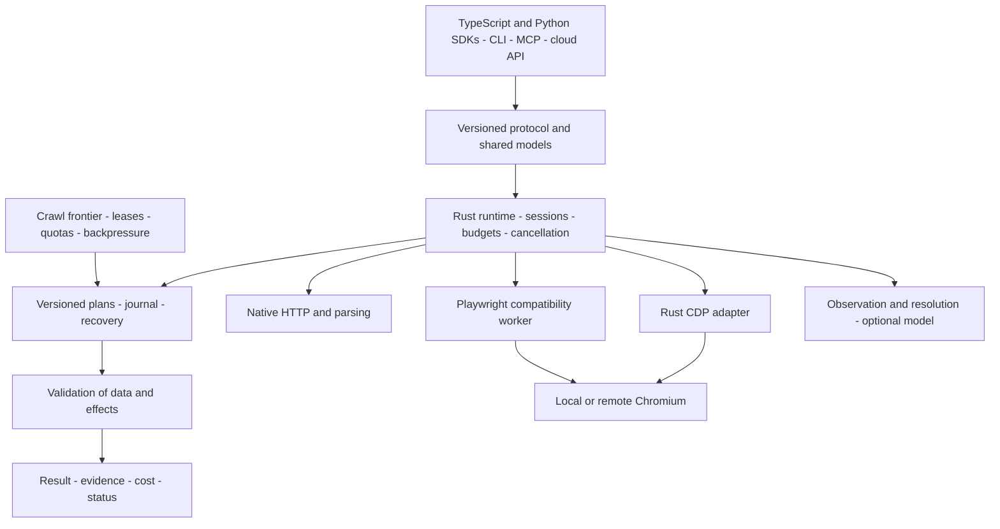

# ADR-001: language and architecture of the Automan runtime

**Status: proposed, to be adopted explicitly when implementation starts.**
**Date: October 7, 2026.**
**Final decision: user / project owner.**

## Context

Automan must be an open source framework that combines HTTP collection, browser rendering, deterministic actions, model-assisted perception/extraction and reusable workflows. The commercial services must use the same executor. The initial constraint of a small team and a release in 3–6 months has been removed; it does not govern this choice. The goals are speed, efficiency, versatility and reliability, with comparative evidence at equal quality.

**There is no established universal consensus on the best language for this type of framework.** The projects studied show several solutions: Stagehand runs its runtime in a Chrome extension with TS/Python/Go clients; Crawlee has TS and Python implementations and accepts native HTTP clients; Spider and its agents are in Rust. This survey is not a representative poll of all developers. [Stagehand architecture](https://github.com/browserbase/stagehand/blob/main/CONTRIBUTING.md), [Crawlee Python](https://crawlee.dev/python/docs/guides/architecture-overview), [Crawlee/Impit](https://crawlee.dev/js/docs/guides/impit-http-client), [published Spider](https://docs.rs/crate/spider/2.53.9/source/).

The distinction to keep is between **engine language, API language and execution location**. Different clients can consume a common protocol. A native engine does not eliminate network, model or Chromium latency; operations executed far from the browser can lose more in round trips than the controller gains in CPU. This last conclusion is an architectural inference, consistent with Stagehand's placement and batching; it is not a measured, quantified gain for Automan. [Stagehand protocol](https://github.com/browserbase/stagehand/blob/main/packages/protocol/README.md), [batching](https://docs.stagehand.dev/v4/reference/stagehand).

## Proposed decision

Build **a canonical asynchronous Rust engine, usable as a library and as a standalone binary**, with TypeScript and Python SDKs, a CLI and MCP tools consuming the same contract. Tokio is the async runtime candidate. The shared protocol carries types, results, capabilities, budgets, progress and cancellation; the models are generated, the public APIs remain idiomatic. The cloud launches the same Rust workers close to their browsers.

Rust is chosen for the unity of the engine, its native distribution, control over allocations and resources, concurrency and the absence of GC in the core. **This does not demonstrate its superiority on the total time of a workflow.** Dependent services and processes, including Chromium, keep their own behaviors. [Rust](https://rust-lang.org/), [Tokio](https://tokio.rs/).

The browser is a driven dependency. A native CDP adapter wraps Chromey/Chromiumoxide; the final selection of the library awaits a capability qualification. A Playwright adapter provides compatibility and a behavioral reference. Each session has a single backend responsible for its lifecycle. The drivers' internal objects do not become Automan's public contract. [Chromey](https://github.com/spider-rs/chromey), [Chromiumoxide](https://github.com/mattsse/chromiumoxide), [Playwright actionability](https://playwright.dev/docs/actionability).

## Options considered

The assessments below are our design choices for this scope, not a community ranking or a benchmark.

| Option | Relevant advantages | Costs and limitations | Proposed place |
| --- | --- | --- | --- |
| Rust | Common native engine, resource control, async, library + binary | Per-platform distribution, IPC, qualification and maintenance of a CDP driver | Core, workers, CLI |
| TypeScript | Direct access to the Playwright ecosystem and web APIs; good developer surface | Node runtime for a TS engine; GC and CPU cost to be measured, no universal handicap established | SDK, tools and interface; Playwright worker |
| Python | Integration with data and agent pipelines; API familiar to their users | CPU hot paths to be delegated if profiling calls for it; packaging of a Python engine to be considered | SDK and integrations |
| Go | Network/concurrency runtime and binary distribution; existing CDP drivers and crawlers | GC; does not by itself solve parity of browser waits and actions | Viable alternative for the core, possible future SDK |

The presence of Impit already allows TS/Python to use native code; it would be wrong to infer the speed of an entire stack from the language of its SDK. Go must not be rejected for its GC alone, and a Python engine can delegate its costly parts. [Impit](https://github.com/apify/impit), [chromedp](https://github.com/chromedp/chromedp), [Colly](https://github.com/gocolly/colly).

## Proposed architecture

The core forms well-separated modules in a common product; the initial architecture does not require an independent service for each module. Workers become process boundaries when isolation, proximity to the browser or work distribution justifies it.

### Structuring contracts

1. **Protocol:** bidirectional JSON-RPC proposed over local stdio and secure remote WebSocket. Version and capabilities negotiated; large artifacts transferred by references or bounded streams. This choice is proposed to unify SDK, CLI and cloud; its overhead will be measured. Embedded bindings can be added if a use case justifies their cost.
2. **Execution:** API/HTTP, parsing, deterministic browser and model-based resolution. The means of access is chosen according to the requested result and the history; routes known to require JS can go directly to the browser.
3. **Plans:** version, parameters, session requirements, steps, waits, preconditions and postconditions. Recorder, code or model can produce plans; no general conversion of arbitrary code into a safe plan is promised.
4. **Collection:** frontier, deduplication, per-domain quotas, leases and backpressure, distinct from action recovery. An external Crawlee adapter can own the queue while Automan executes, without a double scheduler for a request.
5. **State:** SQLite proposed locally for journal/checkpoints; PostgreSQL and object storage proposed for the multi-worker cloud. Results are idempotent when their contract allows it; an uncertain external effect requires reconciliation of the state before repetition.
6. **Verification:** schema, identity, completeness, freshness and postcondition are separate properties. Distinguish technical success, verified result, partial result and unknown effect. Probabilistic verdicts are explicitly identified.
7. **Models and caches:** optional models for discovery, ambiguity and repair. Perception cache, plan cache and data cache have distinct invalidations. A valid plan can run without new inference.
8. **Placement:** keep workers and browsers close, sessions reused under an isolated identity, independent operations grouped and concurrency bounded. The SDK does not have a second implementation of the engine.

These choices are inspired by responsibilities present in the references, without attributing to them a guarantee they do not have. See [inspected contracts](../research/2026-10-07-crawlee-spider-contracts-followup.md) and [Stagehand/alternatives](../research/2026-10-07-stagehand-alternatives-followup.md).

## Consequences and trade-offs

The product has a single execution semantics, local and remote, with distribution independent of the client language. Maintenance concentrates on the protocol and the adapters; the team must nevertheless qualify CDP actionability, navigation races, frames/OOPIF, downloads, connection losses and cancellation. Merely binding a CDP command does not provide Playwright's reliability.

The Rust choice must not shift effort away from the dominant costs. The first performance goal is to avoid an unnecessary render or decision, then redundant screenshots and round trips; profiling decides CPU optimization. The memory safety of the core does not prove the correctness of the recipe, of the extraction or of the effects on the site.

The features already present at competitors — adaptive HTTP, script cache, repair, verification — remain references. Automan's differentiation must lie in their common contract, their portability, their diagnostics and the cost per actually correct result. [In-depth comparison](../research/2026-10-07-stagehand-crawlee-spider-comparison.md).

## Qualification actions

- [ ] Fix schemas, session ownership and terminal states before the public driver.
- [ ] Establish equivalent baselines for HTTP, JS rendering and authenticated workflows with Spider, Crawlee, Playwright and Stagehand.
- [ ] Qualify Chromey/Chromiumoxide behind the same contract, keep the Playwright backend for required capabilities that are still incomplete.
- [ ] Measure total CPU/memory, cold/warm startup, latency, RPC, LLM calls and the cost of all attempts.
- [ ] Test DOM drift, changing data, expired auth and interruption between effect, validation and acknowledgment.

The promotion gates for a backend rest on **equivalent quality and reliability with a measured gain**. No universal ranking of languages and no quantified Automan gain is established by this ADR. [Audit of public benchmarks](../research/2026-10-07-benchmark-audit-followup.md).
