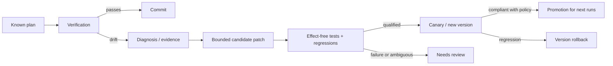

# Proposed Goodfetch architecture

**October 7, 2026 — design proposal, no implementation at this stage.** This document expands on the [language/runtime ADR](../adr/0001-runtime-language.md). The example APIs and the qualification objectives are described separately in [api.md](api.md) and in the [R&D plan gates](../plan/rd-plan.md#7-promotion-gates-without-invented-figures).

## 1. Principles and decisions

### 1.1 One canonical engine, idiomatic surfaces

Rust/Tokio owns the execution contracts: plans, state, frontier, admission, resumes, sessions, validation and costs. It is usable as a library and as an executable. The TypeScript/Python SDKs, the CLI and the apps consume the same engine. The protocol models are generated; the facades remain idiomatic, documented and short.

This choice aims at native distribution, resource control and semantic unity. It does not prove an advantage on the total time of a workflow dominated by the network, Chromium or models. A TS/Node engine with Playwright is a credible alternative, as is Go for distribution and networking. The benefits of the Rust choice must be measured on the complete product. [Proposed ADR](../adr/0001-runtime-language.md), [Rust](https://rust-lang.org/), [Tokio](https://tokio.rs/).

### 1.2 Deep modules, justified processes

| Module | Responsibility and contract | Proposed process boundary |
| --- | --- | --- |
| Control | Create/inspect/cancel a run, manage versions, identities and capabilities | Local daemon; cloud control API |
| Frontier | Deduplication, discovery, priority, leases, delays, crawl completion | In the engine; shared cloud state |
| Executor | Interpret the plan, journal steps, conditions and results | Rust worker |
| Admission | Reserve resources, budgets and capacity before dispatch | Local to the engine, global credits granted by cloud control |
| Site access | HTTP, parsing, CDP, Playwright; normalized information and errors | HTTP in the worker; Chromium and Playwright compatibility separate |
| Sessions/pools | Ownership, identity, health, availability, retirement and reuse | Manager in the worker; Chromium isolated depending on scope |
| Decision/agent | Models, typed decisions, tools and budgets, compilation | Optional module; local/remote providers |
| Validation/repair | Verify the result, diagnose drift, qualify a candidate version | Same executor; separate test runs |
| Data | Datasets, artifacts, caches, export, provenance and outbox | SQLite + local files; PostgreSQL + cloud objects |
| Observability | Structured journal, spans, counters, redacted traces | Same module; optional exporter |

An async task, a tab, a process and a machine are four different units. A worker can process several HTTP requests and own several Chromium processes; the number of workers therefore does not by itself define concurrency. The architecture avoids an independent service for each module and a second scheduler inside an adapter.

### 1.3 Reuse components, keep the contracts

Existing projects serve as references and targeted dependencies. The complete Spider engine does not become the hidden owner of the Foxhound frontier; Crawlee can orchestrate a Foxhound adapter in an external integration, but then **Crawlee owns the queue**. A Stagehand backend exposes its version and cache limits. It does not reimplement the platform's pools.

| Component | Proposed choice | Why / remaining qualification |
| --- | --- | --- |
| Async/types | Tokio, Serde; JSON Schema generated from the shared types | Versioned wire schemas, common limitations explicitly tested; Schemars as generation candidate |
| HTTP | Reqwest as baseline; optional Impit/wreq adapter or specialized transport | Streaming, TLS, pools and timeouts; compatibility, footprint, license and gain specific to specialized transports |
| Parsing | HTML5 DOM parser for CSS; streaming rewriting/filtering when useful | DOM for relations/locators; streaming for volume; XPath to be qualified separately |
| Chromium/CDP | Chromey and Chromiumoxide to be qualified behind the browser contract | Final selection by conformance and maintenance, not by throughput claims |
| Compatibility | Dedicated and versioned Playwright worker | Reference for waits, actions and Firefox/WebKit engines when required |
| State | Local SQLite WAL; cloud PostgreSQL | Transactions, unique constraints and leases; the same business states, adapted storage implementations |
| Artifacts | Local files or S3-compatible object storage | Bounded streams, checksums, references and retention policies |
| Observability | tracing + OpenTelemetry export | Run/step/attempt/provider correlation; versioned GenAI conventions because they are still in development |

Candidate sources: [Reqwest](https://docs.rs/reqwest/latest/reqwest/), [Impit](https://github.com/apify/impit), [html5ever](https://github.com/servo/html5ever), [scraper](https://github.com/rust-scraper/scraper), [lol-html](https://github.com/cloudflare/lol-html), [Schemars](https://github.com/GREsau/schemars), [Chromey](https://github.com/spider-rs/chromey), [Chromiumoxide](https://github.com/mattsse/chromiumoxide), [GenAI conventions](https://opentelemetry.io/docs/specs/semconv/gen-ai/gen-ai-spans/). A CSS library is not enough to announce a complete XPath implementation.

## 2. Domain and state model

### 2.1 Persisted objects

| Object | Contractual elements |
| --- | --- |
| Workspace | Owner, members, policies, quotas and data namespaces |
| WorkflowVersion | Immutable identifier/version, input/output, plan or code package, validations, capabilities and budgets |
| Run | Pinned version, parameters, identity scope, policies, state and limits |
| RunTask | Durable activation of an autonomous run/step, dependencies/timer, lease/epoch and resource class; distinct from a frontier URL |
| CrawlRequest | URL/method/payload, context, deduplication key, discovery, priority, delay, lease and result |
| StepAttempt | Step/attempt, observation used, command, timestamps, cost, proof and status |
| Session | Identity, domain, authorized cookies/storage, owning backend, lease and health |
| Worker | Version, capabilities, placement, state, capacity credits and heartbeat |
| DatasetCommit | Idempotent key, schema/version, data or durable reference, provenance, validation |
| Artifact | Type, size, digest, location, rights and retention |
| RepairCandidate | Base version, reason, patch, tests, costs, candidate version and promotion status |

A run pins its version and its policies at startup. A promoted repair serves the next runs; it does not silently modify the plan of a run already in progress. An explicit resume can switch versions with an identifiable event and new attempt.

An autonomous workflow without crawling also has durable activations: start, step ready, timer expired or wait resolved. The executor journals them and the workers take them by lease/epoch, under the same admission as the collection requests. The frontier owns URL discovery/deduplication; it is not used artificially to store a human wait or a business action. A single owning activation acts on a mutating session; a DAG can parallelize independent branches according to their scope. A crash or loss of the worker rereads the journal and reconciles the effect before a new assignment, with the same fencing limits.

### 2.2 Distinct states

**Run**: `queued → running`, with non-terminal `waiting` (timer, capacity, authentication or human decision) and `retrying`. Terminal states: `succeeded`, `partial`, `failed`, `needs_review`, `effect_unknown`, `cancelled`.

- `succeeded`: all the required criteria of the workflow have passed.
- `partial`: usable data, but part of the contract is not satisfied; the missing part is described.
- `needs_review`: inconclusive decision or validation; the interfaces indicate what is missing.
- `effect_unknown`: an action may have taken place, but its effect is not confirmed; no automatic non-idempotent repetition.
- `failed`: objective not reached, with a known cause; `cancelled`: execution stopped, without erasing results already committed. A cancellation with an uncertain external effect keeps `effect_unknown` and the cancellation request in the history.

**Frontier request**: `ready`, `leased`, `running`, `delayed`, `handled`, `dead_letter`, `cancelled`. `handled` means acknowledgment, not business success. The counters distinguish handled requests, valid results, rejections and duplicates.

**Step**: `pending`, `running`, `committed`, `failed`, `effect_unknown`. **Validation**: `passed`, `failed`, `inconclusive`, `not_checked`. A successful HTTP transport or a click without an exception returns a technical status; it does not turn a run into a verified success.

`resume` acts on a non-terminal wait. After a terminal `needs_review` or `effect_unknown`, a reconciliation command adds a resolution and its proof without rewriting history; a continuation creates a new run linked to the previous one. It pins the version, parameters, reconciliation result and reusable checkpoints after revalidation. No unresolved unknown effect is repeated; data subject to freshness and expired sessions are not blindly reused.

## 3. Frontier, resume and transactions

### 3.1 Complete frontier

- Named and persistent queues; stable priorities, configurable FIFO and depth/breadth strategy, admission per domain and tenant.
- Configurable canonicalization: fragments, query strings, functional parameters, method and body. A URL alone does not always identify the request; variations in language, identity and data require a distinct scope.
- Deduplication within the declared scope, depth, number of pages, domain/path/query allow/deny, robots/sitemaps, links and redirects, discovery from DOM/HTML/XHR/JS when enabled.
- Next collection dates, delays, schedules and recurrence; a recrawl creates a new collection window rather than remaining blocked by historical deduplication.
- Renewable leases, heartbeat, explicit delays, retries, dead-letter inspection and controlled requeue, import/export/checkpoint.
- Crawl completion computed on active requests + leases + delays + known discovery producers. An "empty queue" message does not prove that a producer will not discover anything more.
- Bounded quotas and queues; stop or suspend discovery when storage or output saturates.

The reuse of an existing queue and its resume mode are explicit: the default does not purge the state of a resumed run. The Crawlee/Spider lessons, including the gap between a visits disk and a durable frontier, are sourced in the [collection matrix](../research/2026-10-07-crawl-capability-matrix.md).

### 3.2 Claim protocol

1. Admission checks quotas and capacities, then the transaction assigns a request with an owner, an expiration and a **monotonic lease epoch**.
2. The worker does not keep an SQL transaction open during a navigation. It renews its lease and checks its validity before new commands.
3. It produces provisional results, then validates them according to the contract.
4. A transaction publishes the idempotent result, the next discovery, the completion event and the acknowledgment if these elements reside in the same store.
5. A commit using an old epoch is rejected. The losing worker stops its new actions; the affected session is quarantined if an effect may remain active.

The handler calls `emit`/`discover` only confirm staging under request/attempt/epoch. The engine publishes the outputs after successful completion of the handler and validation. A failure abandons the visibility of the staging, or applies an explicit policy of a validated partial subset with a distinct outcome; it does not publish provisional links or rows as a complete success. Callbacks that write directly to a third-party system do not get this atomicity.

**Fencing prevents stale internal writes; it does not cancel a click already transmitted to a third-party site.** A network partition can leave an old worker alive. Reassigning a mutating session requires a confirmed stop/isolation or a reconciliation, and is never enough to guarantee the external effect exactly once.

PostgreSQL can assign items with `FOR UPDATE SKIP LOCKED` followed by a lease update in a short transaction. This mechanism suits queue-like access but does not by itself ensure global processing order, fairness or resume. The scheduler carries these contracts. [PostgreSQL SELECT](https://www.postgresql.org/docs/current/sql-select.html).

SQLite WAL is used on a single host with a single writer at any given time; a dedicated writer serializes/batches the bounded transactions. Large payloads do not all go through the journal. It is not proposed as a shared database on a network filesystem for a cluster. [SQLite WAL](https://sqlite.org/wal.html).

### 3.3 Dataset and artifacts without false atomicity

The commit key includes run, request, pipeline version and business identity or stable ordinal. Transport deduplication and business upsert are two distinct policies: two different products with the same price must not be merged.

A blob is written, confirmed durable and verified by digest before the transaction that publishes its reference. An abandoned upload remains a provisional artifact recoverable by retention policy; no SQL transaction claims to encompass an external object store. A transactional outbox then delivers webhooks and exports with an event identifier, retry and destination-side deduplication.

For a non-transactional external destination, delivering once or replaying after a crash depends on its idempotency contract. Users see the export position, the rejections and the detected duplicates. Acknowledgment is not deferred indefinitely by an export to an unavailable system: the outbox has its own state.

### 3.4 Retry, repair and uncertain effect

A policy distinguishes temporary transport failure, `Retry-After` throttling, lost browser, expired authentication, blocking, invalid data, locator drift, business absence and unknown effect. It sets the maximum number of **attempts**, delays/backoff with jitter, global timeout and cost cap. Proxy/session rotation and repair calls consume the same total budget; no invisible per-layer retry freely multiplies attempts.

Limits compose: the transport can retry a safe operation, but reports its attempts to the run; the workflow decides on business resumption. A provider's result is journaled; a history replay does not call this provider again if the step is committed and reusable. The contract avoids building a universal engine that replays arbitrary code.

Temporal's operational literature makes explicit the crash after an effect and before the recording: an activity can be executed several times, even if its completion is observed only once. Goodfetch adopts this distinction, without integrating Temporal as a mandatory dependency. [Activity Definition](https://docs.temporal.io/activity-definition).

**Why not mandatory Temporal?** It is suited to long-running, multi-service orchestrations; it adds a service, replay constraints and operations that are not necessary for local collection. Goodfetch proposes a bounded plan executor with transactional state; a Temporal connector can launch and follow a run as an idempotent activity. If future general workflows exceed this contract, the decision will have to be re-examined rather than reproducing all of Temporal.

## 4. Pools, workers, concurrency and autoscaling

### 4.1 Independent pools but common admission

| Pool | Lifecycle and required functions |
| --- | --- |
| Workers | Version/capabilities registration, heartbeat, capacity, selection by region/backend, draining, rolling update, stop and resume |
| HTTP | Keep-alive connections, available protocols, DNS, timeouts and quotas per origin/proxy; bounded closing and size |
| Browser processes | Launch/attach, warmup, health, memory/page/age limit, retirement, crash replacement and draining |
| Contexts/pages | Identity, storage state, windows/tabs, quotas, ownership, closing of orphan pages |
| Sessions | Cookies/storage, successes/errors, expiration, consistent domain/identity/proxy, refresh, quarantine and retirement |
| Proxies | Config/provider, sticky session, country/region if provided, health and score, cooldown, reasoned rotation, quotas and cost |
| Models | Providers/models, connections, request/token limits, circuit breakers, retries and cost |

Global configuration and overrides per workflow/run/domain. Hooks before/after creation and navigation, declared extensions and instrumentation; no hook can bypass the global limits. The private resources of one identity are not recycled to another without a qualified reset.

### 4.2 Admission and controls

A unit of work announces its resource class. Admission computes the available credits from the **workspace → run → worker → domain → pool** limits. These limits do not all carry the same unit: active HTTP requests, tabs, CPU, bytes in flight and tokens are counted separately.

Atomically reserve compatible budgets or use a fixed and bounded acquisition order; do not hold a tab during an arbitrary wait for a model quota. Cost reservations precede an expensive call, then are reconciled with actual usage. A call already sent may exceed the estimated cap depending on the provider; this appears in the statement and the engine blocks subsequent ones. Global cloud concurrency relies on allocated credits, not on a limit merely repeated in each worker.

End-to-end backpressure: discovery → queue → HTTP → parsing → model → sink. Each flow is bounded in items **and in bytes**. Large documents have a maximum size, segmented parsing/extraction and an explicit rejection or partial-result policy. Sink pressure reduces admission even if the CPU is free.

### 4.3 Three levels of autoscaling

1. **Worker concurrency**: controller using CPU, available memory of the process group, latencies, sockets/pages, blocked tasks and sink lag; gradual increase, fast decrease, hysteresis and cooldown.
2. **Per-domain crawl**: adaptation to RTT, errors, rate limits and politeness rules; maximum quota fixed even if other domains are fast.
3. **Cloud fleet**: number/type of workers based on the admissible backlog, wait time, browser/model credits and regional capacity. Scale-down drains then stops; it does not kill an unconfirmed effect to save an instance.

The queue can be large while a provider quota prevents any progress: increasing workers in this case increases cost, not useful throughput. Expose desired, admitted and active concurrency, with the cause of the limitation. The controller provides a fixed mode to reproduce benchmarks.

### 4.4 Placement and isolation

Cloud browser workers are close to Chromium and group explicitly declared dependent operations. Several pages can share a process when isolation and health allow it; untrusted identities or tasks may require separate processes/containers. The benchmark counts all processes, including Node and Chromium.

In the cloud, the user code package does not run in the control process. Isolated containers/processes, limited filesystem/network capabilities, secret references and quotas; the exact isolation boundary is chosen according to the measured threat and cost. A simple `eval` or timeout is not a sandbox.

## 5. Access methods and adaptive choice

### 5.1 HTTP and parsing

GET/POST and other declared methods, headers, cookies, auth, redirects, compression, encodings, keep-alive, negotiated protocols, certificates, proxies, response limits, streaming and downloads. CSS/XPath parsing once qualified, JSON/JSON-LD, tables, links, metadata, Markdown, content cleaning, incremental extraction and typed normalization.

HTTP clients specialized in fingerprinting are transport options, with a consistent profile, declared version and capabilities. Fingerprint, proxy, CAPTCHA or simulated human behavior do not constitute a guarantee of access to every site. A CAPTCHA/handoff provider integration can exist without being confused with a universal bypass engine.

### 5.2 Browser and actionability contract

The public contract covers launch/connect, multiple contexts when the backend allows it, storage state/cookies, pages/popups, navigation, URL/history, CSS/XPath/role/text/test-id locators, frames/OOPIF, shadow DOM, keyboard/pointer/touch input, forms, scroll, drag/drop, upload/download, dialogs, captures/PDF, explicit evaluations, network/route/headers/proxy, console/errors and events.

These functions are not assumed to be identically available on all backends. `capabilities()` and the workflow manifest declare the requirements; a gap fails before the action or chooses another backend **before the session is created**. No change of owning driver in the middle of an active session without a qualified resume.

For an action, check uniqueness, presence, visibility, stability and event reception according to its nature; re-resolve the locator at the moment of acting, rather than keeping a DOM pointer indefinitely. Waits target a URL, element, response, download or postcondition, rather than an arbitrary sleep or a universal `networkidle`. [Playwright actionability](https://playwright.dev/docs/actionability), [locators](https://playwright.dev/docs/locators).

Observation references carry session/page/frame and document generation. Navigation or frame replacement invalidates stale references; a closed page does not automatically retarget its neighbor. An ambiguity returns the candidates and a typed error. The backend keeps a state table and an event sequence to diagnose navigation and popup races.

**Native driver qualification**: CDP carries the commands; Chromey/Chromiumoxide do not by themselves prove this contract. Chrome does not guarantee CDP compatibility as a third-party public API: qualified Chrome versions, compatibility tests and a backend matrix are necessary. Playwright's `connectOverCDP` is an attachment path whose documented fidelity is lower than that of its own connection. [CDP](https://chromedevtools.github.io/devtools-protocol/), [BrowserType](https://playwright.dev/docs/api/class-browsertype#browser-type-connect-over-cdp).

### 5.3 Result-based adaptive HTTP

`auto` routing starts from versioned knowledge of the domain/path and of the extraction contract. A clearly JavaScript page or a known interactive workflow can go directly to the browser. For a new case, the engine observes the selection reasons; it does not systematically go through all backends.

On a **read-only** sample or a fixture without external effects, compare HTTP and browser on: fields/identities, completeness, pagination, discovered links, expected artifacts and freshness. Stage the outputs of each attempt before commit. The browser becomes required if HTTP does not satisfy the contract. An HTML size, a detected JS framework or two empty datasets are not enough to demonstrate equivalence.

A recipe without completeness oracles can only learn technical compatibility or heuristic confidence, explicitly displayed. Learned information has a scope, a duration and invalidation events. Mutating tasks are not executed in duplicate to compare backends.

Prior art sources and gaps: [AdaptivePlaywrightCrawler](https://github.com/apify/crawlee/blob/v3.18.2/packages/playwright-crawler/src/internals/adaptive-playwright-crawler.ts), [Crawlee/Spider matrix](../research/2026-10-07-crawl-capability-matrix.md).

### 5.4 Placement, batching and page helper

The worker sends grouped operations when dependencies, expected state and time limit are known. A decision based on a new observation remains a batch boundary. Journal the operations and validate their result; a batch is not a transaction on the site.

A small JavaScript helper in the browser's isolated context, or an optional extension, can perform snapshots and local operations. It is neither the source of truth of the frontier nor a second durable executor. A main runtime in an extension, à la Stagehand v4, is a topology alternative: separate qualification of distribution, multi-context, lifecycle, protocol, batching and cost. The evaluation compares workers placed at equal distances from the browser, not simply Rust versus TypeScript. [Stagehand architecture](https://github.com/browserbase/stagehand/blob/main/CONTRIBUTING.md), [protocol](https://github.com/browserbase/stagehand/blob/main/packages/protocol/README.md), [published latency experiment and limits](../research/2026-10-07-stagehand-cdp-latency.md).

## 6. Plans, user code and agents

### 6.1 Bounded executable plan

The plan carries: schema/version, parameters, referenced secrets, capabilities, resources, inputs/outputs, steps and dependencies, conditions, bounded loops, checkpoints, pre/postconditions, error strategy and repair policy.

Standard operations: HTTP, navigate, resolve, act, wait, extract, validate, discover, persist, branch, bounded repeat, invoke workflow/tool and handoff. Each operation declares its nature: read, idempotent write or non-idempotent effect. A committed step has a journaled output; it can be reused during a resume if its validity period and its contract allow it. An extraction that must be fresh is redone during a **new run**, even if its plan is known.

Two notions are distinct: replaying a run's history to resume its orchestration; re-executing the plan to collect new data. The cache of a historical output does not make the data fresh for a new run.

Compilation covers representable operations and their parameters; there is no promise to transform any JavaScript/Python program or any demonstration into a correct plan. Code extensions remain possible, with a declared retry and effect contract.

### 6.2 SDK handlers and distributable packages

A TypeScript/Python callback provided to the SDK runs in that language; it cannot be serialized as an opaque function to a Rust worker. In attached local mode, a bridge carries calls/results with backpressure and cancellation; the disappearance of the client suspends or fails the task according to its contract. Resuming an arbitrary callback happens at the task level, with possible re-execution, not at an arbitrary line of code.

The cloud accepts a package containing code, manifests, lockfiles and an entrypoint, or a portable plan. An isolated Node/Python handler host receives the tasks from the worker; the engine keeps frontier, leases and result. The manifest pins runtime, versions, schemas, dependencies, capabilities, resources and tests. The build produces an immutable version and its digest. A thin SDK therefore does not mean that user code never needs Node/Python.

A Crawlee adapter can use Goodfetch only for a session or an extraction. In this mode, Goodfetch does not add a second queue owner. The external commit/export contract remains that of the integration.

### 6.3 Perception and typed decisions

An observation assembles a reduced DOM/AX tree, targeted elements, relevant network data and an optional visual capture. It is bounded, timestamped, redacted and tied to the document generation. Fields have provenance; a capture alone does not always identify the right account or the right row.

A decision returns a target among candidates, an extraction conforming to a schema, a branch or a step proposal. Unambiguous candidates and deterministic rules pass without a model. Compact decision models may constitute an option to be qualified; Jev/TypeSafe, studied in the Stagehand PRs, does not become a stable dependency by assumption.

Proposed resolution: primary locator → deterministic alternatives and identity → structural comparison → typed model → vision/agent according to policy. A similarity is not a probability of success. Do not silently choose the first tie. A locator that still matches the wrong element must fail through identity or postcondition validation.

### 6.4 Optional Goodfetch agent and external agents

The built-in agent has an objective, declared tools, bounded state/memory, recorded decisions, action/token/cost/time budgets and a terminal condition. It uses the same tools as an external agent. The user can choose the model/provider, bring their own key or call a local provider; deterministic mode is functional without a provider.

Page observations are untrusted data, distinct from the objective and from the granted capabilities. Tool calls are validated by schema, domain scope, effect and budget. A model cannot broaden its permissions because a page text asks it to. Arbitrary code tools are excluded from the standard MCP profiles and remain an explicit capability for trusted code.

A `done` message from the model is a stop proposal; it does not automatically validate the objective. Execution can end in `needs_review` if the conditions are insufficient. The engine distinguishes mechanical checks (schema, URL, identity, number of rows, server state) and model judgment (plausibility) in the provenance of the verdict.

## 7. Verification, caches and self-repair

### 7.1 Multi-level verification

| Level | Examples | What it does not prove on its own |
| --- | --- | --- |
| Transport | Status, MIME, complete download and checksum | The identity of the document or the coverage of the site |
| Structure | Schema, type, currency/date/unit, required fields | The truth of the values |
| Identity | Account, SKU, period, domain, expected document | The completeness of all pages |
| Completeness | Pagination completed, count oracle, absence of gaps/duplicates, partition traversed | Fresh data without a date contract |
| Freshness | Timestamp/source, TTL, version, invalidation | An unbroken plan |
| Effect | External state reread, business receipt, observed version/transaction | A single effect if the site offers neither an identifier nor idempotence |
| Probabilistic judgment | Relevance and plausibility evaluated by a model | Independent proof of identity or effect |

The critical validator is defined before the repair. An AI proposal cannot remove a requirement or lower its threshold to declare itself repaired. A change to the business contract is a new, explicitly reviewed version, not an automatic locator patch.

### 7.2 Three caches, three invalidations

| Cache | Stored value | Scope and invalidation |
| --- | --- | --- |
| Perception/decision | Reduced snapshot, candidates, typed decision | Session/identity, URL, document/frame generation, language/viewport, instruction, model/prompt and constraints |
| Plan | Qualified parameterized plan and alternatives | Workflow version, expected structure, backend/capabilities, identity contract and tests; drift/regression invalidates |
| Data | Extracted result, possibly HTTP response | Request + identity scope + schema/pipeline; explicit freshness/TTL, bypass and revalidation |

Secrets are not visible cache keys. Sensitive scopes use internal identifiers and access separation; no implicit pooling between tenants/accounts. Caches are local/self-hostable, exportable when permitted, inspectable and invalidatable. Their availability does not require Browserbase or Goodfetch cloud. Comparison of competing caches: [agent matrix](../research/2026-10-07-agent-capability-matrix.md).

### 7.3 Self-repair cycle

1. Detect an invalid locator, inconsistent data, incomplete pagination, a page change or a failed postcondition, even without an exception.
2. Capture minimal evidence and classify the cause. A `429`, an expired session or genuinely absent data does not necessarily call for a modification of the plan.
3. Try deterministic alternatives, then produce a bounded patch: locator, mapping, wait or pagination; limit attempts and cost. Keep the base version, reason and diff.
4. Test on observations/fixtures and already known variants; mocks determine behaviors but do not prove that the real site works. Mutating steps are not repeated for testing without a defined effect strategy.
5. Verify the result on an authorized canary. Automatically promote read repairs when the policy and all validators allow it; otherwise request a decision with a concrete proposal.
6. Track correction rate, regressions and cost; explicit rollback. A code rollback does not revoke an external effect already produced.

A repair in progress can unblock an attempt of the run with an event and a pinned version; the other runs in progress do not change silently. The history keeps the initial failure, the cost and the validation data. No "100% auto repair" is promised.

## 8. Interfaces, protocol and cloud

### 8.1 Transport contracts

- **Rust library**: internal typed calls for embedded execution.
- **Private RPC**: versioned Goodfetch schema; stdio for ephemeral SDK/CLI, authenticated local IPC for app/daemon, secure channel for controlling remote workers. Version/capabilities handshake, IDs, deadlines, cancellation and events; stdout reserved for messages, logs on stderr.
- **Public API**: HTTPS REST for durable resources/actions, SSE for events and progress resumable by cursor; artifacts via authorized upload/download. A launched run remains inspectable if the connection disappears.
- **MCP**: adapter of the public contract, stdio and Streamable HTTP conforming to the negotiated version. The MCP protocol and the Goodfetch private RPC are not assumed to have identical semantics.

The current MCP protocol consulted is 2026-07-28; its per-request version/capabilities rules and the absence of server-initiated JSON-RPC requests are not replaced by the private bidirectional handshake. Older revisions require their own adaptation. [MCP transports](https://modelcontextprotocol.io/specification/2026-07-28/basic/transports), [platform options](../research/2026-10-07-product-platform-options.md).

Clients request a projection, pagination and a cursor rather than receiving all pages and screenshots on each poll. Typed and compatible errors, unknown fields supported according to version, mandatory capability validated before dispatch. Backpressure/cancellation and connection loss have cross-SDK contract tests.

The local daemon's HTTP API listens on loopback, uses a per-user local credential and validates Host, Origin and CSRF protection for browser commands. Only authorized console origins and authenticated clients access control; a token is not hard-coded in the JS bundle. CORS or "localhost" are not authentication. Distributing credentials to the local console is a scoped/ephemeral exchange controlled by the daemon; tests with a hostile page and DNS rebinding before delivery.

### 8.2 Web and macOS

**Proposed React/shadcn console with Vite**: operational SPA, served by the local daemon or by a CDN in the cloud, consuming API/SSE. This surface does not require SSR to inspect runs. Next.js remains an option for the public site/docs or a concrete SSR/BFF need; its static export is also possible. No scheduler/secret provider/driver is reimplemented in the frontend. [Sourced options](../research/2026-10-07-product-platform-options.md).

**Native macOS app**: SwiftUI for navigation/views, AppKit for the necessary system integrations, engine as a common sidecar/daemon. Start/stop control, Keychain for local references/credentials, file selection, native notifications and keyboard commands. Work can survive the closing of a window depending on an explicit mode. Signed/notarized packaging and update lifecycle qualified; permanent background launch enabled explicitly according to the macOS mechanism. No mandatory FFI binding as long as a measurement does not demonstrate its usefulness.

### 8.3 Cloud and self-hosting

The cloud adds organization APIs, auth/roles, multi-tenant control, fleet/scheduling, retained observability, quotas/billing, object store and connectors. The workers use the same plans/types/runtime as local, with visible effective capabilities. Self-hosting allows one's own workers, state, outputs and providers; a cloud license is not required to run the framework.

Secrets are referenced in the plan and resolved at the authorized moment; never written into the portable package, logs or captures by default. Authenticated sessions have a tenant/identity scope and explicit access control. Session import/export is an operation distinct from plan export. Traces and captures have their own retention, redaction and rights.

Scheduling and webhooks: explicit cron/timezone, documented delay/duplicate, scheduled run key, overlap policy (skip, queue, parallel allowed), outbox and signing of deliveries. The same recipe can run locally and in the cloud, provided that the necessary secrets/capabilities and connectivity exist there.

The package registry carries provenance, immutable versions, schemas, permissions, tests and expected costs. The open engine remains independent of this registry. Distributing a package containing a dependency with a specific license must preserve its conditions; a separate process does not in itself constitute a conclusion about distribution obligations.

### 8.4 Metering and billing

Account per attempt/run/tenant: worker CPU/memory/time, active browser, bytes/proxy, models/input/output/cache tokens, storage and exports. Reserve before execution, record actual usage, deduplicate billing events with a stable identifier; failures and repairs do not disappear from the cost.

The dashboard displays planned, reserved and consumed budget, units and cost estimate with the pricing source/version. Local execution can expose the units without inventing a price. Browser seconds without business success remain consumed; a result-billed offering requires a specific business contract.

## 9. Risks, trade-offs and gates

| Real risk | Consequence | Response and required proof |
| --- | --- | --- |
| Incomplete native CDP or changing Chrome version | Apparent gain at the price of incorrect actions | Actionability/frames/network/downloads suite, supported versions, Playwright backend available |
| Non-atomic queue and results | Duplications/losses after a crash | Crash tests before/after each commit, idempotent keys, outbox and staged artifacts |
| Shared session or old worker still alive | Wrong account, double mutation | Exclusive ownership, epoch, isolation/quarantine and external reconciliation |
| HTTP considered sufficient on misleading HTML | Silent partial data | Comparison of results and discovery, coverage oracles, visible heuristic flags |
| Repair overfits or weakens validators | Scraper apparently repaired but wrong | Immutable contract, regression fixtures, canary, provenance and rollback |
| Non-durable callback/package | Claimed resume impossible in reality | Plan vs. callback contract, retries at the right level, isolated hosts and crash tests |
| Global concurrency ignored by a module | OOM, quotas exceeded or increased cost | Common admission, credits and multi-worker/multi-tenant tests |
| Multiplication of services/adapters before proof | Costly maintenance | Modules in one engine; adapters promoted on a need and a qualified test |
| OSS/cloud/license confusion | Implicit proprietary dependency | Inventory of components and features, replaceable providers, documented distribution |

The decisions are **proposed**. Their implementation is built in testable batches; the gates and measurement limits are defined in the [R&D plan](../plan/rd-plan.md#7-promotion-gates-without-invented-figures). The architecture promises contracts to be delivered, not reliability or performance already observed.
