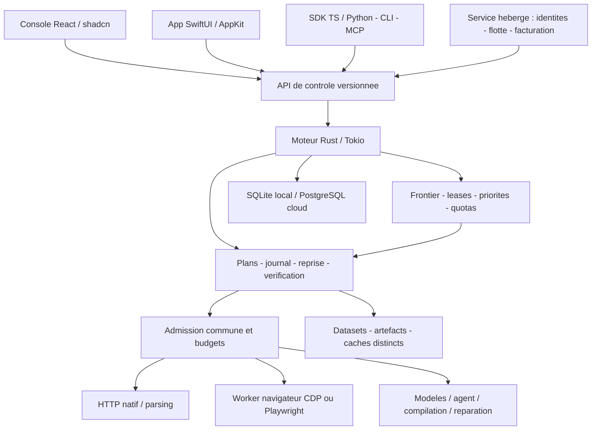

# Automan : proposition de framework et de plateforme

**Dossier de conception du 7 octobre 2026. Statut : proposition.** Aucun moteur Automan, service hébergé ou benchmark Automan n'est encore implémenté. La maquette jointe illustre le produit avec des données simulées.

## 1. Direction recommandée

Construire **un moteur d'automatisation web commun, avec une frontier de crawl durable, plusieurs moyens d'accès au site, des plans réutilisables et une vérification explicite des résultats**. Ce moteur sert la console web, les SDK, la CLI, MCP, l'app macOS et le service hébergé.

La consolidation recherchée est la réunion des capacités et de leurs contrats, plutôt qu'une fusion des dépôts Crawlee, Spider et Stagehand. Ces projets ont des modèles d'état, de reprise et de sessions différents ; empiler leurs schedulers et leurs caches introduirait des responsabilités concurrentes. Le détail des différences vérifiées est dans les matrices de [collecte](../research/2026-10-07-crawl-capability-matrix.md) et d'[automatisation/agents](../research/2026-10-07-agent-capability-matrix.md).

**Choix proposés : Rust + Tokio pour le moteur ; HTTP natif et Chromium/CDP pour l'exécution ; Playwright pour la référence et les capacités de compatibilité ; TypeScript et Python pour les SDK ; React/shadcn pour le web ; SwiftUI/AppKit pour macOS.** Rust et CDP se complètent : le premier est un langage/runtime hôte, le second un protocole de pilotage du navigateur. Ni ce choix ni les recherches ne démontrent une supériorité de performance Automan.

L'ambition produit inclut l'ensemble des fonctions demandées. Les étapes de développement sont ordonnées par dépendance et preuve, sans hypothèse de petite équipe ni échéance arbitraire.

## 2. Ce que prendre chez chaque référence

| Référence | Mécanismes pertinents | Consolidation proposée | Limite à corriger ou qualifier |
| --- | --- | --- | --- |
| Crawlee | Frontier, autoscaling, pools, routage, sessions, proxies, stockage, crawling adaptatif | Orchestration générale et contraintes de ressources ; comparaison HTTP/navigateur fondée sur le résultat | Résultats et acquittement ne forment pas automatiquement une transaction ; custom handlers réexécutables ; intégration Stagehand publiée encore liée à v3 |
| Spider-rs | Chemin HTTP natif, crawling concurrent, streaming, découverte, politiques réseau, rendu à la demande | Collecte légère, parsing et flux bornés ; workers proches du navigateur | Disque de visites ≠ frontier durable ; qualité HTML ≠ correction métier ; autoscaling de ressources à construire/qualifier |
| Stagehand v4 | Primitives naturelles et déterministes, observations, plans d'actions, placement près de Chrome, batching | API `observe/act/extract`, décisions amorties, opérations groupées côté worker | Cache cloud ≠ cache local portable ; résolution de cible ≠ preuve de résultat ; couverture du pilote différente de Playwright |
| Playwright | Locators, actionability, attentes, événements, frames, téléchargements, réseau, moteurs multiples | Suite de conformité et backend de compatibilité | Une connexion CDP externe n'a pas la même fidélité que son protocole propre ; coût d'un worker Node à mesurer |
| Scrapy / Colly / StormCrawler | Frontier, politiques de crawl, pipelines, throttling, stockage/distribution | Complétude, politeness, règles de découverte, reprise et pipelines | Leur architecture ne doit pas imposer un cluster aux usages locaux |
| Browser Use / Skyvern / Magnitude | Boucles d'agent, perception multimodale, workflows, décisions réutilisées | Agent facultatif, décisions typées, escalade DOM → modèle → vision | Prompts, modèles et décisions ont un coût ; validation d'un modèle ≠ vérité indépendante |
| Scrapling / Imprint / OpenAdapt Flow | Localisation adaptative, enregistrement, replay, preuves et tests de dérive | Autoréparation versionnée, trace causale, plans paramétrés et tests | Heuristiques de similarité ≠ probabilité ; généralisation et maturité à démontrer |
| Crawl4AI / Firecrawl / Katana | Extraction de contenu, formats, dispatch, découverte de liens/API | Markdown/HTML/JSON, extraction par règles ou modèles, découverte avancée | Distinguer SDK, moteur open source et fonctions de service propriétaire |

Sources et versions détaillées : [comparaison inspectée](../research/2026-10-07-stagehand-crawlee-spider-comparison.md), [contrats Crawlee/Spider](../research/2026-10-07-crawlee-spider-contracts-followup.md), [contrats Stagehand/alternatives](../research/2026-10-07-stagehand-alternatives-followup.md), [paysage commercial](../research/2026-10-07-commercial-landscape.md). Ce paysage répertorie 64 acteurs/familles de produits ; il ne constitue pas une vérification exhaustive de chaque fonction de chaque acteur. Les matrices complètent le catalogue par les mécanismes qui influencent la conception.

## 3. Architecture d'ensemble

Le noyau commence comme **un ensemble de modules dans un exécutable**, avec un processus navigateur séparé et des workers isolés lorsque nécessaire. Le cloud ajoute gestion de flotte, multi-tenant et exploitation. Il utilise la même sémantique d'exécution. Les SDK ne réimplémentent pas le scheduler ou la réparation.

Les quatre formes d'automatisation sont des politiques explicites d'un même moteur :

1. **Déterministe** : requêtes, sélecteurs, étapes et validations déclarés ; aucun modèle nécessaire.
2. **Assistée par IA** : une instruction résout une cible ou une extraction précise ; l'appel et son coût sont visibles.
3. **Agent** : une boucle choisit ses prochains outils avec limites et état terminal vérifié ; elle peut être externe.
4. **Compilation et réparation** : une démonstration ou un agent produit un plan paramétré, qualifié puis rejoué ; la dérive déclenche une réparation contrôlée.

Le chemin connu utilise le moyen suffisant : API autorisée ou HTTP, navigateur déterministe, résolution sémantique, puis agent/vision lorsque requis. Il s'agit d'une politique de coût et de capacité, pas d'un ordre universel : un workflow authentifié connu peut aller directement au navigateur.

## 4. Choix techniques et alternatives

| Décision proposée | Pourquoi dans ce produit | Alternative réelle et condition de réexamen |
| --- | --- | --- |
| Moteur canonique Rust/Tokio | Bibliothèque et binaire distribuables, ressources maîtrisées, sémantique commune aux clients | TS/Node est très viable pour Playwright et extensions ; le choisir si maintenance du pilote natif domine sans avantage utile mesuré |
| Chromium/CDP natif + backend Playwright | Chemin natif pour HTTP/Chrome, référence robuste pour les interactions et compatibilité | Extension comme runtime principal, à la Stagehand, si ses gains de placement justifient lifecycle/distribution et limites Chromium |
| Rust worker près de Chromium | Limiter les allers-retours distants et réutiliser les sessions | SDK pilotant directement chaque clic distant : simple mais coût RTT à mesurer ; un petit helper de page/extension peut grouper le travail sans devenir un second moteur |
| SQLite local, PostgreSQL cloud | Transaction sur état, résultat et acquittement ; leases inspectables | Broker spécialisé si la capacité mesurée ou la topologie l'exige ; un broker n'est pas une seconde source de vérité |
| Console React/shadcn avec Vite | Console opérationnelle servie localement et en cloud, contrat API commun sans besoin de SSR | Next.js pertinent pour site public/docs, SSR/BFF justifié ou export statique ; aucun moteur de crawl dans le frontend |
| App macOS SwiftUI/AppKit, daemon séparé | Interface réellement native, moteur partagé et isolation du lifecycle | FFI Rust si une mesure justifie IPC ; WebView/Tauri ne satisfait pas seul l'objectif d'interface native |
| Apache-2.0 proposé pour le framework | Adoption des développeurs et construction de services autour | Copyleft possible si l'objectif de diffusion change ; les dépendances gardent leurs licences propres |

Les décisions sont détaillées dans [l'architecture](architecture.md) et les [options de plateforme sourcées](../research/2026-10-07-product-platform-options.md). Le choix Rust précédent reste un [ADR proposé](../adr/0001-runtime-language.md), développé ici. Il n'existe pas de consensus universel établi sur le « meilleur langage ».

## 5. L'API et l'expérience produit

L'API donne un usage court pour l'extraction ponctuelle et des contrôles précis pour la production : même session, même run, mêmes traces. Une URL, un schéma et une politique suffisent au cas simple ; un workflow versionné fixe découverte, étapes, validation et budgets pour le cas récurrent. Les instructions en langage naturel restent une option explicite, pas une condition de chaque opération.

La console permet de créer, tester, exécuter et diagnostiquer avant d'ouvrir les paramètres avancés. Son objet central est le **run avec sa chronologie, ses données et ses preuves**. Les pools et workers ont des vues dédiées à l'exploitation ; les éléments internes du driver ne sont pas montrés dans le parcours de création. [Contrats et exemples d'API](api.md), [design des interfaces](product-design.md), [maquette interactive](design/automan-console.html).

Le PRD sera rédigé après les décisions du [plan R&D](../plan/rd-plan.md). Le [glossaire](../../GLOSSARY.md) évite notamment de confondre workflow, run, agent, pool et session.

La **documentation complète est un livrable du développement**, à produire avec chaque capacité : quickstarts, concepts, guides, références exhaustives, exemples, exploitation, migration et diagnostic. Son [plan de couverture](documentation-plan.md) décrit le travail futur ; les exemples du présent dossier restent des propositions d'API.

## 6. La différenciation à construire

Les concurrents possèdent déjà plusieurs mécanismes recherchés : HTTP adaptatif, cache d'actions, code caching, agents, auto-localisation et replay. Automan doit rendre leur réunion plus utile :

- **Une seule sémantique locale/cloud** : portabilité des plans, résultats, sessions autorisées et diagnostics.
- **Fiabilité observable** : erreur de complétude ou d'identité détectée même sans exception ; aucun succès annoncé pour un effet inconnu.
- **IA amortie** : création et réparation coûtent ; les replays connus restent déterministes et sont instrumentés.
- **Pilotage des ressources commun** : CPU, mémoire, HTTP, navigateurs, requêtes par domaine, tokens et budgets ne se concurrencent pas dans des schedulers cachés.
- **Adoption agentique simple** : outils typés, CLI JSON, MCP standard, schémas et capacités négociés, résultats paginés/référencés.

Ce sont des objectifs de conception, pas encore un avantage établi. La mesure principale sera le coût et la latence par résultat **réellement vérifié**, avec la couverture, la fraîcheur et les échecs publiés. [Protocole de preuve existant](../research/2026-10-07-benchmark-and-runtime.md), [gates de promotion](../plan/rd-plan.md#7-gates-de-promotion-sans-chiffres-inventés).

## 7. Framework ouvert et services monétisables

Le framework ouvert contient l'exécution utile : frontier durable, HTTP/navigateur, pools, plans, agents facultatifs, réparation, CLI/MCP, stockage local, instrumentation et exécution de workers autohébergés. Les fonctions fondamentales ne nécessitent pas une clé cloud Automan. Les modèles et proxies peuvent être apportés par l'utilisateur.

Le service vend l'exploitation : navigateurs et workers hébergés, scheduling récurrent, stockage et rétention, proxies intégrés, distribution géographique, gestion d'organisations et d'identités, capacité réservée, diagnostics conservés, intégrations et maintenance des workflows. Un registre/marketplace de packages peut ensuite distribuer des automatisations versionnées ; chaque package déclare ses entrées, sorties, capacités et coûts.

La facturation doit exposer les ressources réellement consommées, y compris échecs et réparations : unités de worker, secondes de navigateur, trafic/proxy, stockage et consommation de modèle séparables. Vendre des « résultats vérifiés » peut constituer une offre métier après définition du validateur et de la complétude ; ce n'est pas une unité universelle adaptée à tous les crawls. Aucun prix ou marge n'est calculable avec les seules recherches actuelles.

## 8. Ordre concret de construction

1. **Console web et première boucle réelle** : créer un workflow HTTP, obtenir un run durable, inspecter résultats/traces, arrêter/reprendre et exporter. Le vertical slice comprend déjà le moteur et son API.
2. **Frontier, pools et workers complets** : reprise après crash, sessions, proxies, concurrence et autoscaling, stockage et pipelines.
3. **Navigateur déterministe** : actionability, réseau, frames, téléchargements, contextes et qualification CDP/Playwright.
4. **Primitives IA et agents** : observe/act/extract, multimodalité, outils externes, quotas, caches et évaluation.
5. **Plans compilés et autoréparation** : recorder, paramètres, validations, mutations de site, tests, canary et rollback.
6. **Parité des surfaces et cloud** : CLI/MCP précoce pour intégrer et tester ; macOS native après stabilisation des contrats ; flotte cloud, organisations, scheduling et facturation.

Ces lots peuvent se chevaucher lorsque leurs contrats sont stables. Le détail n'est pas une checklist de promesses : chaque capacité est livrée avec une preuve de comportement, et chaque adaptation de backend conserve ses limites visibles.

## 9. Vérification du dossier

Les contrats ont fait l'objet d'une revue indépendante et de corrections ; les liens internes et l'exemple JSON ont été contrôlés. La maquette a été inspectée dans un navigateur sur desktop et mobile, avec interactions simulées. Ces vérifications portent sur le dossier et le design ; la qualification du moteur reste à réaliser.
