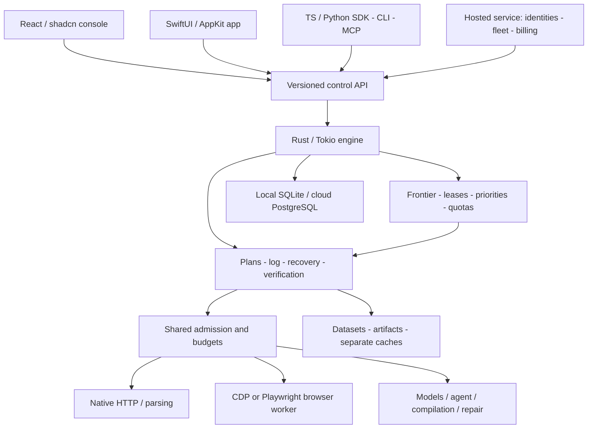

# Goodfetch: framework and platform proposal

**Design dossier of October 7, 2026. Status: proposal.** No Goodfetch engine, hosted service or Goodfetch benchmark is implemented yet. The attached mockup illustrates the product with simulated data.

## 1. Recommended direction

Build **a common web automation engine, with a durable crawl frontier, several means of accessing the site, reusable plans and explicit verification of results**. This engine serves the web console, the SDKs, the CLI, MCP, the macOS app and the hosted service.

The consolidation sought is the union of capabilities and their contracts, rather than a merger of the Crawlee, Spider and Stagehand repositories. These projects have different state, recovery and session models; stacking their schedulers and caches would introduce competing responsibilities. The details of the verified differences are in the [collection](../research/2026-10-07-crawl-capability-matrix.md) and [automation/agents](../research/2026-10-07-agent-capability-matrix.md) matrices.

**Proposed choices: Rust + Tokio for the engine; native HTTP and Chromium/CDP for execution; Playwright for the reference and compatibility capabilities; TypeScript and Python for the SDKs; React/shadcn for the web; SwiftUI/AppKit for macOS.** Rust and CDP complement each other: the first is a host language/runtime, the second a browser control protocol. Neither this choice nor the research demonstrates Goodfetch performance superiority.

The product ambition includes all the requested functions. The development stages are ordered by dependency and evidence, without assuming a small team or an arbitrary deadline.

## 2. What to take from each reference

| Reference | Relevant mechanisms | Proposed consolidation | Limitation to correct or qualify |
| --- | --- | --- | --- |
| Crawlee | Frontier, autoscaling, pools, routing, sessions, proxies, storage, adaptive crawling | General orchestration and resource constraints; HTTP/browser comparison based on the result | Results and acknowledgement do not automatically form a transaction; re-executable custom handlers; published Stagehand integration still tied to v3 |
| Spider-rs | Native HTTP path, concurrent crawling, streaming, discovery, network policies, on-demand rendering | Lightweight collection, parsing and bounded streams; workers close to the browser | On-disk visit record ≠ durable frontier; HTML quality ≠ business correctness; resource autoscaling to build/qualify |
| Stagehand v4 | Natural and deterministic primitives, observations, action plans, placement near Chrome, batching | `observe/act/extract` API, amortized decisions, grouped operations on the worker side | Cloud cache ≠ portable local cache; target resolution ≠ proof of result; driver coverage different from Playwright's |
| Playwright | Locators, actionability, waits, events, frames, downloads, network, multiple engines | Conformance suite and compatibility backend | An external CDP connection does not have the same fidelity as its own protocol; cost of a Node worker to be measured |
| Scrapy / Colly / StormCrawler | Frontier, crawl policies, pipelines, throttling, storage/distribution | Completeness, politeness, discovery rules, recovery and pipelines | Their architecture must not impose a cluster on local uses |
| Browser Use / Skyvern / Magnitude | Agent loops, multimodal perception, workflows, reused decisions | Optional agent, typed decisions, DOM → model → vision escalation | Prompts, models and decisions have a cost; a model's validation ≠ independent truth |
| Scrapling / Imprint / OpenAdapt Flow | Adaptive localization, recording, replay, evidence and drift tests | Versioned self-repair, causal trace, parameterized plans and tests | Similarity heuristics ≠ probability; generalization and maturity to be demonstrated |
| Crawl4AI / Firecrawl / Katana | Content extraction, formats, dispatch, link/API discovery | Markdown/HTML/JSON, rule- or model-based extraction, advanced discovery | Distinguish SDK, open-source engine and proprietary service functions |

Detailed sources and versions: [inspected comparison](../research/2026-10-07-stagehand-crawlee-spider-comparison.md), [Crawlee/Spider contracts](../research/2026-10-07-crawlee-spider-contracts-followup.md), [Stagehand/alternatives contracts](../research/2026-10-07-stagehand-alternatives-followup.md), [commercial landscape](../research/2026-10-07-commercial-landscape.md). This landscape lists 64 players/product families; it does not constitute an exhaustive verification of every function of every player. The matrices complement the catalog with the mechanisms that influence the design.

## 3. Overall architecture

The core starts as **a set of modules in one executable**, with a separate browser process and isolated workers when necessary. The cloud adds fleet management, multi-tenancy and operations. It uses the same execution semantics. The SDKs do not reimplement the scheduler or repair.

The four forms of automation are explicit policies of a single engine:

1. **Deterministic**: declared requests, selectors, steps and validations; no model needed.
2. **AI-assisted**: an instruction resolves a precise target or extraction; the call and its cost are visible.
3. **Agent**: a loop chooses its next tools with limits and a verified terminal state; it can be external.
4. **Compilation and repair**: a demonstration or an agent produces a parameterized plan, qualified then replayed; drift triggers a controlled repair.

The known path uses the sufficient means: authorized API or HTTP, deterministic browser, semantic resolution, then agent/vision when required. This is a cost and capability policy, not a universal order: a known authenticated workflow can go directly to the browser.

## 4. Technical choices and alternatives

| Proposed decision | Why in this product | Real alternative and condition for re-examination |
| --- | --- | --- |
| Canonical Rust/Tokio engine | Distributable library and binary, controlled resources, semantics shared by all clients | TS/Node is very viable for Playwright and extensions; choose it if maintenance of the native driver dominates without a measured useful advantage |
| Native Chromium/CDP + Playwright backend | Native path for HTTP/Chrome, robust reference for interactions and compatibility | Extension as the main runtime, à la Stagehand, if its placement gains justify the lifecycle/distribution and Chromium limits |
| Rust worker near Chromium | Limit remote round trips and reuse sessions | SDK directly driving each remote click: simple, but RTT cost to be measured; a small page helper/extension can group the work without becoming a second engine |
| Local SQLite, cloud PostgreSQL | Transaction over state, result and acknowledgement; inspectable leases | Specialized broker if measured capacity or topology requires it; a broker is not a second source of truth |
| React/shadcn console with Vite | Operational console served locally and in the cloud, common API contract with no need for SSR | Next.js relevant for a public site/docs, justified SSR/BFF or static export; no crawl engine in the frontend |
| SwiftUI/AppKit macOS app, separate daemon | Truly native interface, shared engine and lifecycle isolation | Rust FFI if a measurement justifies it over IPC; WebView/Tauri alone does not meet the native interface goal |
| Apache-2.0 proposed for the framework | Developer adoption and building services around it | Copyleft possible if the distribution goal changes; dependencies keep their own licenses |

The decisions are detailed in [the architecture](architecture.md) and the [sourced platform options](../research/2026-10-07-product-platform-options.md). The earlier Rust choice remains a [proposed ADR](../adr/0001-runtime-language.md), expanded here. There is no established universal consensus on the "best language".

## 5. The API and the product experience

The API provides short usage for one-off extraction and precise controls for production: same session, same run, same traces. A URL, a schema and a policy are enough for the simple case; a versioned workflow fixes discovery, steps, validation and budgets for the recurring case. Natural-language instructions remain an explicit option, not a condition of every operation.

The console makes it possible to create, test, run and diagnose before opening the advanced settings. Its central object is the **run with its timeline, its data and its evidence**. Pools and workers have dedicated operations views; the driver's internals are not shown in the creation flow. [API contracts and examples](api.md), [interface design](product-design.md), [interactive mockup](design/goodfetch-console.html).

The [glossary](../GLOSSARY.md) notably avoids confusing workflow, run, agent, pool and session.

The **complete documentation is a development deliverable**, to be produced with each capability: quickstarts, concepts, guides, exhaustive references, examples, operations, migration and diagnostics. Its [coverage plan](documentation-plan.md) describes the future work; the examples in this dossier remain API proposals.

## 6. The differentiation to build

Competitors already have several of the sought mechanisms: adaptive HTTP, action cache, code caching, agents, self-localization and replay. Goodfetch must make their combination more useful:

- **A single local/cloud semantics**: portability of plans, results, authorized sessions and diagnostics.
- **Observable reliability**: completeness or identity errors detected even without an exception; no success announced for an unknown effect.
- **Amortized AI**: creation and repair have a cost; known replays remain deterministic and are instrumented.
- **Shared resource control**: CPU, memory, HTTP, browsers, requests per domain, tokens and budgets do not compete in hidden schedulers.
- **Simple agentic adoption**: typed tools, JSON CLI, standard MCP, negotiated schemas and capabilities, paginated/referenced results.

These are design goals, not yet an established advantage. The main measure will be cost and latency per **actually verified** result, with coverage, freshness and failures published. [Existing evidence protocol](../research/2026-10-07-benchmark-and-runtime.md), [promotion gates](../plan/rd-plan.md#7-promotion-gates-without-invented-figures).

## 7. Open framework and monetizable services

The open framework contains the useful execution: durable frontier, HTTP/browser, pools, plans, optional agents, repair, CLI/MCP, local storage, instrumentation and execution of self-hosted workers. The fundamental functions do not require a Goodfetch cloud key. Models and proxies can be brought by the user.

The service sells operations: hosted browsers and workers, recurring scheduling, storage and retention, integrated proxies, geographic distribution, organization and identity management, reserved capacity, retained diagnostics, integrations and workflow maintenance. A package registry/marketplace can then distribute versioned automations; each package declares its inputs, outputs, capabilities and costs.

Billing must expose the resources actually consumed, including failures and repairs: worker units, browser seconds, traffic/proxy, storage and model consumption, each separable. Selling "verified results" can constitute a business offering once the validator and completeness have been defined; it is not a universal unit suited to all crawls. No price or margin can be calculated from the current research alone.

## 8. Concrete build order

1. **Web console and first real loop**: create an HTTP workflow, obtain a durable run, inspect results/traces, stop/resume and export. The vertical slice already includes the engine and its API.
2. **Complete frontier, pools and workers**: recovery after a crash, sessions, proxies, concurrency and autoscaling, storage and pipelines.
3. **Deterministic browser**: actionability, network, frames, downloads, contexts and CDP/Playwright qualification.
4. **AI primitives and agents**: observe/act/extract, multimodality, external tools, quotas, caches and evaluation.
5. **Compiled plans and self-repair**: recorder, parameters, validations, site mutations, tests, canary and rollback.
6. **Surface parity and cloud**: early CLI/MCP for integration and testing; native macOS after the contracts stabilize; cloud fleet, organizations, scheduling and billing.

These batches can overlap when their contracts are stable. The detail is not a checklist of promises: each capability is delivered with behavioral evidence, and each backend adaptation keeps its limits visible.

## 9. Dossier verification

The contracts underwent an independent review and corrections; the internal links and the JSON example were checked. The mockup was inspected in a browser on desktop and mobile, with simulated interactions. These checks concern the dossier and the design; the engine's qualification remains to be done.
