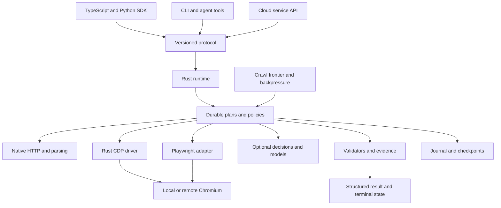

# Automan — market research and recommended direction

**State as of October 7, 2026.** The user has withdrawn the initial assumption "small team, first product in 3–6 months". The current recommendation targets an ambitious architecture with a strong AI-assisted implementation capacity; the initial timeline no longer constrains the choices. This study extends the attached context and existing research; it does not turn earlier leads into decisions already made.

**Deep dive:** the [Stagehand, Crawlee and Spider-rs comparison](2026-10-07-stagehand-crawlee-spider-comparison.md) details the contracts of the published versions, the alternatives, the verified Reddit testimonies and the limits of the benchmarks. It keeps the ambitious target and refines the validation, caching and resumption requirements.

## Recommended decision

Build **an open source web execution engine in Rust, shared by crawling, workflows and agent tools**, whose contract is: portable recipe, deterministic execution when sufficient, use of models when necessary, checked result, explicit error and observable cost.

I recommend **an autonomous Rust runtime, a common protocol and TypeScript/Python SDKs**, Chromium driven over CDP through a qualified dependency, a native HTTP path, a durable plan executor and a separate crawling orchestration. Add a Playwright adapter for compatibility and reliability comparison. The CLI and the cloud consume the same engine. Go and native bindings remain possible extensions, without becoming competing implementations of the runtime.

Rust is chosen here for distributing an autonomous engine, sharing across languages and controlling resources. **Its overall speed superiority is not established.** The priority performance investments remain selecting the means of access, eliminating repeated decisions, execution proximity and session management.

This recommendation is a design and product judgment, not an experimental conclusion. No Automan performance advantage has been measured yet. The ideas of caching, replay, repair and validation already exist at several competitors, including open source ones. The commercial opportunity will depend on the first workflows actually maintained, ease of adoption and comparative evidence.

## 1. What the market actually sells

The references cited by the user occupy different layers. A cloud browser, an agent framework and a collection platform can cooperate within the same product. A public SDK does not mean the service is open source.

| Layer | Function | Examples | Consequence for Automan |
| --- | --- | --- | --- |
| Browser and protocol | Run JS, manage pages, events and input | Chromium, Playwright, Puppeteer, CDP, BiDi, Lightpanda | Reuse a proven substrate; isolate the dependency on its API. |
| Agent primitives | Observe, act, extract, expose tools | Stagehand, Browser Use, agent-browser, Playwright MCP, AgentQL | Highly competitive offering; good compatibility required. |
| Agent and workflows | Plan, keep context, replay, repair | Browser Use, Skyvern, Airtop, Anchor, OpenAdapt | Reuse of decisions and repair are becoming ordinary expectations. |
| Crawling and acquisition | Discover, schedule, deduplicate, render and store | Crawlee, Scrapy, Spider, Crawl4AI, Firecrawl, Scrapling | Many building blocks available; compare their adaptive modes. |
| Access infrastructure | Hosted browsers, proxies, sessions, anti-bot | Browserbase, Browserless, Steel, Bright Data, Oxylabs, Zyte, ZenRows | Buy or allow integration before operating one's own infrastructure. |
| Data product | Provide a useful, maintained dataset | Apify Actors, Kadoa, Diffbot, managed services | The billable value often lies in the result and its upkeep. |

This classification is an analysis grid. The detailed characteristics and official sources for each player are in [the commercial landscape](2026-10-07-commercial-landscape.md), [the browser frameworks study](2026-10-07-browser-frameworks.md) and [the collection engines study](2026-10-07-crawl-engines.md).

**Coverage:** four research axes, 441 Exa results requested in total (96 + 110 + 80 + 155), with duplicates and discarded results; this counter is not a number of validated independent sources. The commercial landscape consolidates 64 players/products/families, including one discontinued reference. The technical reports add libraries and niches. The conclusions rest on the cited primary sources, code inspections and published versions; no service was benchmarked in production.

## 2. Findings that change the decision

### Stagehand v4 is a serious architecture to study

The runtime runs in a Chrome extension; the SDKs share an RPC protocol. The AI primitives integrate with deterministic operations and external orchestration. The v4 migration removes the old `agent()` API; confusing v3 and v4 skews a comparison. [v4 architecture](https://www.browserbase.com/blog/stagehand-v4), [protocol](https://github.com/browserbase/stagehand/blob/main/packages/protocol/README.md), [v3 to v4 migration](https://docs.stagehand.dev/v4/migrations/v3).

Stagehand already has concurrency across tabs, browser management, some resumption mechanisms and a cache for eligible calls. These functions must be distinguished from a persistent crawling queue and from resuming a complete job. The documented cache depends on a Browserbase session. [Multi-tabs](https://docs.stagehand.dev/v4/best-practices/using-multiple-tabs), [act](https://docs.stagehand.dev/v4/basics/act), [cache](https://docs.stagehand.dev/v4/best-practices/caching).

**Implication:** batched commands close to the browser and SDKs in several languages are avenues already invested in. Evaluating what is actually missing on a customer workflow is more useful than copying the `act/observe/extract` surface. The proposed Rust must keep the proximity advantages that an extension already has, notably by placing the cloud worker close to the browser and batching independent operations when that is correct.

### Rust and replay are already present at competitors

Browser Use introduced a beta Rust agent and a native core in its version 0.13.0; its terminal repository offers a JSON-RPC/stdio SDK server. agent-browser now has a native Rust daemon. These are architectural facts, not proof that these projects win every comparison. [Browser Use 0.13.0 release](https://github.com/browser-use/browser-use/releases/tag/0.13.0), [terminal](https://github.com/browser-use/terminal), [agent-browser](https://github.com/vercel-labs/agent-browser).

Skyvern describes generating and reusing scripts by blocks with AI fallback; Anchor describes a fallback during the run and a repaired version after the failure; Airtop sells compiled agents. The current state of Browser Use must be read in its versioned docs: the old skills product is not a contract to rebuild from obsolete pages. [Skyvern code caching](https://www.skyvern.com/docs/developers/features/code-caching), [Anchor](https://docs.anchorbrowser.io/advanced/self-healing), [Airtop](https://www.airtop.ai/agent-builder), [Browser Use scripts](https://docs.browser-use.com/cloud/agent/scripts).

OpenAdapt Flow presents itself as a beta engine for governed local replay and effect verification; FlowReplay offers a portable format and multi-locator replay, still alpha. These niche projects count in the competition even if their maturity and adoption are not those of a large platform. [OpenAdapt](https://github.com/OpenAdaptAI/openadapt-flow), [FlowReplay](https://github.com/kuilenren/flowreplay).

**Implication:** "Rust + cache + self-healing + proof" is not enough to establish differentiation. One must deliver a better-qualified combination for a precise need and prove that it installs, integrates and is maintained more easily.

### Adaptive collection already exists

Crawlee has an adaptive HTTP/Playwright crawler. Its selection model and the validation of its extraction deserve examination rather than a simple "browser or not" checkbox. Spider also has smart crawling mechanisms, with different logic. Their adaptive modes are not interchangeable and do not automatically verify the business objective of a collection. [Crawlee AdaptivePlaywrightCrawler](https://crawlee.dev/js/api/playwright-crawler/class/AdaptivePlaywrightCrawler), [Spider](https://github.com/spider-rs/spider).

The inspected published `@crawlee/stagehand` adapter depends on Stagehand v3: its existence does not demonstrate v4 compatibility. A `Page` is not a universal object across these runtimes. [Adapter package](https://github.com/apify/crawlee/blob/master/packages/stagehand-crawler/package.json), [Stagehand migration from Playwright](https://docs.stagehand.dev/v4/migrations/playwright).

**Implication:** separate workflow control and the collection scheduler. The adaptive handler can be replayed to compare results; it must not become a blind resumption loop for external actions.

### Cost depends on the whole service

Providers bill by different units: browser time, CPU, credits, proxy traffic, requests or actor resources. Minimums, inclusions and additional line items prevent ranking offers by a single displayed price. Some official pages even present contradictory amounts. The recorded values and ambiguities are kept in the commercial report, without misleading conversion into a universal cost per task. [Browserbase pricing](https://www.browserbase.com/pricing), [Apify pricing](https://apify.com/pricing), [Spider pricing](https://spider.cloud/pricing), [ScrapingBee pricing](https://www.scrapingbee.com/pricing/).

**Implication:** measure browsers, models, traffic, resumptions and maintenance. Billing "per successful result" is only viable if the result, the validator and the resumption limits are contractually defined.

## 3. The positioning to test and the overall ambition

**Proposition:** "Automan lets developers turn a recurring web collection into a portable, observable and maintainable recipe, with quality control of the results."

The first commercial validation segment is **B2B SaaS teams and integrators who maintain data flows from supplier, distributor or partner portals**. It provides concrete ground to qualify the general engine; it does not limit its APIs to catalog scraping. This segment is a commercial hypothesis: no customer interview or willingness to pay was verified during this research.

Three demonstration and pilot workflows:

1. Logging into an authorized portal, downloading an export and checking the number of rows, the period and the account.
2. Collecting a paginated catalog, extracting price/stock/references, normalizing and detecting partial results.
3. Comparing two collections, producing a structured change with sources and keeping the history.

Use a documented API when it is sufficient. The browser remains available for the parts that require it. The first version can handle navigation, filters and search while limiting business effects to read and download operations.

This choice meets four sought-after characteristics: frequent repetition, checkable result, identifiable maintenance cost and the possibility of selling an assisted integration. There are competitors in this segment, notably data platforms and managed repair offerings. Kadoa already describes quality, provenance and pipeline repair; merely claiming these features does not create a new category. [Kadoa](https://www.kadoa.com/).

The advantage to build would be a demonstrated developer experience and economics: the same project runs locally or at a chosen host; the deterministic path works without a model; the customer sees what was extracted, what is missing and what a repair changes; recipes can be versioned and maintained with their code. This remains a product intention until validated.

## 4. Recommended target architecture

| Runtime location | Architectural advantage | Work or limit to qualify |
| --- | --- | --- |
| Chrome extension, like Stagehand | Operations close to the browser, JS helpers and clients in several languages | Extension installation/lifecycle and Chromium scope; durable orchestration requires another responsibility. |
| **Autonomous Rust process — proposed choice** | Same library/binary engine, CLI/SDK/cloud, shared resources and contracts | Distribution, process management, IPC, cancellation and driver; batch and colocate so as not to lose latency. |
| napi-rs/PyO3 bindings | Embedded calls to the engine and direct access to structures | Per-language interfaces and lifecycles, ABI/wheels distribution and fault isolation; value to be measured for the intended use. |
| TypeScript/Playwright runtime | Already proven browser behaviors and integration with the ecosystem | Very good baseline; presence of a Node runtime to accept and multi-language boundaries to define. |

This comparison describes trade-offs, not a performance ranking. The autonomous target is chosen for product unity and distribution. A perception/batching extension can remain complementary without becoming the owner of durable state.

### Runtime: owning the recipe and its result

The Automan code to build covers a versioned sequence, its state, its parameters, its observations, validation and repair. The Rust runtime executes an inspectable intermediate representation: sequence, branch, bounded loop, independent parallelism, wait, extraction, checkpoint and effect operations. A plan must not be a succession of coordinates or a stale result cache.

A JSON manifest describes identity, version, parameters, output schema, authentication requirements, budgets, capabilities and resumption policy. A step has preconditions, a target resolved at action time, postconditions and a classification of its effect. TypeScript/Python code is an authoring or extension surface, not a copy of the executor.

The first intermediate representation must have few, well-specified constructs. Extend these constructs when a workflow requires it, rather than claiming that a compiler turns any arbitrary code into a safe plan. A recorder, a developer or a model can produce the same type of plan; these sources do not bring the same guarantees and remain traced.

Public browser objects are Automan references and capability contracts. A Playwright `Page` can exist inside its adapter, without being promised as an object interchangeable with the Rust driver. Defining a recipe's requirements makes it possible to reject an incapable backend before execution.

The proposed end states: `verified`, `failed`, `partial`, `needs_review`, `effect_unknown`. The engine must not turn the absence of an exception into business success. For important fields, keep the source, date, locator or proof of origin and validation method. Complete provenance does not, by itself, establish the truth of a piece of data.

### Acquisition: choosing the sufficient means

Two reference paths: native HTTP for accessible content and extraction; Chromium via CDP for the necessary interactions and rendering. The choice can be explicit or provided by a policy that knows the site, the account, the route and the expected result. A site known to require JS can start directly in the browser; a systematic HTTP-then-Chrome fallback is not always the fastest path.

An adaptive policy learns with validations and read-only trials, on the model of Crawlee's compared results. Also keep content heuristics, like Spider, to discover cases with no history. The API/HTTP/browser route is chosen according to cost and the probability of a valid result, with a risk limit set by the workflow. A stable, authorized API remains the priority when it is sufficient.

The standard HTTP transport can use Reqwest; impersonation and network profiles are an optional adapter to qualify, with building blocks such as Impit or wreq. The engine and SDKs must not impose this need on all consumers. [Spider RemoteFetcher](https://github.com/spider-rs/spider/blob/main/spider/src/fetcher.rs), [Impit](https://github.com/apify/impit).

Make room for authorized structured network responses when they constitute a reliable source. Automatically turning every observed endpoint into a stable API would be risky: tokens, pagination, permissions, mutations and contract changes require qualification.

The browser and the model are adapters. The runtime can launch locally and connect to the cloud; each announced mode must pass the contract tests corresponding to the promised capabilities. Lightweight rendering, notably Lightpanda, constitutes a future third backend for the corpus that supports it, with Chromium fallback; its lack of graphical rendering and its license prevent making it an implicit universal substitute. [Lightpanda](https://github.com/lightpanda-io/browser).

### Rust driver: Chromey as candidate, Playwright as independent reference

**First candidate to qualify: Chromey**, a fork of Chromiumoxide maintained by the Spider ecosystem, under `MIT OR Apache-2.0` in its manifest. Pin a release and encapsulate its types. Compare against upstream Chromiumoxide and the public native driver of Browser Use/agent-browser on Automan's needs; a repository's activity does not prove its superiority. Reusing libraries or contributing upstream is preferable to taking over the whole Spider crawler with its feature branches. [Chromey](https://github.com/spider-rs/chromey), [manifest](https://github.com/spider-rs/chromey/blob/main/Cargo.toml), [Chromiumoxide](https://github.com/mattsse/chromiumoxide).

A CDP driver's `Element::click` path does not constitute the whole Playwright contract. Automan must qualify late locator resolution, uniqueness, visibility, enablement, stability, hit-testing, navigation, cross-origin frames/OOPIF, shadow DOM, dialogs, downloads and cancellation. [Playwright contract](https://playwright.dev/docs/actionability).

Chromey also exposes `Content` and `WebMCP` as **non-standard** CDP domains present on certain remote engines. Their existence in the library does not attest to their availability on local Chrome. Announce them only after capability negotiation; do not confuse them with a WebMCP standard guarantee. [Content](https://github.com/spider-rs/chromey/blob/main/src/content_markdown.rs), [WebMCP](https://github.com/spider-rs/chromey/blob/main/src/webmcp.rs).

agent-browser already contains Rust handling of OOPIF sessions, mapping and hit-testing that deserves a reuse study; these are CLI runtime modules, not a small interchangeable CDP crate. The browser crate of Browser Use Terminal is also coupled to workers, including Python ones. Adapting a qualified release or extracting a component with a clear contract limits the cost of a full fork. [agent-browser browser](https://github.com/vercel-labs/agent-browser/blob/main/cli/src/native/browser.rs), [element](https://github.com/vercel-labs/agent-browser/blob/main/cli/src/native/element.rs), [Browser Use browser crate](https://github.com/browser-use/terminal/blob/main/crates/browser-use-browser/src/lib.rs).

A **Playwright adapter** enables existing integrations and constitutes a conformance baseline. The same session must not be driven simultaneously by two owners of its lifecycle. Each session chooses a backend; changing backend is an explicit transition with supported state transfer, or a new session.

The goal of Rust is a complete, reusable and controlled engine. As long as functions are not qualified, announce their status and keep the proven backend for the workflows concerned. This preserves the ambition without inventing parity.

### Orchestration: a crawl frontier distinct from the executor

The Rust scheduler covers URL frontier, deduplication, per-domain limits, budgets, backpressure, request leases, retries and progressive data emission. The plan executor keeps its own step guarantees. A task "download this export in this account" works without a full site crawler.

Draw inspiration from the frontiers of Crawlee and Scrapy and evaluate Spider as an optional crawling backend. A Crawlee integration on the TypeScript side remains possible: in that case its queue owns the requests and Automan executes the plans. The same request is not orchestrated by two persistent schedulers. [Crawlee](https://crawlee.dev/js/docs/introduction), [Scrapy scheduler](https://github.com/scrapy/scrapy/blob/master/scrapy/core/scheduler.py), [Spider](https://github.com/spider-rs/spider).

Locally, SQLite is a proposed choice for journal, checkpoints and recipe index, with datasets/artifacts in files. For a multi-worker cloud, separate the control plane, job scheduling and workers; PostgreSQL and object storage are conventional choices to qualify. Workers keep the same Rust executor. This architecture does not imply an exactly-once guarantee on the effects on a third-party site.

| Responsibility | Proposed authority |
| --- | --- |
| Job, resource allocation and worker lease | Scheduler/control plane; no implicit replay of a mutation on renewal. |
| Global deadline, plan attempt, budget and checkpoint | Rust runtime. |
| Resolution/action of a step and confirmation of its effect | Rust step executor, following the plan's policy. |
| Browser lifecycle, events and protocol requests | One browser worker/backend per session. |
| Transport or model retries | Adapter, within the granted budget and with attempts reported to the runtime. |
| Requests of a delegated collection | Automan frontier or the queue of the chosen external framework, never both for the same request. |

An adapter does not independently replay an effectful action after a timeout. The `effect_unknown` state goes up to the executor, which applies verification, abstention or authorized resumption. If a new backend is launched after an uncertain click, this change does not make the uncertainty of the previous effect disappear.

Bounded concurrency and per-domain limits; sessions reused under the same identity; no automatic sharing between tenants or accounts. Operations depending on a page's state remain ordered. Worker/browser proximity and keeping sessions alive can matter more than the SDK's serialization speed.

### Models: optional, replaceable and budgeted

A healthy, deterministic recipe can run with zero model calls. Use a model to help produce an extraction or a recipe, resolve an ambiguity or propose a repair. The first adapter can rely on a proven structured generation API; avoid a provider matrix before real demand.

Repair creates a new candidate version, subject to its validations and the workflow's non-regression tests. Define what can be activated automatically for read workflows; request a review according to the user's policy when the effect or the target cannot be verified. An explicit abstention is preferable to a false success, but its rate must be measured. Closed-set decisions, small selection models, text LLMs and vision can form distinct escalation levels; compare their cost and error instead of imposing a fixed cascade on all tasks.

Jev is a lead for a decision provider, not a mandatory foundation. The Stagehand PRs studied were open and unmerged at verification time; their figures are not reproduced performance. Keeping a decision interface makes it possible to evaluate this type of model later. [PR 3103](https://github.com/browserbase/stagehand/pull/3103), [PR 2953](https://github.com/browserbase/stagehand/pull/2953).

### Distribution: one canonical engine and idiomatic clients

The SDK launches a precompiled binary when no engine is connected, keeps the process during the session and communicates over bidirectional JSON-RPC/stdio. Remote mode uses the same contract over a secure network transport. Messages carry IDs, version, capabilities, budgets, cancellation and terminal state. Clients do not need to install Cargo on supported platforms.

Derive the data models from a shared schema and write idiomatic APIs per language. Large artifacts go through references or a bounded stream, with backpressure, rather than repeated copies of captures in JSON. Model callbacks provided by the host require correlated, reentrant RPCs; a cancellation or a failure must unblock both sides.

**Reference SDKs: TypeScript and Python**, with a JSON/MCP CLI on the same engine. Go comes next without reimplementing the decisions or the driver. napi-rs/PyO3 bindings can be evaluated for embedded uses; they are not necessary for the initial contract of the autonomous runtime.

Add MCP if pilot users need it. Microsoft also recommends a CLI + skills approach for some development agents, while MCP remains suited to loops that benefit from a persistent session. The choice depends on the consumer. [Playwright MCP](https://github.com/microsoft/playwright-mcp).

The macOS application and a web builder become clients of the engine, with recipe inspection, visual selection, traces and repairs. The cloud provides managed sessions, scheduling, teams and observability. They share the execution contract rather than carrying their own browser logic.

## 5. Features and build order

| Priority | Feature | Completion criterion |
| --- | --- | --- |
| P0 | Rust runtime and protocol | Autonomous library and binary, TS/Python SDK, explicit cancellation and sessions. |
| P0 | Parameterized, versioned recipe | Local and CLI execution, structured errors, inspectable plan. |
| P0 | CDP navigation/interactions | Tested action contract; qualified capabilities and Playwright backend available. |
| P0 | Typed extraction | Schema, deterministic normalization and distinction between absent field and null value. |
| P0 | Completeness check | Pagination, duplicates, account, period and business rules of each pilot. |
| P0 | Sessions and resumption | User-provided authentication, detected expiration and secrets outside the recipe. |
| P0 | Execution report | Status, relevant evidence, steps, durations, model cost and failure causes. |
| P0 | Optional AI | Production/assistance of a recipe and bounded fallback; healthy path without AI. |
| P0 | Corpus and reference recipes | Reproducible fixtures, extraction/actions/agents workloads and real pilots. |
| P0 | HTTP and streaming | Native transport, parsing, memory limits and progressive data production. |
| P1 | Crawl scheduler | Durable frontier, deduplication, fairness and budgets; one authority for requests. |
| P1 | Crawlee/Spider integration | Optional adapter, ownership of queues and retries made explicit. |
| P1 | Candidate repair | Version comparison and tests before activation. |
| P1 | API/HTTP/browser routing | Verified result, learned cost and observable selection reasons. |
| P1 | Cloud execution | Same runtime contract, isolation and measured costs. |
| P1 | Agent/MCP adapter | Leads to a runtime session, without new parallel logic. |
| P2 | Rust optimizations and local models | Measured gain, full profile and maintained reliability. |
| P2 | Go and embedded bindings | Contract parity tests and qualified distribution cost. |
| P2 | Lightweight browser | Compatible corpus and qualified Chromium fallback. |
| P2 | Builder and native application | To be decided according to usage, after the framework stabilizes. |

The report interface, the visual recorder, a recipe library and the desktop/cloud surfaces are part of the ambition. Their build order follows the qualification of the execution contract. A marketplace and an in-house proxy network constitute distinct operational products; build them only when they bring demonstrated value compared with provider integrations.

## 6. Open source and services

**License proposal for the original Automan code: Apache-2.0**, with prior verification of dependencies and of what is actually redistributed. This proposal favors adoption in commercial products; it does not by itself protect against a provider that rehosts the code.

The published core should remain complete for its announced use: recipes, local execution, extraction, validation, reports, plugins and configurable repair. Paid offerings can cover onboarding, hosting availability, site monitoring, managed sessions, team features and agreed operational guarantees. Keeping the customer in control of their recipe strengthens trust, but requires offering a real operational service.

Beware of license classifications: several projects described commercially as "open source" or published on GitHub have restrictions or special clauses. The detailed notes distinguish engine, SDK and service licenses. Do not base a product on GitHub metadata without reading the applicable file. [Engines and licenses study](2026-10-07-crawl-engines.md).

Offerings to test, without setting a fictitious market price:

| Offering | What the customer buys | Commercial verification |
| --- | --- | --- |
| Initial integration | Recipe/connector, validation and going to production | A scope and a price agreed with a first customer. |
| Maintenance | Change monitoring, repair and response time | Measure the actual hours and the changes per site. |
| Managed cloud | Runs, sessions, traces, scheduling and operations | Compute total cost and margin before an unlimited flat rate. |
| Private deployment | Installation, operations and support | To be offered when a customer requests it and funds its cost. |

At first, a simple unit — execution with included limits and visible variable line items — can be more defensible than a universal price per business success. Billing per result becomes possible for a qualified connector, with its definition of success and the known cost of failure.

The accumulated know-how can reside in recipes, failure cases, validators, repair data and integration experience. Their use must respect customer data; synthetic fixtures and voluntary feedback can feed OSS quality. These are assets to build, not a competitive barrier already acquired.

## 7. Roadmap by validation gates

| Gate | Work | Deliverable and decision |
| --- | --- | --- |
| A — Contracts and evidence | Extraction, interaction, agent task corpus; baselines; interviews and pilots | Result, evaluation, frequency and budget defined before comparisons. |
| B — Substrates | Rust runtime, HTTP, CDP driver, Playwright adapter, protocol and SDKs | Action and capability suite; no parity announced without evidence. |
| C — Durable plans | IR, journal, sessions, deadlines, replay, validation and unknown effects | Crash/resumption and drift tested; one retry authority per level. |
| D — Adaptation | Compiler/recorder, routing, local cache, decision models and repair | Cost/quality comparison on separate data; repaired versions without measured regression. |
| E — Crawl at volume | Frontier, streaming, backpressure, workers and per-domain budgets | Throughput of valid results and footprint at constant resources. |
| F — Operations and services | Cloud, secrets, teams, scheduling, diagnostics, private installation | Same local/cloud contract, operating costs and connector upkeep measured. |
| G — Expansion | Go, desktop, builder, distributed recipes and lightweight engines | Usage value and compatibility established; extended public benchmark. |

These axes can be developed in parallel by agents from frozen contracts. The dependencies remain real: the SDKs depend on the protocol, the compiler on the step model, routing on output validation, and resumption on the effects contract. AI can speed up implementation and trials; qualification relies on observed executions and validators, never on the number of agents or the amount of code produced.

**Proposed product criterion:** useful, repeated and checked workflows; teams ready to pay for the service; reliability comparable to a good baseline; substantial measured gain in cost or latency on a declared scope. Development of the general framework can continue beyond the three pilots, but its commercial promises must remain tied to the qualified corpus.

## 8. How to demonstrate performance

The [benchmark and runtime](2026-10-07-benchmark-and-runtime.md) report defines workloads, metrics, full cost, perturbations and publication rules. It distinguishes learning and re-execution, static pages and workflows, local and remote systems.

Separate three objectives: **correctness parity with a good manual script; cost reduction compared with comparable agents on recurring runs; throughput or footprint gain compared with the best existing collection paths**. The proposed threshold of latency halved or cost reduced by at least 50% targets the agent baseline defined before the trials, not a promise to beat an optimal deterministic script. These are proposed decision thresholds, in no way figures achieved.

The test must include manual Playwright, current configurations of the suitable tools and their caches/fast modes. Failures, repairs, human work and compilation costs count. Publish creation and maintenance costs separately, then amortized costs for 1, 10, 100 and 1,000 executions with declared cadence and change rate. Publishing cases where Automan loses gives a credible usage boundary.

Universally superior performance cannot be inferred from a language or a diagram. The right goal is to win a defined set of tasks, then broaden that scope without degrading the contracts.

## 9. Limits and questions still open

- Broad, non-exhaustive mapping: no protocol can certify all players and new repositories on the market. Historical or discontinued references are separated from current offerings.
- The offerings were studied through docs, sources, registries and official pages; no paid account was opened and no provider test in production was run.
- The figures from providers and articles remain those of their authors. They are qualified by workload and methodology when they influence a decision.
- Published versions may differ from `main`, alphas, READMEs and GitHub Releases. The technical notes keep the important distinctions.
- The proposed product, niche and services are hypotheses to test. Customer interviews and the real cost of pilots will determine the commercial priority.
- The user retains the choice of language. The current recommendation is canonical Rust for the general ambition; it replaces the initial TypeScript recommendation based on the withdrawn constraint.
- This study adds notes in `automan/research`. The folder belongs to the parent Git repository `/Users/jb/Dev`; no code, branch, commit, publication or pre-existing file is modified by this research.
