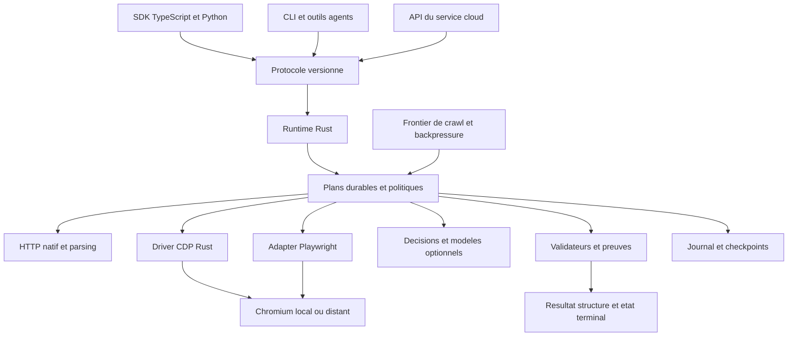

# Automan — recherche de marché et direction recommandée

**État au 7 octobre 2026.** L'utilisateur a retiré l'hypothèse initiale « petite équipe, premier produit en 3–6 mois ». La recommandation actuelle vise une architecture ambitieuse avec une forte capacité d'implémentation assistée par IA ; le calendrier initial ne limite plus les choix. Cette étude prolonge le contexte joint et les recherches existantes ; elle ne transforme pas les pistes antérieures en décisions déjà prises.

**Approfondissement :** la [comparaison Stagehand, Crawlee et Spider-rs](2026-10-07-stagehand-crawlee-spider-comparison.md) précise les contrats des versions publiées, les alternatives, les témoignages Reddit vérifiés et les limites des benchmarks. Elle conserve la cible ambitieuse et affine les exigences de validation, de cache et de reprise.

## Décision recommandée

Construire **un moteur d'exécution web open source en Rust, commun au crawling, aux workflows et aux outils d'agents**, dont le contrat est : recette portable, exécution déterministe quand elle suffit, recours aux modèles quand nécessaire, résultat contrôlé, erreur explicite et coût observable.

Je recommande **un runtime Rust autonome, un protocole commun et des SDK TypeScript/Python**, Chromium piloté par CDP via une dépendance qualifiée, un chemin HTTP natif, un exécuteur de plans durables et une orchestration de crawling séparée. Ajouter un adapter Playwright pour la compatibilité et la comparaison de fiabilité. La CLI et le cloud consomment le même moteur. Go et bindings natifs restent des extensions possibles, sans devenir des implémentations concurrentes du runtime.

Rust est choisi ici pour la distribution d'un moteur autonome, le partage entre langages et la maîtrise des ressources. **Sa supériorité de vitesse globale n'est pas établie.** Les investissements de performance prioritaires restent la sélection du moyen d'accès, l'élimination de décisions répétées, la proximité de l'exécution et la gestion des sessions.

Cette recommandation est un jugement de conception et de produit, pas une conclusion expérimentale. Aucun avantage de performance d'Automan n'a encore été mesuré. Les idées de cache, replay, réparation et validation existent déjà chez plusieurs concurrents, y compris open source. La possibilité commerciale dépendra des premiers workflows réellement maintenus, de la facilité d'adoption et de preuves comparatives.

## 1. Ce que le marché vend réellement

Les références citées par l'utilisateur occupent des couches différentes. Un navigateur cloud, un framework d'agent et une plateforme de collecte peuvent coopérer dans un même produit. Le caractère public d'un SDK ne signifie pas que le service est open source.

| Couche | Fonction | Exemples | Conséquence pour Automan |
| --- | --- | --- | --- |
| Navigateur et protocole | Exécuter JS, gérer pages, événements et entrées | Chromium, Playwright, Puppeteer, CDP, BiDi, Lightpanda | Réutiliser un substrate éprouvé ; isoler la dépendance à son API. |
| Primitives pour agents | Observer, agir, extraire, exposer des outils | Stagehand, Browser Use, agent-browser, Playwright MCP, AgentQL | Offre très concurrentielle ; bonne compatibilité nécessaire. |
| Agent et workflows | Planifier, garder le contexte, rejouer, réparer | Browser Use, Skyvern, Airtop, Anchor, OpenAdapt | Réutilisation des décisions et réparation deviennent des attentes ordinaires. |
| Crawling et acquisition | Découvrir, planifier, dédupliquer, rendre et stocker | Crawlee, Scrapy, Spider, Crawl4AI, Firecrawl, Scrapling | Beaucoup de briques disponibles ; comparer leurs modes adaptés. |
| Infrastructure d'accès | Navigateurs hébergés, proxies, sessions, anti-bot | Browserbase, Browserless, Steel, Bright Data, Oxylabs, Zyte, ZenRows | Acheter ou permettre l'intégration avant d'exploiter sa propre infrastructure. |
| Produit de données | Fournir un jeu de données utile et maintenu | Apify Actors, Kadoa, Diffbot, services managés | La valeur facturable porte souvent sur le résultat et l'entretien. |

Cette classification est une grille d'analyse. Les caractéristiques détaillées et les sources officielles de chaque acteur figurent dans [la cartographie commerciale](2026-10-07-commercial-landscape.md), [l'étude des frameworks navigateur](2026-10-07-browser-frameworks.md) et [l'étude des moteurs de collecte](2026-10-07-crawl-engines.md).

**Couverture :** quatre axes de recherche, 441 résultats Exa demandés au total (96 + 110 + 80 + 155), avec doublons et résultats écartés ; ce compteur n'est pas un nombre de sources indépendantes validées. La cartographie commerciale consolide 64 acteurs/produits/familles, dont une référence arrêtée. Les dossiers techniques ajoutent les bibliothèques et niches. Les conclusions reposent sur les sources primaires citées, des inspections de code et des versions publiées ; aucun service n'a été benchmarké en production.

## 2. Constats qui changent la décision

### Stagehand v4 est une architecture sérieuse à étudier

Le runtime tourne dans une extension Chrome ; les SDK partagent un protocole RPC. Les primitives IA s'intègrent à des opérations déterministes et à une orchestration externe. La migration v4 retire l'ancienne API `agent()` ; confondre v3 et v4 fausse une comparaison. [Architecture v4](https://www.browserbase.com/blog/stagehand-v4), [protocole](https://github.com/browserbase/stagehand/blob/main/packages/protocol/README.md), [migration v3 vers v4](https://docs.stagehand.dev/v4/migrations/v3).

Stagehand possède déjà concurrence entre onglets, gestion de navigateurs, certains mécanismes de reprise et un cache pour des appels éligibles. Il faut distinguer ces fonctions d'une file persistante de crawling et de la reprise d'un job complet. Le cache documenté dépend d'une session Browserbase. [Multi-tabs](https://docs.stagehand.dev/v4/best-practices/using-multiple-tabs), [act](https://docs.stagehand.dev/v4/basics/act), [cache](https://docs.stagehand.dev/v4/best-practices/caching).

**Implication :** des commandes groupées près du navigateur et des SDK dans plusieurs langages sont des pistes déjà investies. Évaluer ce qui manque réellement sur un workflow client est plus utile que recopier la surface `act/observe/extract`. Le Rust proposé doit conserver les avantages de proximité qu'une extension possède déjà, notamment en plaçant le worker cloud près du navigateur et en groupant les opérations indépendantes lorsque c'est correct.

### Rust et le replay sont déjà présents chez les concurrents

Browser Use a introduit un agent bêta Rust et un cœur natif dans sa version 0.13.0 ; son dépôt terminal propose un serveur SDK JSON-RPC/stdio. agent-browser possède désormais un daemon Rust natif. Ce sont des faits d'architecture, pas des preuves que ces projets gagnent toutes les comparaisons. [Release Browser Use 0.13.0](https://github.com/browser-use/browser-use/releases/tag/0.13.0), [terminal](https://github.com/browser-use/terminal), [agent-browser](https://github.com/vercel-labs/agent-browser).

Skyvern décrit la génération et réutilisation de scripts par blocs avec recours à l'IA ; Anchor décrit un fallback pendant le run et une version réparée après l'échec ; Airtop vend des agents compilés. L'état Browser Use actuel doit être lu dans ses docs versionnées : l'ancien produit de skills n'est pas un contrat à reconstruire à partir de pages obsolètes. [Skyvern code caching](https://www.skyvern.com/docs/developers/features/code-caching), [Anchor](https://docs.anchorbrowser.io/advanced/self-healing), [Airtop](https://www.airtop.ai/agent-builder), [Browser Use scripts](https://docs.browser-use.com/cloud/agent/scripts).

OpenAdapt Flow se présente comme un moteur bêta de replay local gouverné et de vérification de l'effet ; FlowReplay propose un format portable et un replay à locators multiples, encore alpha. Ces projets de niche comptent dans la concurrence même si leur maturité et leur adoption ne sont pas celles d'une grande plateforme. [OpenAdapt](https://github.com/OpenAdaptAI/openadapt-flow), [FlowReplay](https://github.com/kuilenren/flowreplay).

**Implication :** « Rust + cache + self-healing + preuve » ne suffit pas à établir une différenciation. Il faut livrer une combinaison mieux qualifiée pour un besoin précis et prouver qu'elle s'installe, s'intègre et s'entretient plus facilement.

### La collecte adaptative existe déjà

Crawlee possède un crawler adaptatif HTTP/Playwright. Son modèle de choix et la validation de son extraction méritent examen plutôt qu'une simple case « navigateur ou pas ». Spider possède aussi des mécanismes de crawling smart, avec une logique différente. Leurs modes adaptatifs ne sont pas interchangeables et ne vérifient pas automatiquement l'objectif métier d'une collecte. [Crawlee AdaptivePlaywrightCrawler](https://crawlee.dev/js/api/playwright-crawler/class/AdaptivePlaywrightCrawler), [Spider](https://github.com/spider-rs/spider).

L'adapter `@crawlee/stagehand` publié inspecté dépend de Stagehand v3 : son existence ne démontre pas une compatibilité v4. Une `Page` n'est pas un objet universel entre ces runtimes. [Package de l'adapter](https://github.com/apify/crawlee/blob/master/packages/stagehand-crawler/package.json), [migration Stagehand depuis Playwright](https://docs.stagehand.dev/v4/migrations/playwright).

**Implication :** séparer le contrôle d'un workflow et le scheduler de collecte. Le handler adaptatif peut être rejoué pour comparer les résultats ; il ne doit pas devenir une boucle de reprise aveugle d'actions externes.

### Le coût dépend de l'ensemble du service

Les fournisseurs facturent selon des unités différentes : temps navigateur, CPU, crédits, trafic proxy, requêtes ou ressources d'un actor. Les minima, inclusions et postes additionnels empêchent de classer les offres avec un seul prix affiché. Certaines pages officielles présentent même des montants contradictoires. Les valeurs relevées et les ambiguïtés sont conservées dans le rapport commercial, sans conversion trompeuse en coût universel par tâche. [Browserbase pricing](https://www.browserbase.com/pricing), [Apify pricing](https://apify.com/pricing), [Spider pricing](https://spider.cloud/pricing), [ScrapingBee pricing](https://www.scrapingbee.com/pricing/).

**Implication :** mesurer navigateurs, modèles, trafic, reprises et maintenance. Facturer « au résultat réussi » n'est viable que si le résultat, le validateur et les limites de reprise sont définis contractuellement.

## 3. Le positionnement à tester et l'ambition générale

**Proposition :** « Automan permet aux développeurs de transformer une collecte web récurrente en une recette portable, observable et maintenable, avec contrôle de la qualité des résultats. »

Le premier segment de validation commerciale est celui des **équipes SaaS B2B et des intégrateurs qui maintiennent des flux de données depuis des portails fournisseurs, distributeurs ou partenaires**. Il donne un terrain concret pour qualifier le moteur général ; il ne limite pas ses APIs au scraping de catalogues. Ce segment est une hypothèse commerciale : aucune interview client ni volonté de payer n'a été vérifiée pendant cette recherche.

Trois workflows de démonstration et de pilote :

1. Connexion à un portail autorisé, téléchargement d'un export et contrôle du nombre de lignes, de la période et du compte.
2. Collecte d'un catalogue paginé, extraction prix/stock/références, normalisation et détection des résultats partiels.
3. Comparaison de deux collectes, production d'un changement structuré avec sources et conservation de l'historique.

Utiliser une API documentée lorsqu'elle suffit. Le navigateur reste disponible pour les parties qui l'exigent. La première version peut manipuler navigation, filtres et recherche tout en limitant les effets métier aux opérations de lecture et de téléchargement.

Ce choix répond à quatre caractéristiques recherchées : répétition fréquente, résultat contrôlable, coût de maintenance identifiable et possibilité de vendre une intégration accompagnée. Il existe des concurrents sur ce segment, notamment des plateformes de données et des offres de réparation managée. Kadoa décrit déjà qualité, provenance et réparation de pipelines ; la simple revendication de ces fonctionnalités ne crée pas une catégorie nouvelle. [Kadoa](https://www.kadoa.com/).

L'avantage à construire serait une expérience développeur et une économie démontrées : le même projet tourne localement ou chez un hébergeur choisi ; le chemin déterministe fonctionne sans modèle ; le client voit ce qui a été extrait, ce qui manque et ce qu'une réparation modifie ; les recettes peuvent être versionnées et maintenues avec son code. Cela demeure une intention produit jusqu'à validation.

## 4. Architecture cible recommandée

| Emplacement du runtime | Avantage architectural | Travail ou limite à qualifier |
| --- | --- | --- |
| Extension Chrome, comme Stagehand | Opérations proches du navigateur, helpers JS et clients de plusieurs langages | Installation/lifecycle de l'extension et périmètre Chromium ; l'orchestration durable nécessite une autre responsabilité. |
| **Processus Rust autonome — choix proposé** | Même moteur bibliothèque/binaire, CLI/SDK/cloud, ressources et contrats communs | Distribution, gestion de processus, IPC, annulation et driver ; batcher et colocaliser pour ne pas perdre en latence. |
| Bindings napi-rs/PyO3 | Appels embarqués au moteur et accès direct aux structures | Interfaces et cycles de vie par langage, distribution ABI/wheels et isolation des pannes ; intérêt à mesurer pour l'usage visé. |
| Runtime TypeScript/Playwright | Comportements navigateur déjà éprouvés et intégration avec l'écosystème | Très bonne baseline ; présence d'un runtime Node à accepter et frontières multilangages à définir. |

Cette comparaison décrit des compromis, pas un palmarès de performances. La cible autonome est retenue pour l'unité du produit et sa distribution. Une extension de perception/batching peut rester complémentaire sans devenir propriétaire de l'état durable.

### Runtime : posséder la recette et son résultat

Le code Automan à construire porte sur une séquence versionnée, son état, ses paramètres, ses observations, la validation et la réparation. Le runtime Rust exécute une représentation intermédiaire inspectable : séquence, branche, boucle bornée, parallélisme indépendant, attente, extraction, checkpoint et opérations d'effet. Un plan ne doit pas être une succession de coordonnées ou un cache de résultat périmé.

Un manifeste JSON décrit identité, version, paramètres, schéma de sortie, exigences d'authentification, budgets, capacités et politique de reprise. Une étape possède des préconditions, une cible résolue au moment de l'action, des postconditions et une classification de son effet. Le code TypeScript/Python est une surface d'auteur ou d'extension, pas une copie de l'exécuteur.

La première représentation intermédiaire doit avoir peu de constructions bien spécifiées. Étendre ces constructions lorsqu'un workflow l'exige, plutôt qu'affirmer qu'un compilateur transforme tout code arbitraire en plan sûr. Un recorder, un développeur ou un modèle peut produire le même type de plan ; ces sources n'apportent pas les mêmes garanties et restent tracées.

Les objets de navigateur publics sont des références Automan et des contrats de capacités. Une `Page` Playwright peut exister à l'intérieur de son adapter, sans être promise comme objet interchangeable avec le driver Rust. Définir les exigences d'une recette permet de refuser un backend incapable avant son exécution.

Les états de fin proposés : `verified`, `failed`, `partial`, `needs_review`, `effect_unknown`. Le moteur ne doit pas transformer l'absence d'exception en succès métier. Pour les champs importants, conserver source, date, locator ou preuve d'origine et méthode de validation. Une provenance complète n'établit pas, à elle seule, la vérité d'une donnée.

### Acquisition : choisir le moyen suffisant

Deux chemins de référence : HTTP natif pour les contenus accessibles et extraction ; Chromium via CDP pour les interactions et le rendu nécessaires. Le choix peut être explicite ou fourni par une politique qui connaît le site, le compte, la route et le résultat attendu. Un site connu comme nécessitant JS peut commencer directement dans le navigateur ; un fallback systématique HTTP puis Chrome n'est pas toujours le chemin le plus rapide.

Une politique adaptative apprend avec des validations et des essais en lecture, sur le modèle des résultats comparés de Crawlee. Garder aussi des heuristiques de contenu, comme Spider, pour découvrir les cas sans historique. La route API/HTTP/browser est choisie selon le coût et la probabilité de résultat valide, avec une limite de risque fixée par le workflow. Une API stable et autorisée reste prioritaire lorsqu'elle suffit.

Le transport HTTP standard peut utiliser Reqwest ; l'impersonation et les profils réseau sont un adapter optionnel à qualifier, avec des briques comme Impit ou wreq. Le moteur et les SDK ne doivent pas imposer ce besoin à tous les consommateurs. [Spider RemoteFetcher](https://github.com/spider-rs/spider/blob/main/spider/src/fetcher.rs), [Impit](https://github.com/apify/impit).

Faire une place aux réponses réseau structurées autorisées lorsqu'elles constituent une source fiable. Transformer automatiquement chaque endpoint observé en une API stable serait risqué : tokens, pagination, droits, mutations et changements de contrat nécessitent une qualification.

Le navigateur et le modèle sont des adapters. Le runtime peut lancer localement et se connecter au cloud ; chaque mode annoncé doit passer les tests de contrat correspondant aux capacités promises. Le rendu léger, notamment Lightpanda, constitue un troisième backend futur pour le corpus qui le supporte, avec repli Chromium ; son absence de rendu graphique et sa licence empêchent d'en faire un substitut universel implicite. [Lightpanda](https://github.com/lightpanda-io/browser).

### Driver Rust : Chromey comme candidat, Playwright comme référence indépendante

**Premier candidat à qualifier : Chromey**, fork de Chromiumoxide maintenu par l'écosystème Spider, sous `MIT OR Apache-2.0` dans son manifeste. Épingler une release et encapsuler ses types. Comparer à Chromiumoxide upstream et au driver natif public de Browser Use/agent-browser sur les besoins Automan ; l'activité d'un dépôt ne prouve pas sa supériorité. Réutiliser des bibliothèques ou contribuer upstream est préférable à reprendre tout le crawler Spider avec ses branches de features. [Chromey](https://github.com/spider-rs/chromey), [manifest](https://github.com/spider-rs/chromey/blob/main/Cargo.toml), [Chromiumoxide](https://github.com/mattsse/chromiumoxide).

Le chemin `Element::click` d'un driver CDP ne constitue pas l'ensemble du contrat Playwright. Automan doit qualifier résolution tardive des locators, unicité, visibilité, activation, stabilité, hit-testing, navigation, frames cross-origin/OOPIF, shadow DOM, dialogues, téléchargements et cancellation. [Contrat Playwright](https://playwright.dev/docs/actionability).

Chromey expose aussi `Content` et `WebMCP` comme domaines CDP **non standard** présents sur certains moteurs distants. Leur existence dans la bibliothèque n'atteste pas leur disponibilité sur Chrome local. Les annoncer uniquement après négociation de capacités ; ne pas les confondre avec une garantie de standard WebMCP. [Content](https://github.com/spider-rs/chromey/blob/main/src/content_markdown.rs), [WebMCP](https://github.com/spider-rs/chromey/blob/main/src/webmcp.rs).

agent-browser contient déjà des traitements Rust de sessions OOPIF, de mapping et de hit-testing qui valent une étude de réutilisation ; ce sont des modules de runtime CLI, pas une petite crate CDP interchangeable. Le crate navigateur de Browser Use Terminal est également couplé à des workers, dont Python. Adapter une release qualifiée ou extraire un composant au contrat clair limite le coût d'un fork complet. [agent-browser browser](https://github.com/vercel-labs/agent-browser/blob/main/cli/src/native/browser.rs), [element](https://github.com/vercel-labs/agent-browser/blob/main/cli/src/native/element.rs), [Browser Use browser crate](https://github.com/browser-use/terminal/blob/main/crates/browser-use-browser/src/lib.rs).

Un **adapter Playwright** permet les intégrations existantes et constitue une baseline de conformité. Il ne faut pas piloter simultanément la même session avec deux propriétaires de son cycle de vie. Chaque session choisit un backend ; changer de backend est une transition explicite avec transfert d'état supporté, ou une nouvelle session.

L'objectif de Rust est un moteur complet réutilisable et maîtrisé. Tant que les fonctions ne sont pas qualifiées, annoncer leur statut et conserver le backend éprouvé pour les workflows concernés. Cela préserve l'ambition sans inventer une parité.

### Orchestration : une frontier de crawl distincte de l'exécuteur

Le scheduler Rust couvre frontier d'URL, déduplication, limites par domaine, budgets, backpressure, leases de requêtes, retries et émission progressive des données. L'exécuteur de plans conserve ses propres garanties d'étape. Une tâche « télécharger cet export dans ce compte » fonctionne sans crawler de site complet.

S'inspirer des frontières de Crawlee et Scrapy et évaluer Spider comme backend de crawling facultatif. Une intégration Crawlee côté TypeScript reste possible : dans ce cas sa queue possède les requêtes et Automan exécute les plans. La même requête n'est pas orchestrée par deux schedulers persistants. [Crawlee](https://crawlee.dev/js/docs/introduction), [scheduler Scrapy](https://github.com/scrapy/scrapy/blob/master/scrapy/core/scheduler.py), [Spider](https://github.com/spider-rs/spider).

En local, SQLite est un choix proposé pour journal, checkpoints et index de recettes, avec datasets/artefacts en fichiers. Pour un cloud multi-worker, séparer le control plane, l'ordonnancement des jobs et les workers ; PostgreSQL et un stockage d'objets sont des choix conventionnels à qualifier. Les workers gardent le même exécuteur Rust. Cette architecture n'implique pas une garantie exactly-once sur les effets d'un site tiers.

| Responsabilité | Autorité proposée |
| --- | --- |
| Job, allocation de ressources et lease de worker | Scheduler/control plane ; aucun replay implicite d'une mutation lors du renouvellement. |
| Deadline globale, tentative de plan, budget et checkpoint | Runtime Rust. |
| Résolution/action d'une étape et confirmation de son effet | Exécuteur d'étapes Rust, suivant la politique du plan. |
| Cycle de vie navigateur, événements et requêtes de protocole | Un browser worker/backend par session. |
| Retries de transport ou de modèle | Adapter, dans le budget accordé et avec tentatives remontées au runtime. |
| Requêtes d'une collecte déléguée | Frontier Automan ou queue du framework externe choisi, jamais les deux pour la même requête. |

Un adapter ne rejoue pas indépendamment une action d'effet après un timeout. L'état `effect_unknown` remonte à l'exécuteur, qui applique vérification, abstention ou reprise autorisée. Si un nouveau backend est lancé après un clic incertain, ce changement ne fait pas disparaître l'incertitude de l'effet précédent.

Concurrence bornée et limites par domaine ; sessions réutilisées sous une même identité ; aucun partage automatique entre tenants ou comptes. Les opérations dépendant de l'état d'une page restent ordonnées. La proximité worker/navigateur et le maintien de sessions peuvent compter davantage que la vitesse de sérialisation du SDK.

### Modèles : facultatifs, remplaçables et budgétés

Une recette saine et déterministe peut tourner avec zéro appel de modèle. Utiliser un modèle pour aider à produire une extraction ou une recette, résoudre une ambiguïté ou proposer une réparation. Le premier adapter peut s'appuyer sur une API de génération structurée éprouvée ; éviter une matrice de providers avant la demande réelle.

La réparation crée une nouvelle version candidate, soumise à ses validations et aux tests de non-régression du workflow. Définir ce qui peut être activé automatiquement pour les workflows de lecture ; demander une revue selon la politique de l'utilisateur lorsque l'effet ou la cible ne peut être vérifié. Une abstention explicite est préférable à un faux succès, mais son taux doit être mesuré. Décisions à ensemble fermé, petits modèles de sélection, LLM textuel et vision peuvent former des niveaux d'escalade distincts ; comparer leur coût et leur erreur au lieu d'imposer une cascade fixe à toutes les tâches.

Jev est une piste de provider de décisions, pas une base obligatoire. Les PR Stagehand étudiées étaient ouvertes et non fusionnées lors de la vérification ; leurs chiffres ne sont pas des performances reproduites. Garder une interface de décision permet d'évaluer ce type de modèle plus tard. [PR 3103](https://github.com/browserbase/stagehand/pull/3103), [PR 2953](https://github.com/browserbase/stagehand/pull/2953).

### Distribution : un moteur canonique et des clients idiomatiques

Le SDK lance un binaire précompilé lorsqu'aucun moteur n'est connecté, conserve le processus pendant la session et communique en JSON-RPC bidirectionnel/stdio. Le remote emploie le même contrat sur un transport réseau sécurisé. Les messages portent IDs, version, capacités, budgets, annulation et état terminal. Les clients n'ont pas besoin d'installer Cargo sur les plateformes supportées.

Dériver les modèles de données d'un schéma partagé et écrire des APIs idiomatiques par langage. Les gros artefacts passent par des références ou un flux borné, avec backpressure, plutôt que par des copies répétées de captures en JSON. Les callbacks de modèles fournis par l'hôte nécessitent des RPC corrélés et réentrants ; une annulation et une panne doivent débloquer les deux côtés.

**SDKs de référence : TypeScript et Python**, avec CLI JSON/MCP sur le même moteur. Go arrive ensuite sans réimplémenter les décisions ou le driver. Les bindings napi-rs/PyO3 peuvent être évalués pour des usages embarqués ; ils ne sont pas nécessaires au contrat initial du runtime autonome.

Ajouter MCP si les utilisateurs pilotes en ont besoin. Microsoft recommande aussi une approche CLI + skills pour certains agents de développement, tandis que MCP reste adapté à des boucles qui bénéficient d'une session persistante. Le choix dépend du consommateur. [Playwright MCP](https://github.com/microsoft/playwright-mcp).

L'application macOS et un builder web deviennent des clients du moteur, avec inspection des recettes, sélection visuelle, traces et réparations. Le cloud fournit sessions gérées, scheduling, équipes et observabilité. Ils partagent le contrat d'exécution plutôt que porter leur propre logique de navigateur.

## 5. Fonctions et ordre de construction

| Priorité | Fonction | Critère de réalisation |
| --- | --- | --- |
| P0 | Runtime Rust et protocole | Bibliothèque et binaire autonomes, SDK TS/Python, annulation et sessions explicites. |
| P0 | Recette paramétrée et versionnée | Exécution locale et CLI, erreurs structurées, plan inspectable. |
| P0 | Navigation/interactions CDP | Contrat d'actions testé ; capacités qualifiées et backend Playwright disponible. |
| P0 | Extraction typée | Schéma, normalisation déterministe et distinction champ absent/valeur nulle. |
| P0 | Contrôle de complétude | Pagination, doublons, compte, période et règles métier de chaque pilote. |
| P0 | Sessions et reprise | Authentification fournie par l'utilisateur, expiration détectée et secrets hors recette. |
| P0 | Rapport d'exécution | Statut, preuves pertinentes, étapes, durées, coût modèle et causes d'échec. |
| P0 | IA optionnelle | Production/assistance d'une recette et recours borné ; chemin sain sans IA. |
| P0 | Corpus et recettes de référence | Fixtures reproductibles, workloads extraction/actions/agents et pilotes réels. |
| P0 | HTTP et streaming | Transport natif, parsing, limites de mémoire et production progressive des données. |
| P1 | Scheduler de crawl | Frontier durable, déduplication, fairness et budgets ; une autorité pour les requêtes. |
| P1 | Intégration Crawlee/Spider | Adapter facultatif, propriété des files et des retries explicitée. |
| P1 | Réparation candidate | Comparaison de versions et tests avant activation. |
| P1 | Routing API/HTTP/browser | Résultat vérifié, coût appris et raisons de sélection observables. |
| P1 | Exécution cloud | Même contrat runtime, isolation et coûts mesurés. |
| P1 | Adapter agent/MCP | Conduit vers une session du runtime, sans nouvelle logique parallèle. |
| P2 | Optimisations Rust et modèles locaux | Gain mesuré, profil complet et fiabilité maintenue. |
| P2 | Go et bindings embarqués | Tests de parité des contrats et coût de distribution qualifié. |
| P2 | Navigateur léger | Corpus compatible et recours Chromium qualifié. |
| P2 | Builder et application native | À décider selon les usages, après stabilisation du framework. |

L'interface de rapport, le recorder visuel, une bibliothèque de recettes et les surfaces desktop/cloud font partie de l'ambition. Leur ordre de construction suit la qualification du contrat d'exécution. Une marketplace et un réseau propre de proxies constituent des produits opérationnels distincts ; les construire uniquement lorsqu'ils apportent une valeur démontrée face aux intégrations de fournisseurs.

## 6. Open source et services

**Proposition de licence pour le code Automan original : Apache-2.0**, avec vérification préalable des dépendances et de ce qui est réellement redistribué. Cette proposition favorise une adoption dans des produits commerciaux ; elle ne protège pas à elle seule contre un fournisseur qui réhéberge le code.

Le cœur publié devrait rester complet pour son usage annoncé : recettes, exécution locale, extraction, validation, rapports, plugins et réparation configurable. Les offres payantes peuvent porter sur la mise en service, la disponibilité d'un hébergement, le suivi des sites, les sessions gérées, l'équipe et les garanties d'exploitation convenues. Garder le contrôle du client sur sa recette renforce la confiance, mais oblige à offrir un service opérationnel réel.

Attention aux classifications de licences : plusieurs projets décrits commercialement comme « open source » ou publiés sur GitHub ont des restrictions ou clauses particulières. Les notes détaillées distinguent licence du moteur, SDK et service. Ne pas fonder un produit sur une métadonnée GitHub sans lire le fichier applicable. [Étude des moteurs et licences](2026-10-07-crawl-engines.md).

Offres à tester, sans fixer un tarif de marché fictif :

| Offre | Ce que le client achète | Vérification commerciale |
| --- | --- | --- |
| Intégration initiale | Recette/connecteur, validation et mise en production | Un périmètre et un prix convenus avec un premier client. |
| Maintenance | Surveillance des changements, réparation et délai d'intervention | Mesurer les heures réelles et les changements par site. |
| Cloud managé | Runs, sessions, traces, scheduling et exploitation | Calculer coût total et marge avant forfait illimité. |
| Déploiement privé | Installation, exploitation et accompagnement | À offrir lorsqu'un client le demande et finance son coût. |

Au début, une unité simple — exécution avec limites incluses et postes variables visibles — peut être plus défendable qu'un prix par succès métier universel. Une facturation au résultat devient possible pour un connecteur qualifié, avec sa définition de réussite et le coût d'échec connu.

Le savoir-faire accumulé peut résider dans les recettes, les cas d'échec, les validateurs, les données de réparation et l'expérience d'intégration. Leur usage doit respecter les données du client ; des fixtures synthétiques et des retours volontaires peuvent alimenter la qualité OSS. Ce sont des actifs à construire, pas une barrière concurrentielle déjà acquise.

## 7. Feuille de route par portes de validation

| Porte | Travail | Livrable et décision |
| --- | --- | --- |
| A — Contrats et preuve | Corpus extraction, interactions, tâches agents ; baselines ; entretiens et pilotes | Résultat, évaluation, fréquence et budget définis avant les comparaisons. |
| B — Substrates | Rust runtime, HTTP, pilote CDP, adapter Playwright, protocole et SDKs | Suite d'actions et de capacités ; pas de parité annoncée sans preuve. |
| C — Plans durables | IR, journal, sessions, deadlines, replay, validation et effets inconnus | Crash/reprise et dérive testés ; une autorité de retry par niveau. |
| D — Adaptation | Compiler/recorder, routing, cache local, modèles de décision et réparation | Comparaison coût/qualité sur données séparées ; versions réparées sans régression mesurée. |
| E — Crawl à volume | Frontier, streaming, backpressure, workers et budgets par domaine | Débit de résultats valides et empreinte à ressources constantes. |
| F — Exploitation et services | Cloud, secrets, équipes, scheduling, diagnostic, installation privée | Même contrat local/cloud, coûts d'exploitation et maintien de connecteurs mesurés. |
| G — Élargissement | Go, desktop, builder, recettes distribuées et moteurs légers | Valeur d'usage et compatibilité établies ; benchmark public étendu. |

Ces axes peuvent être développés en parallèle par des agents à partir de contrats figés. Les dépendances restent réelles : les SDKs dépendent du protocole, le compilateur du modèle d'étapes, le routing de la validation des sorties, et la reprise du contrat des effets. L'IA peut accélérer l'implémentation et les essais ; la qualification s'appuie sur des exécutions observées et des validateurs, jamais sur le nombre d'agents ou la quantité de code produite.

**Critère produit proposé :** workflows utiles, répétés et contrôlés ; équipes prêtes à payer le service ; fiabilité comparable à une bonne baseline ; gain substantiel mesuré de coût ou latence sur un périmètre déclaré. Le développement du framework général peut continuer au-delà des trois pilotes, mais ses promesses commerciales doivent rester liées au corpus qualifié.

## 8. Comment démontrer les performances

Le dossier [benchmark et runtime](2026-10-07-benchmark-and-runtime.md) définit workloads, métriques, coût complet, perturbations et règles de publication. Il distingue apprentissage et réexécution, pages statiques et workflows, systèmes locaux et distants.

Séparer trois objectifs : **parité de correction avec un bon script manuel ; réduction de coût face aux agents comparables sur les runs récurrents ; gain de débit ou d'empreinte face aux meilleurs chemins existants de collecte**. Le seuil proposé de latence divisée par deux ou coût réduit d'au moins 50 % vise la baseline d'agent définie avant les essais, pas une promesse de battre un script déterministe optimal. Ce sont des seuils de décision proposés, aucunement des chiffres atteints.

Le test doit inclure Playwright manuel, des configurations actuelles des outils adaptés et leurs caches/modes rapides. Les échecs, réparations, travail humain et coûts de compilation comptent. Publier coût de création et de maintien séparément, puis coûts amortis pour 1, 10, 100 et 1 000 exécutions avec cadence et taux de changements déclarés. Publier des cas où Automan perd donne une frontière d'usage crédible.

Une performance universellement supérieure ne peut être déduite d'un langage ou d'un diagramme. Le bon objectif est de gagner un ensemble défini de tâches, puis d'élargir ce périmètre sans dégrader les contrats.

## 9. Limites et questions restant ouvertes

- Cartographie large, non exhaustive : aucun protocole ne peut certifier tous les acteurs et nouveaux dépôts du marché. Les références historiques ou arrêtées sont séparées des offres actuelles.
- Les offres ont été étudiées par docs, sources, registres et pages officielles ; aucun compte payant n'a été ouvert et aucun test fournisseur en production n'a été exécuté.
- Les chiffres des fournisseurs et des articles restent ceux de leurs auteurs. Ils sont qualifiés par workload et méthodologie lorsqu'ils influencent une décision.
- Les versions publiées peuvent différer de `main`, des alphas, des README et des GitHub Releases. Les notes techniques conservent les distinctions importantes.
- Le produit, la niche et les services proposés sont des hypothèses à tester. Les interviews clients et le coût réel des pilotes détermineront la priorité commerciale.
- L'utilisateur conserve le choix du langage. La recommandation actuelle est Rust canonique pour l'ambition générale ; elle remplace la recommandation TypeScript initiale fondée sur la contrainte retirée.
- Cette étude ajoute des notes dans `automan/research`. Le dossier appartient au dépôt Git parent `/Users/jb/Dev` ; aucun code, branche, commit, publication ni fichier préexistant n'est modifié par cette recherche.
